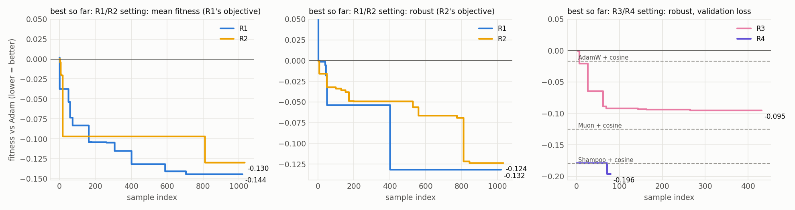
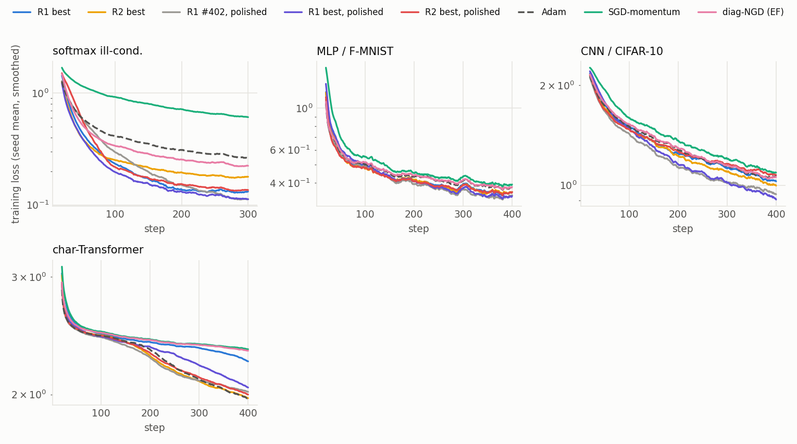
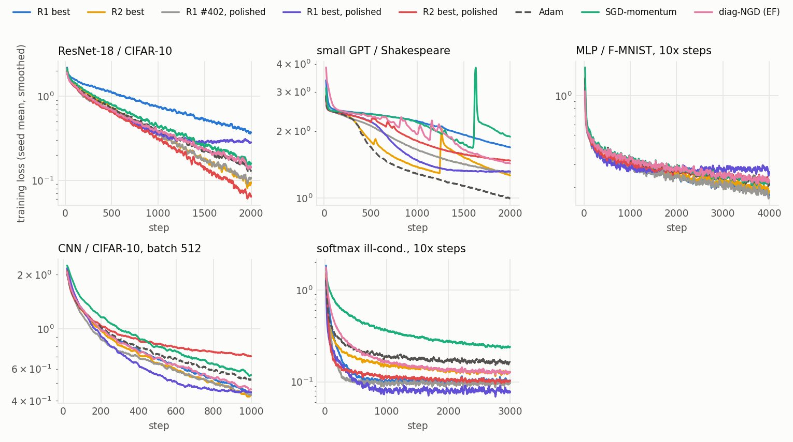
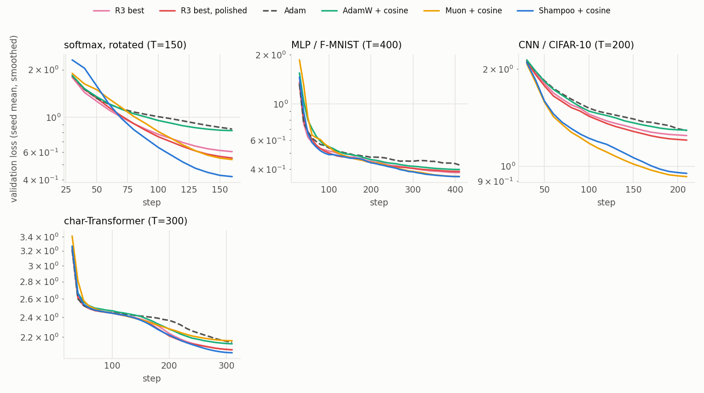
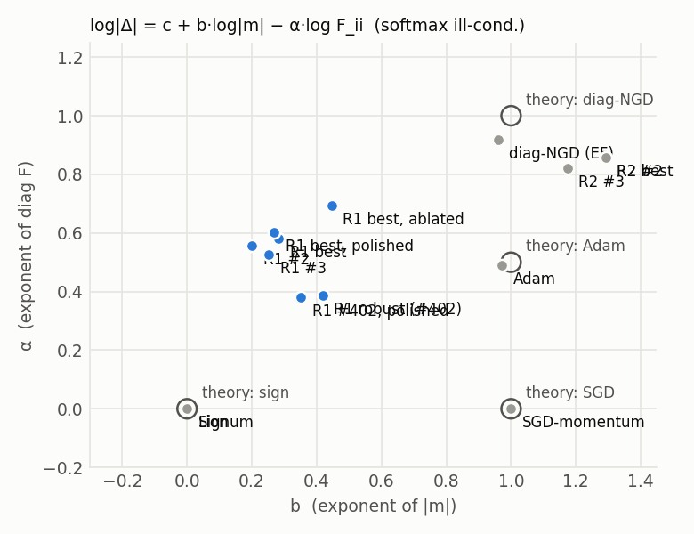
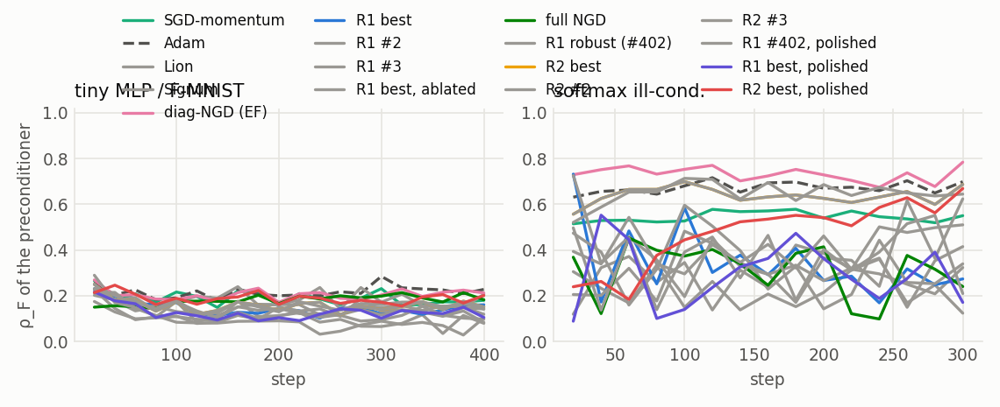

# EoH tái phát hiện best practices của optimizer, nhìn qua lăng kính Natural Gradient

*Dự án cho buổi trình bày paper môn Tối ưu hóa (UET). Paper: F. Liu et al., "Evolution of Heuristics: Towards Efficient Automatic Algorithm Design Using Large Language Model", ICML 2024.*

> Bảng và hình trong báo cáo được sinh tự động bởi `make_report.py` từ kết quả chạy thật (giữa các marker `BEGIN/END`). Phần văn được viết sau khi có số liệu. Mọi con số "fitness" hay "Δ log-AUC" đều tính so với Adam đã tune lr: **âm là nhanh hơn Adam**.

## Tóm tắt

<!-- SUMMARY -->

## 1. Bối cảnh và câu hỏi nghiên cứu

**EoH** coi một heuristic là một cặp *thought* (mô tả ý tưởng bằng ngôn ngữ tự nhiên) và *code*. Thuật toán duy trì một quần thể các cặp này và dùng LLM làm toán tử biến đổi:

- **i1** sinh cá thể ban đầu từ template;
- **e1, e2** (exploration) tạo ý tưởng mới, khác hẳn hoặc lấy cảm hứng từ các cha mẹ;
- **m1, m2, m3** (modification) sửa cấu trúc, đổi tham số, hoặc rút gọn code.

Mỗi cá thể được chạy để tính fitness, và quần thể giữ lại các cá thể tốt nhất. Bản dùng ở đây là EoH V0.2 (pipeline bất đồng bộ), với vài patch nhỏ để gọi được vLLM local. LLM là **Qwen3.8-27B-FP8**, tắt thinking.

Ta dùng EoH để tiến hóa *update rule* của optimizer cho mạng nơ-ron, với mục tiêu hội tụ nhanh, rồi hỏi:

- **RQ1 — tái phát hiện.** EoH có tự tìm lại các best practice của optimizer deep learning không: momentum, scale thích nghi, schedule (warmup/annealing), regularization, preconditioning bậc hai? Rule tìm được có nhanh hơn các baseline best practice (AdamW với warmup và cosine, Muon, Shampoo) không, và có tổng quát hóa sang task chưa thấy không?
- **RQ2 — thiết kế bài toán.** Fitness và không gian tìm kiếm quyết định cơ chế nào nổi lên như thế nào? Ta có bốn run R1 → R4. Ba run đầu "blind", mỗi run sửa một điểm yếu mà run trước để lộ ra. R4 có seed, để kiểm tra riêng phần mà R3 không tự tìm ra.
- **RQ3 — nối với NGD.** Hai nhóm cơ chế "scale đường chéo" và "preconditioning ma trận" là các xấp xỉ khác nhau của hướng natural gradient $-F^{-1}g$. Ta đo trực tiếp xem rule tìm được gần NGD đến đâu, và tính chất này có giải thích được tốc độ hội tụ không.

## 2. Bài toán đưa cho EoH: bốn run

| | R1 | R2 | R3 | R4 |
|---|---|---|---|---|
| Không gian tìm kiếm | rule **element-wise** trên vector tham số đã flatten: `step(p, g, state, t, lr)` | như R1 | rule **gọi riêng cho từng tensor**, biết tổng số bước **T**: `step(p, g, state, t, T, lr)`; được dùng norm, matmul, `torch.linalg` | như R3 |
| Fitness | log-AUC của *training loss* so với Adam đã tune, **trung bình** qua 4 task | **robust**: trung bình + phạt task tệ nhất thua Adam | robust, trên *validation loss* (dữ liệu held-out) | như R3 |
| Task | softmax ill-cond. (thẳng trục), MLP/F-MNIST, CNN/CIFAR-10, char-Transformer; 300–400 bước | như R1 | softmax ill-cond. **đã xoay**, MLP, CNN, char-Transformer; **T khác nhau**: 150/400/200/300 | như R3 |
| Quần thể khởi đầu | 20 mẫu i1 từ template SGD-momentum | 32 mẫu i1 | 32 mẫu i1 | **5 seed**: Shampoo, Muon và 3 rule tốt của R3 |
| Quản lý quần thể | pop 10, mặc định của EoH | pop 16, tối đa 2 cá thể mỗi khung code | như R2 | như R2 |
| Ngân sách | 1000 mẫu | 1000 mẫu | 400 mẫu | 250 mẫu |
| Blind? | có | có | có | **không** |

Chi tiết thiết kế:

- **Cùng một thước đo cho mọi rule.** Learning rate của mọi rule, kể cả Adam, đều được tune như nhau: probe 7 giá trị trên lưới log ở 25% horizon, rồi refine 3 giá trị. fitness = 0 nghĩa là nhanh ngang Adam đã tune; fitness < 0 nghĩa là nhanh hơn.
- **R1–R3 "blind" về NGD.** Template là SGD-momentum, không có seed rule nào, và task description không nhắc tới Fisher, natural gradient, curvature hay tên optimizer nào. Có hai lưu ý:
  - "blind" chỉ có nghĩa là *ta* không gợi ý; Qwen vẫn biết Adam, Shampoo, K-FAC từ dữ liệu huấn luyện;
  - task description của R3 có liệt kê các phép toán được dùng (`eigh`, `solve`, lũy thừa ma trận), tức R3 blind về đáp án nhưng không blind về không gian tìm kiếm.
- **R1 → R2.** R1 cho thấy fitness trung bình bị task softmax lấn át, và quần thể bị lấp đầy bởi các bản sao chỉ khác tham số. R2 sửa cả hai điểm này.
- **R2 → R3.** Mục tiêu dịch sang "best practices". R3 mở rộng không gian tìm kiếm theo đúng mục tiêu đó:
  - **T** cho phép annealing/warmup *theo tỉ lệ t/T* thay vì gắn với số bước tuyệt đối;
  - **validation loss** thưởng cho cả regularization ngầm;
  - **thao tác theo tensor** cho phép preconditioning ma trận;
  - **bài softmax đã xoay** tạo áp lực chọn lọc có chủ đích: rule đường chéo không thể precondition nó (xem P3), còn preconditioner ma trận thì có thể.
- **R3 → R4.** R3 không làm preconditioning ma trận tự xuất hiện (mục 4.3). R4 giữ nguyên mọi thứ của R3, chỉ thay quần thể khởi đầu bằng 5 seed: Shampoo và Muon viết tay (kèm warmup và cosine), R3#1, R3#6 (một khung code khác của R3) và R3#1 đã polish. Câu hỏi của R4 vì thế không còn là "EoH có tự tìm ra không" mà là "cho sẵn preconditioner bậc hai, EoH có cải tiến hay lai ghép được không". Báo cáo coi R4 là run **có hướng dẫn**.

<!-- BEGIN:search_config_R1 -->
**Task description sent to the LLM (verbatim):**

> Design a novel element-wise update rule (optimizer) for training neural networks that decreases the training loss as fast as possible. The rule is applied to all parameters at every step, and the harness tunes the learning rate lr separately for each task. Fitness is the average log training loss over the whole run (so early progress matters as much as the final loss), relative to Adam, averaged over four short training runs of a few hundred steps: ill-conditioned softmax regression, an MLP on Fashion-MNIST, a small CNN on CIFAR-10 and a small character-level transformer. The update of every coordinate may depend only on that coordinate's parameter value, gradient and its own state tensors, plus the step counter t and lr: any element-wise torch operation is allowed, but sums, means, norms, max or other reductions over elements, indexing, and use of the tensor shape or size are forbidden and are rejected automatically.

**Template (initial body = SGD-momentum):**

```python
import torch
import math


class UpdateRule:
    """Element-wise optimizer, constructed with no arguments.

    One instance handles all parameters of the network, flattened into a single
    1-D tensor, with a single state dict. The update of each entry may depend
    only on that entry's own values (p, g, state tensors) and on the
    scalars t and lr.
    """

    def init_state(self, p: torch.Tensor) -> dict:
        """Return the initial state: any number of tensors shaped like p."""
        return {"m": torch.zeros_like(p)}

    def step(self, p: torch.Tensor, g: torch.Tensor, state: dict, t: int, lr: float) -> torch.Tensor:
        """Return the update delta (same shape as p); the harness applies p += delta.

        Args:
            p:     current parameter values.
            g:     minibatch gradient of the training loss.
            state: the dict returned by init_state; update its tensors in place.
            t:     step counter, starting at 1.
            lr:    learning rate selected by the harness with a log-spaced sweep.
        """
        m = state["m"]
        m.mul_(0.9).add_(g)
        return -lr * m
```

**Reference scores of LR-tuned Adam** (mean log training loss over the whole run): softmax ill-cond. -0.943, MLP / F-MNIST -0.797, CNN / CIFAR-10 +0.266, char-Transformer +0.809
<!-- END:search_config_R1 -->

<details>
<summary><b>R3/R4</b>: task description và template gửi cho LLM (nguyên văn)</summary>

<!-- BEGIN:search_config_R3 -->
**Task description sent to the LLM (verbatim):**

> Design a novel optimizer (update rule) for training neural networks that decreases the held-out validation loss as fast as possible. The rule is applied separately to every parameter tensor (weight matrices, convolution kernels, embeddings, biases, normalisation gains) at every step; it receives the step counter t and the total number of steps T of the run, and the harness tunes the base learning rate lr per task. Fitness is the average log validation loss over the whole run (so early progress matters as much as the final value), relative to Adam with a tuned constant learning rate, on four training runs of different lengths T (200 to 600 steps): an ill-conditioned softmax regression with correlated input features, an MLP on Fashion-MNIST, a small CNN on CIFAR-10 and a small character-level transformer. The fitness also adds the largest per-task excess over Adam, so a rule that is slower than Adam on any single task is penalised: aim to be at least as fast as Adam on every task. The update may use any deterministic torch operations on its tensor: element-wise operations, reductions over the tensor (norms, means), and for matrices (reshape higher-order kernels to (out, -1)) matrix products and torch.linalg functions (e.g. eigh, solve, matrix powers); recompute expensive matrix functions only every few steps so that a step costs at most a few times an Adam step. Randomness is not allowed.

**Template (initial body = SGD-momentum):**

```python
import torch
import math


class UpdateRule:
    """Optimizer for one parameter tensor; the harness builds one instance (with no
    arguments) and one state for every parameter tensor of the network.

    Tensors keep their natural shapes: weight matrices (out, in), convolution
    kernels (out, in, kh, kw), embeddings (vocab, dim), biases and normalisation
    gains (n,).
    """

    def init_state(self, p: torch.Tensor) -> dict:
        """Return the initial state of this tensor: tensors and numbers."""
        return {"m": torch.zeros_like(p)}

    def step(self, p: torch.Tensor, g: torch.Tensor, state: dict, t: int, T: int, lr: float) -> torch.Tensor:
        """Return the update of this tensor (same shape as p); the harness applies p += delta.

        Args:
            p:     current values of this parameter tensor.
            g:     minibatch gradient of the training loss with respect to p.
            state: the dict returned by init_state for this tensor; update it in place.
            t:     step counter, from 1 to T.
            T:     total number of training steps of this run.
            lr:    base learning rate, selected per task by the harness with a log-spaced sweep.
        """
        m = state["m"]
        m.mul_(0.9).add_(g)
        return -lr * m
```

**Reference scores of LR-tuned Adam** (mean log validation loss over the whole run): softmax, rotated (T=150) +0.106, MLP / F-MNIST (T=400) -0.679, CNN / CIFAR-10 (T=200) +0.431, char-Transformer (T=300) +0.875
<!-- END:search_config_R3 -->

</details>

Task description của R3/R4 ghi "T từ 200 đến 600 bước"; đó là horizon của cấu hình R3 đầu tiên. R3 được khởi động lại với horizon ngắn hơn (150/400/200/300) để vừa ngân sách thời gian. Rule nhận T thật qua tham số, nên chỗ lệch này không ảnh hưởng tới phép đo.

**Cấu hình và thống kê của các run**

<!-- BEGIN:eoh_summary -->
|  | R1 | R2 | R3 | R4 |
|---|---|---|---|---|
| Fitness optimised | mean over tasks, training loss | robust (mean + worst-task excess), training loss | robust (mean + worst-task excess), validation loss | robust (mean + worst-task excess), validation loss |
| Rule interface | element-wise, `step(p, g, state, t, lr)` | element-wise, `step(p, g, state, t, lr)` | per tensor, `step(p, g, state, t, T, lr)` | per tensor, `step(p, g, state, t, T, lr)` |
| Initial population | 20 i1 samples from the SGD-momentum template | 32 i1 samples from the SGD-momentum template | 32 i1 samples from the SGD-momentum template | seeds: Shampoo + cosine -0.179, Muon + cosine -0.124, R3 best -0.094, R3 #6 (dual momentum) -0.093, R3 best, polished -0.103 |
| Population management | pop 10, EoH default | pop 16, max 2 per code skeleton | pop 16, max 2 per code skeleton | pop 16, max 2 per code skeleton |
| LLM | `qwen3.8-27b`, thinking off, T=0.7, top-p=0.8 | `qwen3.8-27b`, thinking off, T=0.7, top-p=0.8 | `qwen3.8-27b`, thinking off, T=0.7, top-p=0.8 | `qwen3.8-27b`, thinking off, T=0.7, top-p=0.8 |
| Samples (valid) | 1020 (979, 96%) | 1032 (695, 67%) | 432 (331, 77%) | 80 (68, 85%) |
| Per operator (valid/total) | e1 226/234, e2 200/209, i1 19/20, m1 213/220, m2 227/228, m3 94/109 | e1 141/227, e2 152/220, i1 29/32, m1 147/218, m2 154/230, m3 72/105 | e1 52/90, e2 56/81, i1 19/32, m1 75/89, m2 87/97, m3 42/43 | e1 15/21, e2 15/18, m1 15/17, m2 16/16, m3 7/8 |
| Best by own fitness | -0.1444 (#705, m2) | -0.1237 (#844, m1) | -0.0953 (#265, m2) | -0.1963 (#71, m2) |
| Best in final population | -0.1444 (evolved) | -0.1237 (evolved) | -0.0953 (evolved) | -0.1963 (evolved) |
| Best robust fitness | -0.1317 (#402) | -0.1237 (#844) | -0.0953 (#265) | -0.1963 (#71) |
| Beat Adam on all 4 tasks | 46 | 131 | 106 | 26 |
| Distinct skeletons in final population | 8/10 | 11/16 | 11/16 | 13/16 |
| Wall-clock | 55 min | 89 min | 102 min | 16 min |
<!-- END:eoh_summary -->

R2 chỉ có 67% mẫu hợp lệ (R1 có 96%) vì một sự cố: khoảng 290 mẫu bị fail oan khi `prob.py` được sửa trong lúc R2 đang chạy. Mỗi evaluation chạy trong một tiến trình mới, nạp code mới nhưng dùng object problem đã pickle từ code cũ. Các mẫu còn lại không bị ảnh hưởng.

## 3. Cơ sở lý thuyết: NGD và bốn mệnh đề dùng để đọc kết quả

Ký hiệu: model $p_\theta(y\mid x)$, loss $L(\theta)=\mathbb E[-\log p_\theta(y\mid x)]$, gradient $g=\nabla L$, Fisher

$$F(\theta)=\mathbb E_{x}\,\mathbb E_{y\sim p_\theta(\cdot\mid x)}\big[\nabla_\theta\log p_\theta(y\mid x)\,\nabla_\theta\log p_\theta(y\mid x)^\top\big].$$

Với softmax cross-entropy, $F$ trùng với generalized Gauss–Newton (GGN): $F=\mathbb E_x[J^\top(\operatorname{diag}(p)-pp^\top)J]$ (Martens, 2020). Mọi optimizer có preconditioner đều viết được dưới dạng $\Delta\theta=-\eta\,P^{-1}m$; NGD là trường hợp $P=F$.

**P1 — NGD là steepest descent dưới ràng buộc KL.** Ta có $\mathrm{KL}(p_\theta\,\|\,p_{\theta+\delta})=\tfrac12\delta^\top F\delta+O(\|\delta\|^3)$. Bài toán $\min_\delta g^\top\delta$ với ràng buộc $\tfrac12\delta^\top F\delta\le\varepsilon$ có nghiệm $\delta^\star\propto-F^{-1}g$.

- Với GLM (softmax regression là một ví dụ), $F$ bằng đúng Hessian, nên NGD trùng với Newton và không phụ thuộc vào conditioning.
- NGD bất biến (đến bậc một) với mọi phép reparametrize trơn.

**P2 — Fisher-cosine: hiệu quả trên mỗi đơn vị KL.** Định nghĩa $\rho_F(u)=\dfrac{-g^\top u}{\|u\|_F\,\|g\|_{F^{-1}}}$.

- Theo Cauchy–Schwarz, $\rho_F\le1$, và dấu bằng xảy ra khi và chỉ khi $u\parallel-F^{-1}g$.
- $\rho_F$ chính là tỉ lệ tiến bộ so với NGD khi cùng ngân sách KL.
- **Kantorovich.** Với $u=-Pg$: $\rho_F\ge2\sqrt\kappa/(1+\kappa)$, trong đó $\kappa=\operatorname{cond}(P^{1/2}FP^{1/2})$. Cũng chính $\kappa$ này quyết định tốc độ hội tụ $\big(\tfrac{\kappa-1}{\kappa+1}\big)^2$ trên bài toán bậc hai.

**P3 — Preconditioner đường chéo (nhóm 2).**

- **Số mũ đẳng biến.** Một rule có dạng $|\delta_i|\propto|m_i|^bF_{ii}^{-\alpha}$, khi reparametrize đường chéo $\varphi=D\theta$, biến đổi theo $\delta_\varphi=D^{k}\delta_\theta$ với $k=2\alpha-b$. Chỉ khi $k=+1$ thì update mới bất biến. Các giá trị: SGD −1, Adam/sign 0, diag-NGD +1.
- **Không đẳng biến với phép xoay.** Với $\theta=Q\psi$, $Q$ trực giao: SGD (khởi tạo bằng 0) và full NGD đều đẳng biến, còn rule element-wise thì không. Vì vậy rule đường chéo chỉ khử được ill-conditioning nằm *dọc theo trục*.
- **Adam là "căn bậc hai" của NGD đường chéo.** Adam là $\operatorname{diag}(F_{\text{emp}})^{-1/2}$ (empirical Fisher); diag-NGD là $\operatorname{diag}(F)^{-1}$ (Kunstner et al., 2019 bàn về sự khác nhau giữa Fisher và empirical Fisher).

**P4 — Preconditioner Kronecker (nhóm 5) là xấp xỉ NGD theo từng layer.**

- **Fisher của một layer tuyến tính.** Xét layer $s=Wa$ với $\delta=\partial\ell/\partial s$. Gradient là $G=\mathbb E[\delta a^\top]$, và block Fisher là $F_W=\mathbb E[(aa^\top)\otimes(\delta\delta^\top)]$.
- **K-FAC** (Martens & Grosse, 2015) xấp xỉ $F_W\approx A\otimes S$ với $A=\mathbb E[aa^\top]$, $S=\mathbb E[\delta\delta^\top]$. Bước natural gradient của layer khi đó là $S^{-1}GA^{-1}$.
- **Shampoo** (Gupta et al., 2018) chỉ dùng gradient: $L=\sum GG^\top$, $R=\sum G^\top G$, và update $L^{-1/4}GR^{-1/4}$.
  - Với một mẫu, $G=\delta a^\top$ cho $GG^\top=\|a\|^2\delta\delta^\top$ và $G^\top G=\|\delta\|^2aa^\top$. Vậy $L$ và $R$ ước lượng chính các nhân tử $S$ và $A$ của K-FAC (bản empirical).
  - Số mũ $-1/4$ mỗi phía ứng với $(L\otimes R)^{-1/4}\approx F_{\text{emp}}^{-1/2}$, tức "căn bậc hai" của NGD Kronecker, giống quan hệ giữa Adam và diag-NGD.
  - Shampoo² (số mũ $-1/2$) gần với K-FAC/NGD (Morwani et al., 2024).
- **Muon** (UV^T của momentum) là Shampoo với thống kê tức thời: $(MM^\top)^{-1/2}M$. Đó là steepest descent dưới spectral norm.
- **Hệ quả kiểm chứng được.** Preconditioner Kronecker **đẳng biến với phép xoay đầu vào**: $A\to QAQ^\top$ thì preconditioner xoay theo. Vì vậy, khác với nhóm 2, nhóm 5 khử được ill-conditioning *không thẳng trục*. Đây chính là lý do R3 có bài softmax đã xoay.

*Bối cảnh thêm.* Trong chế độ NTK, NGD hội tụ với tốc độ không phụ thuộc conditioning của Gram matrix (Zhang, Martens & Grosse, 2019). Như vậy "hội tụ nhanh" và "gần NGD" có liên hệ lý thuyết, không chỉ là phép loại suy.

Chứng minh ngắn của P1–P4 nằm ở Phụ lục A.

## 4. Kết quả tìm kiếm của EoH

<!-- BEGIN:search_progress -->

<!-- END:search_progress -->

*Best-so-far theo số mẫu. Hai panel đầu là thiết lập R1/R2 (training loss, rule element-wise), panel cuối là thiết lập R3/R4 (validation loss, rule theo tensor). Hai thiết lập đo trên các bài khác nhau nên fitness không so trực tiếp được. Đường đứt nét là baseline viết tay chấm trên thiết lập R3. R4 xuất phát từ seed tốt nhất của nó (Shampoo, −0.180).*

### 4.1 R1: fitness trung bình

- **Hội tụ rồi bão hòa.** 55 phút, 1020 mẫu (96% hợp lệ). Best −0.144 đạt ở mẫu #705, sau đó đứng yên suốt 315 mẫu cuối.
- **Quần thể sập về một ý.** Đó là momentum chia cho $\sqrt{v_\text{nhanh}\,v_\text{chậm}}$, về thực chất là $m/v$ không căn, nhân thêm một hệ số "boost" lớn ở các bước đầu rồi giảm dần. 9/10 rule cuối có số mũ đẳng biến $k=+1$, đúng như diag-NGD (P3), trong khi Adam có $k=0$.
- **Fitness trung bình bị một task lấn át.** Rule tốt nhất nhanh hơn Adam ×3.5 trên softmax thẳng trục, nhưng không bao giờ đạt loss cuối của Adam trên char-Transformer (mục 7.1). R1 có 46 rule thắng Adam trên cả 4 task, tốt nhất là #402 (fitness −0.132), nhưng fitness trung bình không chọn chúng.

<details>
<summary>Các lần đạt best mới (operator, fitness, k của rule, motif thêm/bớt so với best trước, thought của LLM)</summary>

<!-- BEGIN:timeline_R1 -->
- **#1** [i1] fitness +0.0018 k=+0.00 
  > A sign-aware adaptive optimizer that uses a fast-decaying momentum for the gradient sign and a slow-decaying magnitude accumulator to scale the step size inversely proportional to the accumulated gradient magnitude, combined with a small epsilon for stability.

- **#2** [i1] fitness -0.0376 k=-0.00 +second_moment +sqrt +t_schedule -abs
  > A heavy-ball momentum method with a decaying learning rate schedule that accelerates early convergence while maintaining stability through exponential moving average of gradients.

- **#51** [m1] fitness -0.0538 k=+0.00 +sign +saturation
  > A sign-adaptive momentum optimizer with a warmup-aware step size that amplifies updates when the momentum and gradient align, using a soft saturation function to prevent divergence while maintaining a decaying schedule for stability.

- **#60** [e1] fitness -0.0735 k=-0.00 +bias_correction +exp_log -sign -saturation
  > A dual-timescale adaptive optimizer that combines fast momentum for direction with a slowly-adapted, bias-corrected second-moment estimate to dynamically scale the step size, featuring an aggressive early-training boost that decays exponentially to ensure stability in later steps.

- **#74** [m2] fitness -0.0833 k=-0.00 +sign +saturation -bias_correction
  > A momentum optimizer with a decaying step size and a soft-saturation nonlinearity that amplifies updates when the momentum and gradient signs align, using a faster exponential decay schedule and a stronger saturation gain to accelerate early convergence while maintaining stability.

- **#164** [m2] fitness -0.1041 k=+1.00 +bias_correction -sign -saturation
  > A dual-timescale adaptive optimizer with fast momentum for direction, a bias-corrected second-moment estimate for scale, and a step-dependent exponential boost that decays from an aggressive early-training acceleration to a stable baseline, using a hybrid denominator that blends instantaneous and long-term gradient magnitudes to prevent scale instability while maximizing early loss reduction.

- **#180** [m1] fitness -0.1042 k=+1.00 
  > A dual-timescale adaptive optimizer with fast momentum for direction, a bias-corrected second-moment estimate for scale, and a step-dependent exponential boost that decays from an aggressive early-training acceleration to a stable baseline, using a hybrid denominator that blends instantaneous and long-term gradient magnitudes to prevent scale instability while maximizing early loss reduction.

- **#262** [m2] fitness -0.1045 k=+1.00 
  > A dual-timescale adaptive optimizer with fast momentum for direction, a bias-corrected second-moment estimate for scale, and a step-dependent exponential boost that decays from an aggressive early-training acceleration to a stable baseline, using a hybrid denominator that blends instantaneous and long-term gradient magnitudes to prevent scale instability while maximizing early loss reduction.

- **#308** [e2] fitness -0.1152 k=+1.00 
  > A dual-timescale adaptive optimizer with fast momentum for direction, a bias-corrected second-moment estimate for scale, and a step-dependent exponential boost that decays from an aggressive early-training acceleration to a stable baseline, using a hybrid denominator that blends instantaneous and long-term gradient magnitudes to prevent scale instability while maximizing early loss reduction.

- **#402** [m2] fitness -0.1317 k=-0.00 
  > A dual-momentum adaptive optimizer with fast and slow gradient magnitude tracking, using a harmonic mean denominator for scale normalization and a linearly decaying boost factor to accelerate early training while stabilizing convergence

- **#589** [m2] fitness -0.1407 k=+1.00 
  > A dual-momentum adaptive optimizer with fast and slow exponential moving averages for gradient magnitude, using a geometric mean denominator for scale normalization and a time-decaying linear boost to accelerate early convergence while maintaining stability in later training steps.

- **#705** [m2] fitness -0.1444 k=+1.00 
  > A dual-momentum adaptive optimizer with fast and slow gradient magnitude tracking, using a geometric mean denominator for scale normalization and a quadratically decaying boost factor to accelerate early training while stabilizing convergence
<!-- END:timeline_R1 -->

</details>

<details>
<summary>Code của 3 rule đứng đầu quần thể cuối</summary>

<!-- BEGIN:top_rules_R1 -->
**R1#1** — fitness -0.1444

> A dual-momentum adaptive optimizer with fast and slow gradient magnitude tracking, using a geometric mean denominator for scale normalization and a quadratically decaying boost factor to accelerate early training while stabilizing convergence

```python
import torch
import math


class UpdateRule:
    """Element-wise optimizer, constructed with no arguments.

    One instance handles all parameters of the network, flattened into a single
    1-D tensor, with a single state dict. The update of each entry may depend
    only on that entry's own values (p, g, state tensors) and on the
    scalars t and lr.
    """

    def init_state(self, p: torch.Tensor) -> dict:
        """Return the initial state: any number of tensors shaped like p."""
        return {
            "m_fast": torch.zeros_like(p),
            "m_slow": torch.zeros_like(p),
            "v_fast": torch.zeros_like(p),
            "v_slow": torch.zeros_like(p)
        }

    def step(self, p: torch.Tensor, g: torch.Tensor, state: dict, t: int, lr: float) -> torch.Tensor:
        """Return the update delta (same shape as p); the harness applies p += delta.

        Args:
            p:     current parameter values.
            g:     minibatch gradient of the training loss.
            state: the dict returned by init_state; update its tensors in place.
            t:     step counter, starting at 1.
            lr:    learning rate selected by the harness with a log-spaced sweep.
        """
        m_fast = state["m_fast"]
        m_slow = state["m_slow"]
        v_fast = state["v_fast"]
        v_slow = state["v_slow"]

        # Fast momentum (beta1_fast = 0.90)
        m_fast.mul_(0.90).add_(g)

        # Slow momentum (beta1_slow = 0.995)
        m_slow.mul_(0.995).add_(g)

        # Fast second moment (beta2_fast = 0.98)
        v_fast.mul_(0.98).addcmul_(g, g, value=0.02)

        # Slow second moment (beta2_slow = 0.9995)
        v_slow.mul_(0.9995).addcmul_(g, g, value=0.0005)

        # Bias correction for fast second moment
        bias_corr_fast = 1.0 - (0.98 ** t)
        v_fast_corrected = v_fast / bias_corr_fast

        # Bias correction for slow second moment
        bias_corr_slow = 1.0 - (0.9995 ** t)
        v_slow_corrected = v_slow / bias_corr_slow

        # Geometric mean of fast and slow second moments for stable scale estimation
        # G = sqrt(v_fast * v_slow)
        eps = 1e-8
        geometric_mean = torch.sqrt(v_fast_corrected * v_slow_corrected + eps)

        # Use geometric mean as denominator
        denom = geometric_mean

        # Blend fast and slow momentum for direction
        # Weight fast momentum more heavily early on
        blend_weight = 0.8 + 0.2 * math.exp(-t / 100.0)
        blended_momentum = blend_weight * m_fast + (1.0 - blend_weight) * m_slow

        # Base adaptive update
        base_update = blended_momentum / denom

        # Quadratically decaying boost: starts at 6.0, decays to 1.0 by t=200
        progress = min(1.0, t / 200.0)
        boost = 1.0 + 5.0 * (1.0 - progress) ** 2

        return -lr * boost * base_update
```

**R1#2** — fitness -0.1431

> A dual-timescale momentum optimizer with geometric mean second-moment scaling and a linearly decaying early-step boost, using faster momentum decay and a steeper initial boost schedule to accelerate early convergence

```python
import torch
import math


class UpdateRule:
    """Element-wise optimizer, constructed with no arguments.

    One instance handles all parameters of the network, flattened into a single
    1-D tensor, with a single state dict. The update of each entry may depend
    only on that entry's own values (p, g, state tensors) and on the
    scalars t and lr.
    """

    def init_state(self, p: torch.Tensor) -> dict:
        """Return the initial state: any number of tensors shaped like p."""
        return {
            "m_fast": torch.zeros_like(p),
            "m_slow": torch.zeros_like(p),
            "v_fast": torch.zeros_like(p),
            "v_slow": torch.zeros_like(p)
        }

    def step(self, p: torch.Tensor, g: torch.Tensor, state: dict, t: int, lr: float) -> torch.Tensor:
        """Return the update delta (same shape as p); the harness applies p += delta.

        Args:
            p:     current parameter values.
            g:     minibatch gradient of the training loss.
            state: the dict returned by init_state; update its tensors in place.
            t:     step counter, starting at 1.
            lr:    learning rate selected by the harness with a log-spaced sweep.
        """
        m_fast = state["m_fast"]
        m_slow = state["m_slow"]
        v_fast = state["v_fast"]
        v_slow = state["v_slow"]

        # Update fast momentum (beta1_fast = 0.9)
        m_fast.mul_(0.9).add_(g)

        # Update slow momentum (beta1_slow = 0.995)
        m_slow.mul_(0.995).add_(g)

        # Update fast second moment (beta2_fast = 0.98)
        v_fast.mul_(0.98).addcmul_(g, g, value=0.02)

        # Update slow second moment (beta2_slow = 0.9995)
        v_slow.mul_(0.9995).addcmul_(g, g, value=0.0005)

        # Bias correction for fast second moment
        bias_corr_fast = 1.0 - (0.98 ** t)
        v_fast_corrected = v_fast / bias_corr_fast

        # Bias correction for slow second moment
        bias_corr_slow = 1.0 - (0.9995 ** t)
        v_slow_corrected = v_slow / bias_corr_slow

        # Geometric mean of fast and slow second moments
        eps = 1e-8
        geometric_mean = torch.sqrt(v_fast_corrected * v_slow_corrected + eps)

        # Blend fast and slow momentum with linear decay weight
        # Weight fast momentum more heavily early on, transitioning to slow
        blend_weight = 0.8 + 0.2 * (1.0 - min(1.0, t / 100.0))
        blended_momentum = blend_weight * m_fast + (1.0 - blend_weight) * m_slow

        # Base adaptive update
        base_update = blended_momentum / geometric_mean

        # Linearly decaying boost: starts at 6.0, decays to 1.0 by t=100
        progress = min(1.0, t / 100.0)
        boost = 1.0 + 5.0 * (1.0 - progress)

        return -lr * boost * base_update
```

**R1#3** — fitness -0.1407

> A dual-momentum adaptive optimizer with fast and slow exponential moving averages for gradient magnitude, using a geometric mean denominator for scale normalization and a time-decaying linear boost to accelerate early convergence while maintaining stability in later training steps.

```python
import torch
import math


class UpdateRule:
    """Element-wise optimizer, constructed with no arguments.

    One instance handles all parameters of the network, flattened into a single
    1-D tensor, with a single state dict. The update of each entry may depend
    only on that entry's own values (p, g, state tensors) and on the
    scalars t and lr.
    """

    def init_state(self, p: torch.Tensor) -> dict:
        """Return the initial state: any number of tensors shaped like p."""
        return {
            "m_fast": torch.zeros_like(p),
            "m_slow": torch.zeros_like(p),
            "v_fast": torch.zeros_like(p),
            "v_slow": torch.zeros_like(p)
        }

    def step(self, p: torch.Tensor, g: torch.Tensor, state: dict, t: int, lr: float) -> torch.Tensor:
        """Return the update delta (same shape as p); the harness applies p += delta.

        Args:
            p:     current parameter values.
            g:     minibatch gradient of the training loss.
            state: the dict returned by init_state; update its tensors in place.
            t:     step counter, starting at 1.
            lr:    learning rate selected by the harness with a log-spaced sweep.
        """
        m_fast = state["m_fast"]
        m_slow = state["m_slow"]
        v_fast = state["v_fast"]
        v_slow = state["v_slow"]

        # Update fast momentum (beta1_fast = 0.9)
        m_fast.mul_(0.9).add_(g)
        
        # Update slow momentum (beta1_slow = 0.99)
        m_slow.mul_(0.99).add_(g)
        
        # Update fast second moment (beta2_fast = 0.98)
        v_fast.mul_(0.98).addcmul_(g, g, value=0.02)
        
        # Update slow second moment (beta2_slow = 0.999)
        v_slow.mul_(0.999).addcmul_(g, g, value=0.001)

        # Bias correction for fast second moment
        bias_corr_fast = 1.0 - (0.98 ** t)
        v_fast_corrected = v_fast / bias_corr_fast

        # Hybrid denominator: geometric mean of fast and slow second moments
        # Add small epsilon for numerical stability
        denom = torch.sqrt(v_fast_corrected * v_slow + 1e-8)

        # Combine fast and slow momentum for direction
        # Weight fast momentum more heavily early on, slow momentum later
        alpha = 0.5 + 0.5 * math.exp(-t / 50.0)
        combined_momentum = alpha * m_fast + (1.0 - alpha) * m_slow

        # Base adaptive update
        base_update = combined_momentum / denom

        # Time-decaying linear boost: aggressive early, stable later
        # At t=1: ~4.0, t=50: ~2.5, t=100: ~1.8, t=200: ~1.2
        boost = 1.0 + 3.0 * math.exp(-t / 30.0)

        return -lr * boost * base_update
```
<!-- END:top_rules_R1 -->

</details>

### 4.2 R2: fitness robust, chặn bản sao

- **Rule cân bằng hơn.** 89 phút, 1032 mẫu, best −0.124 (#844). Fitness robust buộc rule không được thua Adam ở task nào. Trên seed mới, R2 best đạt −0.43 / −0.05 / −0.03 / −0.003 (softmax / MLP / CNN / char-Transformer), so với −0.61 / −0.04 / −0.01 / +0.06 của R1 best.
- **Cơ chế mới nổi lên:**
  - **Nesterov momentum** (thought ghi "Nesterov-accelerated");
  - **momentum hai tốc độ**, trộn với nhau theo một hệ số thay đổi theo thời gian;
  - **scale theo tỉ lệ $|m|/\sqrt v$ có chặn**, gần với tỉ lệ tín hiệu/nhiễu của gradient. 11/16 rule trong quần thể cuối có bước chặn (`clamp`) kiểu này.
- **Đa dạng được giữ, và search lâu hơn có trả công.** Quần thể cuối có 11 khung code khác nhau trên 16 cá thể. Best vẫn cải thiện mạnh ở cuối run: −0.069 ở mẫu #774, −0.124 ở #844. R1 thì ngược lại, đứng yên suốt 315 mẫu cuối.

<details>
<summary>Các lần đạt best mới</summary>

<!-- BEGIN:timeline_R2 -->
- **#1** [i1] fitness -0.0001 k=-0.00 
  > A momentum-based optimizer that uses an adaptive learning rate scaled by the inverse of the square root of the exponential moving average of the squared gradient, with bias correction to ensure stability in early steps.

- **#4** [i1] fitness -0.0007 k=-0.00 
  > A second-order adaptive optimizer that combines exponential moving averages of the gradient and squared gradient with a bias-corrected, adaptive learning rate scaled by the inverse square root of the second moment, ensuring fast convergence in early steps while maintaining stability across diverse loss landscapes.

- **#5** [i1] fitness -0.0008 k=+0.00 
  > An adaptive second-moment optimizer with a dynamic bias correction factor that accelerates early convergence by scaling the effective learning rate based on the ratio of the first and second moment estimates, ensuring robust performance across ill-conditioned and standard tasks while matching or exceeding Adam's speed.

- **#8** [i1] fitness -0.0160 k=-0.00 +sign +saturation -bias_correction
  > A sign-based update with a gradient magnitude-adaptive learning rate that uses a fast exponential moving average of the gradient to accelerate early convergence while maintaining stability through sign consistency checks.

- **#50** [e2] fitness -0.0323 k=+0.00 -sign -saturation
  > A momentum-based optimizer that employs a heavy-ball-like update with a time-decaying adaptive learning rate that shrinks the effective step size as the accumulated squared gradient magnitude grows, specifically using the inverse of the square root of the cumulative sum of squared gradients to normalize the momentum term, while omitting bias correction to allow for larger initial steps driven by the raw gradient magnitude in early training phases.

- **#100** [e2] fitness -0.0339 k=-0.00 +sign +saturation +bias_correction
  > An adaptive optimizer that uses a fast exponential moving average of gradient magnitudes to dynamically scale the step size, combined with a momentum term that is amplified when the gradient direction is consistent with the recent history, thereby accelerating convergence in stable regions while maintaining robustness against noise in ill-conditioned landscapes.

- **#130** [e1] fitness -0.0358 k=-0.00 +t_schedule
  > A dual-timescale adaptive optimizer that combines a fast gradient magnitude tracker with a slow direction-smoothing momentum, using a dynamic epsilon that shrinks with step count to allow larger initial steps while maintaining stability, and applies a sign-aware scaling factor that amplifies updates when the gradient and momentum align, thereby accelerating convergence in early training while preserving robustness in later stages.

- **#154** [m1] fitness -0.0381 k=-0.00 -bias_correction
  > A momentum-based update with a gradient-norm-adaptive step size that uses a fast exponential moving average of the gradient and a decaying exploration term to accelerate early convergence while maintaining stability through sign consistency checks.

- **#173** [m2] fitness -0.0489 k=-0.00 -t_schedule
  > A momentum-accelerated optimizer with an adaptive learning rate based on the ratio of the current gradient to the exponentially weighted average of squared gradients, incorporating a sign-consistency boost to amplify updates when the gradient direction is stable and dampen them during oscillation to maximize early convergence speed across diverse tasks.

- **#199** [m2] fitness -0.0493 k=-0.00 
  > A momentum-accelerated optimizer with adaptive learning rate based on the ratio of current gradient to exponentially weighted average of squared gradients, incorporating a sign-consistency boost to amplify updates when gradient direction is stable and dampen them during oscillation to maximize early convergence speed across diverse tasks.

- **#529** [m2] fitness -0.0564 k=-0.00 -sign -saturation
  > A Nesterov momentum optimizer with a fast exponential moving average of the squared gradient magnitude to provide adaptive step size scaling, using a faster decay rate for the magnitude estimator to respond quickly to gradient changes while maintaining stability through a minimum denominator floor.

- **#560** [e1] fitness -0.0665 k=-0.00 +sign +saturation +bias_correction +t_schedule
  > A dual-timescale adaptive optimizer that uses a fast exponential moving average of the gradient for direction and a slow exponential moving average of the squared gradient for magnitude normalization, combined with a time-dependent bias correction and a sign-alignment boost to accelerate early convergence while ensuring stability across ill-conditioned and diverse tasks.

- **#774** [m1] fitness -0.0692 k=-0.00 -sign -saturation -bias_correction
  > A modified Nesterov-accelerated adaptive optimizer that uses a dual-momentum approach with a fast exponential moving average of squared gradients for per-coordinate scaling, incorporating a time-dependent epsilon floor for improved numerical stability in early steps.

- **#811** [m1] fitness -0.1218 k=+0.00 +saturation +abs +bias_correction +exp_log
  > A modified dual-timescale adaptive optimizer that replaces the linear momentum blend with a time-varying exponential decay of the fast momentum relative to the slow momentum, and applies a curvature-adaptive scaling factor based on the ratio of the fast momentum magnitude to the second moment estimate to enhance early convergence while maintaining stability

- **#844** [m1] fitness -0.1237 k=-0.00 -exp_log
  > A modified dual-momentum adaptive optimizer that uses a time-varying convex combination of fast and slow momentum estimates, scaled by a bounded ratio of the fast momentum magnitude to the square root of the second moment estimate to enhance early convergence while ensuring stability relative to Adam.
<!-- END:timeline_R2 -->

</details>

<details>
<summary>Code của 3 rule đứng đầu quần thể cuối</summary>

<!-- BEGIN:top_rules_R2 -->
**R2#1** — fitness -0.1237

> A modified dual-momentum adaptive optimizer that uses a time-varying convex combination of fast and slow momentum estimates, scaled by a bounded ratio of the fast momentum magnitude to the square root of the second moment estimate to enhance early convergence while ensuring stability relative to Adam.

```python
import torch
import math


class UpdateRule:
    """Element-wise optimizer, constructed with no arguments.

    One instance handles all parameters of the network, flattened into a single
    1-D tensor, with a single state dict. The update of each entry may depend
    only on that entry's own values (p, g, state tensors) and on the
    scalars t and lr.
    """

    def init_state(self, p: torch.Tensor) -> dict:
        """Return the initial state: any number of tensors shaped like p."""
        return {
            "m_fast": torch.zeros_like(p),
            "m_slow": torch.zeros_like(p),
            "v": torch.zeros_like(p)
        }

    def step(self, p: torch.Tensor, g: torch.Tensor, state: dict, t: int, lr: float) -> torch.Tensor:
        """Return the update delta (same shape as p); the harness applies p += delta.

        Args:
            p:     current parameter values.
            g:     minibatch gradient of the training loss.
            state: the dict returned by init_state; update its tensors in place.
            t:     step counter, starting at 1.
            lr:     learning rate selected by the harness with a log-spaced sweep.
        """
        m_fast = state["m_fast"]
        m_slow = state["m_slow"]
        v = state["v"]
        
        beta1_fast = 0.9
        beta1_slow = 0.99
        beta2 = 0.999
        eps = 1e-8
        
        # Update fast momentum
        m_fast.mul_(beta1_fast).add_(g, alpha=1.0 - beta1_fast)
        
        # Update slow momentum
        m_slow.mul_(beta1_slow).add_(g, alpha=1.0 - beta1_slow)
        
        # Update second moment estimate
        v.mul_(beta2).addcmul_(g, g, value=1.0 - beta2)
        
        # Bias correction for second moment
        bias_correction2 = 1.0 - beta2 ** t
        v_hat = v / bias_correction2
        
        # Time-varying convex combination: fast momentum dominates early, slow takes over later
        # Using a smooth transition based on step count
        # alpha starts near 1 (fast) and decays towards 0 (slow)
        # Using a rational function for stability and element-wise compatibility
        # alpha = 1 / (1 + t/20)
        alpha = 1.0 / (1.0 + t / 20.0)
        
        # Combined momentum
        combined_m = alpha * m_fast + (1.0 - alpha) * m_slow
        
        # Adaptive scaling factor based on curvature
        # Scale by the ratio of fast momentum magnitude to sqrt(second moment)
        # This boosts steps where momentum is consistent relative to noise
        abs_m_fast = torch.abs(m_fast)
        sqrt_v_hat = torch.sqrt(v_hat)
        
        # Ratio: |m_fast| / sqrt(v_hat)
        # Clip to prevent explosion and ensure stability
        ratio = abs_m_fast / (sqrt_v_hat + eps)
        ratio = ratio.clamp(max=1.5)
        
        # Base adaptive step (Adam-like)
        denom = sqrt_v_hat + eps
        base_step = combined_m / denom
        
        # Apply adaptive scaling
        delta = -lr * base_step * ratio
        
        return delta
```

**R2#2** — fitness -0.1229

> An adaptive optimizer that employs a dual-momentum scheme with a time-varying convex combination of fast and slow momenta, where the step size is modulated by a stability-clamped ratio of the fast momentum magnitude to the square root of the bias-corrected second moment, promoting early convergence while maintaining robustness in later stages.

```python
import torch
import math


class UpdateRule:
    """Element-wise optimizer, constructed with no arguments.

    One instance handles all parameters of the network, flattened into a single
    1-D tensor, with a single state dict. The update of each entry may depend
    only on that entry's own values (p, g, state tensors) and on the
    scalars t and lr.
    """

    def init_state(self, p: torch.Tensor) -> dict:
        """Return the initial state: any number of tensors shaped like p."""
        return {
            "m_fast": torch.zeros_like(p),
            "m_slow": torch.zeros_like(p),
            "v": torch.zeros_like(p)
        }

    def step(self, p: torch.Tensor, g: torch.Tensor, state: dict, t: int, lr: float) -> torch.Tensor:
        """Return the update delta (same shape as p); the harness applies p += delta.

        Args:
            p:     current parameter values.
            g:     minibatch gradient of the training loss.
            state: the dict returned by init_state; update its tensors in place.
            t:     step counter, starting at 1.
            lr:     learning rate selected by the harness with a log-spaced sweep.
        """
        m_fast = state["m_fast"]
        m_slow = state["m_slow"]
        v = state["v"]

        beta1_fast = 0.9
        beta1_slow = 0.99
        beta2 = 0.999
        eps = 1e-8

        # Update fast momentum
        m_fast.mul_(beta1_fast).add_(g, alpha=1.0 - beta1_fast)
        
        # Update slow momentum
        m_slow.mul_(beta1_slow).add_(g, alpha=1.0 - beta1_slow)
        
        # Update second moment estimate
        v.mul_(beta2).addcmul_(g, g, value=1.0 - beta2)
        
        # Bias correction for second moment
        bias_correction2 = 1.0 - beta2 ** t
        v_hat = v / bias_correction2
        
        # Time-varying convex combination: fast momentum dominates early, slow takes over later
        alpha = 1.0 / (1.0 + t / 20.0)
        
        # Combined momentum
        combined_m = alpha * m_fast + (1.0 - alpha) * m_slow
        
        # Adaptive scaling factor based on curvature
        abs_m_fast = torch.abs(m_fast)
        sqrt_v_hat = torch.sqrt(v_hat)
        
        # Ratio: |m_fast| / sqrt(v_hat)
        ratio = abs_m_fast / (sqrt_v_hat + eps)
        ratio = ratio.clamp(max=1.5)
        
        # Base adaptive step (Adam-like)
        denom = sqrt_v_hat + eps
        base_step = combined_m / denom
        
        # Apply adaptive scaling
        delta = -lr * base_step * ratio
        
        return delta
```

**R2#3** — fitness -0.1218

> A modified dual-timescale adaptive optimizer that replaces the linear momentum blend with a time-varying exponential decay of the fast momentum relative to the slow momentum, and applies a curvature-adaptive scaling factor based on the ratio of the fast momentum magnitude to the second moment estimate to enhance early convergence while maintaining stability

```python
import torch
import math


class UpdateRule:
    """Element-wise optimizer, constructed with no arguments.

    One instance handles all parameters of the network, flattened into a single
    1-D tensor, with a single state dict. The update of each entry may depend
    only on that entry's own values (p, g, state tensors) and on the
    scalars t and lr.
    """

    def init_state(self, p: torch.Tensor) -> dict:
        """Return the initial state: any number of tensors shaped like p."""
        return {
            "m_fast": torch.zeros_like(p),
            "m_slow": torch.zeros_like(p),
            "v": torch.zeros_like(p)
        }

    def step(self, p: torch.Tensor, g: torch.Tensor, state: dict, t: int, lr: float) -> torch.Tensor:
        """Return the update delta (same shape as p); the harness applies p += delta.

        Args:
            p:     current parameter values.
            g:     minibatch gradient of the training loss.
            state: the dict returned by init_state; update its tensors in place.
            t:     step counter, starting at 1.
            lr:    learning rate selected by the harness with a log-spaced sweep.
        """
        m_fast = state["m_fast"]
        m_slow = state["m_slow"]
        v = state["v"]
        
        beta1_fast = 0.9
        beta1_slow = 0.99
        beta2 = 0.999
        eps = 1e-8
        
        # Update fast momentum
        m_fast.mul_(beta1_fast).add_(g, alpha=1.0 - beta1_fast)
        
        # Update slow momentum
        m_slow.mul_(beta1_slow).add_(g, alpha=1.0 - beta1_slow)
        
        # Update second moment estimate
        v.mul_(beta2).addcmul_(g, g, value=1.0 - beta2)
        
        # Bias correction for second moment
        bias_correction2 = 1.0 - beta2 ** t
        v_hat = v / bias_correction2
        
        # Time-varying exponential decay: fast momentum dominates early, slow takes over later
        # Decay factor: exp(-t/50) starts at ~0.98 and decays to ~0.37 by t=50
        decay_factor = torch.exp(torch.tensor(-t / 50.0, device=p.device))
        
        # Combine: fast * decay + slow * (1 - decay)
        combined_m = decay_factor * m_fast + (1.0 - decay_factor) * m_slow
        
        # Curvature-adaptive scaling: scale by sqrt(|m_fast| / v_hat) to emphasize high-confidence directions
        # This is equivalent to |m_fast| / sqrt(v_hat) * sign(m_fast)
        # But we want to preserve sign of combined_m, so use sign of combined_m
        # Actually, let's use a simpler adaptive scaling: 
        # scale = sqrt(v_hat) / (|m_fast| + eps) -> this would be inverse, we want to boost when m_fast is large relative to v
        # Let's use: adaptive_scale = (|m_fast| + eps) / (sqrt(v_hat) + eps)
        # This boosts steps when momentum is large relative to variance
        
        abs_m_fast = torch.abs(m_fast)
        sqrt_v_hat = torch.sqrt(v_hat)
        
        # Adaptive scaling factor: larger when momentum is significant relative to variance
        adaptive_scale = (abs_m_fast + eps) / (sqrt_v_hat + eps)
        
        # Clip the adaptive scale to prevent explosion
        adaptive_scale = adaptive_scale.clamp(max=2.0)
        
        # Base adaptive step
        denom = sqrt_v_hat + eps
        base_step = combined_m / denom
        
        # Apply adaptive scaling
        delta = -lr * base_step * adaptive_scale
        
        return delta
```
<!-- END:top_rules_R2 -->

</details>

### 4.3 R3: theo tensor, biết T, validation loss, softmax đã xoay

- **Rule tốt nhất là NAdam + cosine annealing theo t/T.** 103 phút, 432 mẫu, best −0.095 (#265). Rule là Nesterov momentum chia cho căn của EMA bình phương gradient, với lr nhân $\tfrac12(1+\cos\pi t/T)$ và có sàn 1%. 16/16 rule trong quần thể cuối dùng T, 12/16 dùng cosine. Như vậy, ngay khi được cho T, EoH chuyển từ lịch theo số bước tuyệt đối (R1, R2) sang lịch theo tỉ lệ $t/T$.
- **Preconditioning ma trận không tự xuất hiện.** Chỉ 5/331 mẫu hợp lệ (2%) có phép toán ma trận thật, và cả 5 đều thua Adam (tốt nhất +0.101). Trên cùng bài này, Shampoo viết tay đạt −0.180 và Muon −0.125. *(Đính chính: bản nháp trước ghi "17 mẫu, tốt nhất −0.041" vì đếm nhầm cả `torch.linalg.norm`, vốn chỉ là chuẩn hóa bằng một số vô hướng.)*
- **Thought nói một đằng, code làm một nẻo.**
  - 108/331 mẫu (33%) tự mô tả là "second-order", "Hessian", "spectral", "low-rank covariance" hay "Newton". Chỉ 5 trong số đó có phép toán ma trận trong code; phần còn lại là rule đường chéo kiểu Adam.
  - Rule tốt nhất tự gọi mình là "diagonal Newton correction".
  - R3#11 mô tả "low-rank approximation of the gradient covariance … refreshed every 5 steps", nhưng code là RMSProp + Nesterov + cosine. Trong comment, LLM tự cân nhắc rồi bỏ ý tưởng ma trận vì "O(N^2) … is too expensive".
  - Không thought nào nhắc tới Fisher hay natural gradient.
- **Vì sao ý tưởng bậc hai không sống sót:**
  1. *Bài toán đánh lừa (deceptive).* Preconditioner ma trận cần damping, cập nhật thưa và grafting độ lớn bước thì mới mạnh. Bản cài đặt thô ban đầu thua rule dẫn đầu nên bị loại ngay, không kịp được tinh chỉnh.
  2. *Chặn bản sao chỉ chặn trùng code, không chặn trùng ý tưởng.* Quần thể cuối có 11 khung code khác nhau, nhưng gần như cùng một ý.
  3. *Lỗi bị bỏ đi mà không ai sửa.* Các lần thử bậc hai hỏng vì quá chậm, hết bộ nhớ hay sai shape bị loại, và LLM không được biết lý do.

<details>
<summary>Các lần đạt best mới</summary>

<!-- BEGIN:timeline_R3 -->
- **#2** [i1] fitness -0.0003 
  > A per-tensor adaptive optimizer that combines momentum with a dynamically scaled second-moment normalization, where the scaling factor is adjusted using a moving average of the gradient norm ratio to ensure robustness across ill-conditioned and well-conditioned tasks, effectively mimicking Adam's adaptive behavior while maintaining stability through careful hyperparameter tuning and step-dependent learning rate adjustments.

- **#5** [i1] fitness -0.0009 +tensor_reduction
  > A second-order-approximated adaptive gradient method that uses a low-rank diagonal preconditioner derived from the recent gradient history's covariance, combined with a momentum term and a schedule that decays the effective step size to ensure stability while maintaining fast initial convergence, effectively generalizing Adam with a more robust variance estimate that handles ill-conditioning better by explicitly normalizing per-parameter curvature estimates via a running average of squared gradients and a bias-corrected inverse square root, with an additional trust-region-like damping based on the ratio of current gradient norm to historical mean gradient norm to prevent overshooting in high-curvature regions, and a linear warmup followed by a cosine decay of the learning rate multiplier to balance early speed and late stability.

- **#7** [i1] fitness -0.0208 +uses_T +t_schedule -tensor_reduction
  > A second-order adaptive optimizer that combines a momentum-smoothed gradient with a diagonal preconditioner derived from the exponential moving average of squared gradients, applying a step-size schedule that linearly decays from the base learning rate to zero over the training horizon to ensure stable convergence while maximizing early progress relative to Adam.

- **#26** [i1] fitness -0.0645 +tensor_reduction -bias_correction -uses_T -t_schedule
  > A second-order preconditioned momentum method that maintains a running estimate of the gradient covariance and applies a regularized inverse square root via a low-rank approximation refreshed every 5 steps, combined with adaptive learning rate scaling based on the gradient norm to ensure fast early convergence and stability comparable to Adam.

- **#62** [e2] fitness -0.0886 +bias_correction +uses_T +cosine +t_schedule -tensor_reduction
  > A second-order preconditioned momentum optimizer that applies a diagonal Newton correction to the Nesterov-accelerated gradient, using a running average of squared gradients to stabilize the curvature estimate and a cosine-annealed learning rate to balance early speed and late precision.

- **#69** [e1] fitness -0.0921 
  > A spectral preconditioned optimizer that uses a low-rank approximation of the gradient covariance matrix refreshed every 5 steps to compute an inverse square root preconditioner, combined with a heavy-ball momentum term and a cosine-annealed learning rate schedule that maintains high initial step sizes while ensuring stability at the end of training.

- **#143** [m2] fitness -0.0931 
  > A second-order preconditioned momentum optimizer that applies a diagonal Newton correction to the Nesterov-accelerated gradient, using a running average of squared gradients to stabilize the curvature estimate and a cosine-annealed learning rate to balance early speed and late precision.

- **#163** [m2] fitness -0.0941 
  > A second-order preconditioned momentum optimizer that applies a diagonal Newton correction to the Nesterov-accelerated gradient, using a running average of squared gradients to stabilize the curvature estimate and a cosine-annealed learning rate to balance early speed and late precision.

- **#265** [m2] fitness -0.0953 
  > A second-order preconditioned momentum optimizer that applies a diagonal Newton correction to the Nesterov-accelerated gradient, using a running average of squared gradients to stabilize the curvature estimate and a cosine-annealed learning rate to balance early speed and late precision.
<!-- END:timeline_R3 -->

</details>

<details>
<summary>Code của 3 rule đứng đầu quần thể cuối</summary>

<!-- BEGIN:top_rules_R3 -->
**R3#1** — fitness -0.0953

> A second-order preconditioned momentum optimizer that applies a diagonal Newton correction to the Nesterov-accelerated gradient, using a running average of squared gradients to stabilize the curvature estimate and a cosine-annealed learning rate to balance early speed and late precision.

```python
import torch
import math


class UpdateRule:
    """Optimizer for one parameter tensor; the harness builds one instance (with no
    arguments) and one state for every parameter tensor of the network.

    Tensors keep their natural shapes: weight matrices (out, in), convolution
    kernels (out, in, kh, kw), embeddings (vocab, dim), biases and normalisation
    gains (n,).
    """

    def init_state(self, p: torch.Tensor) -> dict:
        """Return the initial state of this tensor: tensors and numbers."""
        return {
            "m": torch.zeros_like(p),
            "v": torch.zeros_like(p),
            "beta1": 0.9,
            "beta2": 0.999,
            "eps": 1e-8
        }

    def step(self, p: torch.Tensor, g: torch.Tensor, state: dict, t: int, T: int, lr: float) -> torch.Tensor:
        """Return the update of this tensor (same shape as p); the harness applies p += delta.

        Args:
            p:     current values of this parameter tensor.
            g:     minibatch gradient of the training loss with respect to p.
            state: the dict returned by init_state for this tensor; update it in place.
            t:     step counter, from 1 to T.
            T:     total number of training steps of this run.
            lr:    base learning rate, selected per task by the harness with a log-spaced sweep.
        """
        m = state["m"]
        v = state["v"]
        beta1 = state["beta1"]
        beta2 = state["beta2"]
        eps = state["eps"]

        # Update momentum
        m.mul_(beta1).add_(g)
        
        # Nesterov lookahead direction
        nesterov_grad = beta1 * m + g

        # Update second moment (squared gradient magnitude)
        v.mul_(beta2).addcmul_(g, g, value=1 - beta2)
        
        # Bias correction for second moment
        bias_correction2 = 1 - beta2 ** t
        v_hat = v / bias_correction2

        # Diagonal Newton correction
        correction = torch.sqrt(v_hat) + eps
        preconditioned_grad = nesterov_grad / correction

        # Cosine annealing learning rate schedule
        # Start at lr, decay to 0.01*lr
        progress = t / T
        lr_t = lr * (0.01 + 0.99 * 0.5 * (1 + math.cos(math.pi * progress)))

        return -lr_t * preconditioned_grad
```

**R3#2** — fitness -0.0946

> A second-order preconditioned optimizer that applies a diagonal Hessian approximation via exponential moving average of squared gradients to the Nesterov-accelerated gradient, with a cosine-annealed learning rate schedule to balance early exploration and late exploitation.

```python
import torch
import math


class UpdateRule:
    """Optimizer for one parameter tensor; the harness builds one instance (with no
    arguments) and one state for every parameter tensor of the network.

    Tensors keep their natural shapes: weight matrices (out, in), convolution
    kernels (out, in, kh, kw), embeddings (vocab, dim), biases and normalisation
    gains (n,).
    """

    def init_state(self, p: torch.Tensor) -> dict:
        """Return the initial state of this tensor: tensors and numbers."""
        return {
            "m": torch.zeros_like(p),
            "v": torch.zeros_like(p),
            "beta1": 0.95,
            "beta2": 0.99,
            "eps": 1e-6
        }

    def step(self, p: torch.Tensor, g: torch.Tensor, state: dict, t: int, T: int, lr: float) -> torch.Tensor:
        """Return the update of this tensor (same shape as p); the harness applies p += delta.

        Args:
            p:     current values of this parameter tensor.
            g:     minibatch gradient of the training loss with respect to p.
            state: the dict returned by init_state for this tensor; update it in place.
            t:     step counter, from 1 to T.
            T:     total number of training steps of this run.
            lr:    base learning rate, selected per task by the harness with a log-spaced sweep.
        """
        m = state["m"]
        v = state["v"]
        beta1 = state["beta1"]
        beta2 = state["beta2"]
        eps = state["eps"]

        # Update momentum
        m.mul_(beta1).add_(g)
        
        # Nesterov lookahead direction
        nesterov_grad = beta1 * m + g

        # Update second moment (squared gradient magnitude)
        v.mul_(beta2).addcmul_(g, g, value=1 - beta2)
        
        # Bias correction for second moment
        bias_correction2 = 1 - beta2 ** t
        v_hat = v / bias_correction2

        # Diagonal Newton correction
        correction = torch.sqrt(v_hat) + eps
        preconditioned_grad = nesterov_grad / correction

        # Cosine annealing learning rate schedule
        # Start at lr, decay to 0.1*lr
        progress = t / T
        lr_t = lr * (0.1 + 0.9 * (1 + math.cos(math.pi * progress)) / 2)

        return -lr_t * preconditioned_grad
```

**R3#3** — fitness -0.0943

> A modified second-order preconditioned optimizer that uses a running average of squared gradients for diagonal scaling, applies a Nesterov momentum correction, and employs a cosine-annealed learning rate schedule to balance early exploration and late convergence precision.

```python
import torch
import math


class UpdateRule:
    """Optimizer for one parameter tensor; the harness builds one instance (with no
    arguments) and one state for every parameter tensor of the network.

    Tensors keep their natural shapes: weight matrices (out, in), convolution
    kernels (out, in, kh, kw), embeddings (vocab, dim), biases and normalisation
    gains (n,).
    """

    def init_state(self, p: torch.Tensor) -> dict:
        """Return the initial state of this tensor: tensors and numbers."""
        return {
            "m": torch.zeros_like(p),
            "v": torch.zeros_like(p),
            "beta1": 0.9,
            "beta2": 0.999,
            "eps": 1e-8
        }

    def step(self, p: torch.Tensor, g: torch.Tensor, state: dict, t: int, T: int, lr: float) -> torch.Tensor:
        """Return the update of this tensor (same shape as p); the harness applies p += delta.

        Args:
            p:     current values of this parameter tensor.
            g:     minibatch gradient of the training loss with respect to p.
            state: the dict returned by init_state for this tensor; update it in place.
            t:     step counter, from 1 to T.
            T:     total number of training steps of this run.
            lr:    base learning rate, selected per task by the harness with a log-spaced sweep.
        """
        m = state["m"]
        v = state["v"]
        beta1 = state["beta1"]
        beta2 = state["beta2"]
        eps = state["eps"]

        # Update momentum
        m.mul_(beta1).add_(g)
        
        # Nesterov lookahead
        nesterov_grad = beta1 * m + g

        # Update second moment
        v.mul_(beta2).addcmul_(g, g, value=1 - beta2)
        
        # Bias correction
        bias_correction2 = 1 - beta2 ** t
        v_hat = v / bias_correction2

        # Diagonal preconditioning
        correction = torch.sqrt(v_hat) + eps
        preconditioned_grad = nesterov_grad / correction

        # Cosine annealing learning rate schedule
        # Decay from lr to 0.1*lr
        progress = t / T
        lr_t = lr * (0.1 + 0.9 * 0.5 * (1 + math.cos(math.pi * progress)))

        return -lr_t * preconditioned_grad
```
<!-- END:top_rules_R3 -->

</details>

### 4.4 R4: có seed (Shampoo, Muon, rule tốt nhất của R3)

<!-- R4_SEARCH -->

<details>
<summary>Các lần đạt best mới (chỉ tính mẫu do EoH sinh ra, không tính seed)</summary>

<!-- BEGIN:timeline_R4 -->
<!-- END:timeline_R4 -->

</details>

<details>
<summary>Code của 3 rule đứng đầu quần thể cuối</summary>

<!-- BEGIN:top_rules_R4 -->
**R4#1** — fitness -0.1963

> Shampoo with Kronecker-factored preconditioners using exponential moving averages of gradient outer products, refreshed every 5 steps with adaptive damping, combined with Adam-style normalization for vectors and a cosine learning rate schedule with linear warmup.

```python
import torch
import math


class UpdateRule:
    """Optimizer for one parameter tensor; the harness builds one instance (with no
    arguments) and one state for every parameter tensor of the network.

    Tensors keep their natural shapes: weight matrices (out, in), convolution
    kernels (out, in, kh, kw), embeddings (vocab, dim), biases and normalisation
    gains (n,).
    """

    def init_state(self, p: torch.Tensor) -> dict:
        """Return the initial state of this tensor: tensors and numbers."""
        st = {"m": torch.zeros_like(p), "v": torch.zeros_like(p)}
        if p.dim() >= 2:
            rows, cols = p.shape[0], p[0].numel()
            for key, n in (("L", rows), ("R", cols)):
                if n <= 1024:
                    st[key] = torch.zeros(n, n, device=p.device, dtype=p.dtype)
                    st["P" + key] = torch.eye(n, device=p.device, dtype=p.dtype)
        return st

    def step(self, p: torch.Tensor, g: torch.Tensor, state: dict, t: int, T: int, lr: float) -> torch.Tensor:
        """Return the update of this tensor (same shape as p); the harness applies p += delta.

        Args:
            p:     current values of this parameter tensor.
            g:     minibatch gradient of the training loss with respect to p.
            state: the dict returned by init_state for this tensor; update it in place.
            t:     step counter, from 1 to T.
            T:     total number of training steps of this run.
            lr:    base learning rate, selected per task by the harness with a log-spaced sweep.
        """
        m, v = state["m"], state["v"]
        m.mul_(0.9).add_(g, alpha=0.1)
        v.mul_(0.999).addcmul_(g, g, value=0.001)
        
        # Adam-style normalized gradient
        adam = (m / (1 - 0.9 ** t)) / ((v / (1 - 0.999 ** t)).sqrt() + 1e-8)
        
        # Learning rate schedule: linear warmup for first 5% of steps, then cosine decay
        warmup_steps = max(1, int(0.05 * T))
        if t <= warmup_steps:
            lr_scale = t / warmup_steps
        else:
            lr_scale = 0.5 * (1.0 + math.cos(math.pi * (t - warmup_steps) / max(1, T - warmup_steps)))
        
        if p.dim() < 2:
            return -lr * lr_scale * adam
        
        G = g.reshape(p.shape[0], -1)
        D = (m / (1 - 0.9 ** t)).reshape(G.shape)
        
        # Update and apply Kronecker-factored preconditioners
        if "L" in state:
            state["L"].mul_(0.95).add_(G @ G.T, alpha=0.05)
            if t % 5 == 1:
                self._refresh_preconditioner(state, "L")
            D = state["PL"] @ D
        
        if "R" in state:
            state["R"].mul_(0.95).add_(G.T @ G, alpha=0.05)
            if t % 5 == 1:
                self._refresh_preconditioner(state, "R")
            D = D @ state["PR"]
        
        # Normalize the preconditioned gradient to match Adam's step norm
        D = D * (adam.norm() / D.norm().clamp_min(1e-30))
        
        return -lr * lr_scale * D.reshape(p.shape)

    def _refresh_preconditioner(self, state, key):
        """Recompute the inverse square root of the preconditioner matrix."""
        A = state[key].double()
        n = A.shape[0]
        # Add damping for numerical stability
        damping = 1e-6 * (A.trace() / n).clamp_min(1e-30)
        A = A + damping * torch.eye(n, device=A.device, dtype=A.dtype)
        
        try:
            lam, U = torch.linalg.eigh(A)
            lam = lam.clamp_min(1e-6 * lam.max().clamp_min(1e-30))
            # Compute A^(-1/4) for Shampoo
            inv_root = (U * lam.pow(-0.25)) @ U.T
            state["P" + key] = inv_root.float()
        except RuntimeError:
            pass
```

**R4#2** — fitness -0.1795 *(seed: Shampoo + cosine)*

> Shampoo (Kronecker-factored L^-1/4 M R^-1/4, Adam grafting) with linear warmup and cosine decay.

```python
import torch
import math

def schedule(t, T, warmup=0.05):
    w = max(1, int(warmup * T))
    if t <= w:
        return t / w
    return 0.5 * (1.0 + math.cos(math.pi * (t - w) / max(1, T - w)))


def inverse_root(A, k, rel_eps=1e-6):
    """A^(-1/k) of a symmetric PSD matrix in float64, damped by rel_eps * mean eigenvalue."""
    A = A.double()
    n = A.shape[0]
    A = A + rel_eps * (A.trace() / n).clamp_min(1e-30) * torch.eye(n, device=A.device, dtype=A.dtype)
    lam, U = torch.linalg.eigh(A)
    lam = lam.clamp_min(rel_eps * lam.max().clamp_min(1e-30))
    return ((U * lam.pow(-1.0 / k)) @ U.T).float()


def refresh(state, key):
    """Recompute the inverse root of state[key]; keep the old one if eigh fails."""
    try:
        state["P" + key] = inverse_root(state[key], 4)
    except RuntimeError:
        pass


class UpdateRule:
    """Shampoo: Kronecker-factored preconditioner L^-1/4 M R^-1/4 from EMAs of G G^T and
    G^T G (a side larger than 1024 is left unpreconditioned), inverse roots refreshed
    every 10 steps, step norm grafted from Adam per tensor; Adam for vectors. Linear
    warmup and cosine decay."""

    def init_state(self, p):
        st = {"m": torch.zeros_like(p), "v": torch.zeros_like(p)}
        if p.dim() >= 2:
            rows, cols = p.shape[0], p[0].numel()
            for key, n in (("L", rows), ("R", cols)):
                if n <= 1024:
                    st[key] = torch.zeros(n, n, device=p.device, dtype=p.dtype)
                    st["P" + key] = torch.eye(n, device=p.device, dtype=p.dtype)
        return st

    def step(self, p, g, state, t, T, lr):
        m, v = state["m"], state["v"]
        m.mul_(0.9).add_(g, alpha=0.1)
        v.mul_(0.999).addcmul_(g, g, value=0.001)
        adam = (m / (1 - 0.9 ** t)) / ((v / (1 - 0.999 ** t)).sqrt() + 1e-8)
        if p.dim() < 2:
            return -lr * schedule(t, T) * adam
        G = g.reshape(p.shape[0], -1)
        D = (m / (1 - 0.9 ** t)).reshape(G.shape)
        if "L" in state:
            state["L"].mul_(0.95).add_(G @ G.T, alpha=0.05)
            if t % 10 == 1:
                refresh(state, "L")
            D = state["PL"] @ D
        if "R" in state:
            state["R"].mul_(0.95).add_(G.T @ G, alpha=0.05)
            if t % 10 == 1:
                refresh(state, "R")
            D = D @ state["PR"]
        D = D * (adam.norm() / D.norm().clamp_min(1e-30))
        return -lr * schedule(t, T) * D.reshape(p.shape)
```

**R4#3** — fitness -0.1521

> Muon with 3 Newton-Schulz iterations, 0.9 momentum for matrices, 0.9/0.999 Adam for vectors, and a schedule that ramps up linearly for the first 5% of steps then decays via cosine to zero.

```python
import torch
import math


class UpdateRule:
    """Optimizer for one parameter tensor; the harness builds one instance (with no
    arguments) and one state for every parameter tensor of the network.

    Tensors keep their natural shapes: weight matrices (out, in), convolution
    kernels (out, in, kh, kw), embeddings (vocab, dim), biases and normalisation
    gains (n,).
    """

    def init_state(self, p: torch.Tensor) -> dict:
        """Return the initial state of this tensor: tensors and numbers."""
        return {
            "m": torch.zeros_like(p),
            "v": torch.zeros_like(p),
        }

    def step(self, p: torch.Tensor, g: torch.Tensor, state: dict, t: int, T: int, lr: float) -> torch.Tensor:
        """Return the update of this tensor (same shape as p); the harness applies p += delta.

        Args:
            p:     current values of this parameter tensor.
            g:     minibatch gradient of the training loss with respect to p.
            state: the dict returned by init_state for this tensor; update it in place.
            t:     step counter, from 1 to T.
            T:     total number of training steps of this run.
            lr:    base learning rate, selected per task by the harness with a log-spaced sweep.
        """
        m = state["m"]
        v = state["v"]

        # Schedule: linear warmup for first 5%, then cosine decay
        warmup_steps = max(1, int(0.05 * T))
        if t <= warmup_steps:
            sched = t / warmup_steps
        else:
            progress = (t - warmup_steps) / max(1, T - warmup_steps)
            sched = 0.5 * (1.0 + math.cos(math.pi * progress))

        if p.dim() >= 2:
            # Muon for matrices: orthogonalize Nesterov momentum
            m.mul_(0.9).add_(g)
            G = (g + 0.9 * m).reshape(p.shape[0], -1)
            
            # Newton-Schulz iterations for polar factor
            X = G / (G.norm() + 1e-7)
            tall = X.shape[0] > X.shape[1]
            if tall:
                X = X.T
            a, b, c = 3.4445, -4.7750, 2.0315
            for _ in range(3):
                A = X @ X.T
                X = a * X + (b * A + c * A @ A) @ X
            if tall:
                X = X.T
            
            # Scale to match RMS of Adam-like updates
            scale = 0.2 * math.sqrt(max(G.shape))
            d = X * scale
            return -lr * sched * d.reshape(p.shape)
        else:
            # Adam for vectors
            m.mul_(0.9).add_(g, alpha=0.1)
            v.mul_(0.999).addcmul_(g, g, value=0.001)
            bias_correction1 = 1 - 0.9 ** t
            bias_correction2 = 1 - 0.999 ** t
            adam = (m / bias_correction1) / ((v / bias_correction2).sqrt() + 1e-8)
            return -lr * sched * adam
```
<!-- END:top_rules_R4 -->

</details>

## 5. Hệ thống hóa: năm nhóm cơ chế mà EoH tìm ra

Mỗi mẫu được gắn nhãn theo motif có trong code (`analysis/motifs.py`). Mỗi ô của bảng gồm: % mẫu hợp lệ có cơ chế đó / số cá thể trong quần thể cuối có cơ chế đó / fitness tốt nhất trong các mẫu có cơ chế đó. R1/R2 và R3/R4 dùng hai thiết lập khác nhau nên fitness không so trực tiếp được. Quần thể cuối của R4 có tính cả seed.

<!-- BEGIN:groups -->
| mechanism group | R1: % samples / in final pop / best fitness | R2: % samples / in final pop / best fitness | R3: % samples / in final pop / best fitness |
|---|---|---|---|
| 1. Momentum / averaging | 97% / 10/10 / -0.144 | 99% / 16/16 / -0.124 | 96% / 16/16 / -0.095 |
| 2. Adaptive diagonal scaling (second moment, sign) | 84% / 10/10 / -0.144 | 83% / 16/16 / -0.124 | 82% / 16/16 / -0.095 |
| 3. Step-size schedule (t or t/T) | 87% / 10/10 / -0.144 | 45% / 14/16 / -0.124 | 85% / 16/16 / -0.095 |
| 4. Regularisation / robustness (weight decay, clipping) | 21% / 0/10 / -0.114 | 37% / 11/16 / -0.124 | 5% / 0/16 / -0.016 |
| 5. Matrix (second-order) preconditioning | 0% / 0/10 / – | 0% / 0/16 / – | 2% / 0/16 / +0.101 |
| 5b. Layer-wise normalisation (per-tensor norms) | 0% / 0/10 / – | 0% / 0/16 / – | 29% / 0/16 / -0.065 |
<!-- END:groups -->

**Nhóm 1 — momentum và lấy trung bình.** Có ở 96–99% mẫu, và ở mọi cá thể của mọi quần thể cuối. Biến thể đáng chú ý là momentum hai tốc độ (R1, R2) và Nesterov (R2, R3). Best practice tương ứng: heavy ball, Nesterov, NAdam.

**Nhóm 2 — scale thích nghi theo đường chéo.** Có ở 82–84% mẫu và 100% quần thể cuối. Adam được tái phát hiện gần như tức thì: ở R2 và R3, best đầu tiên (một mẫu i1) đã là Adam. Điểm thú vị nằm ở *số mũ*:

- R1 hội tụ về $m/v$ không căn ($k=+1$, giống diag-NGD);
- R2 và R3 giữ $\sqrt v$ ($k=0$, giống Adam; 16/16 rule cuối của R2);
- rule dựa trên sign (họ Lion/Signum) chiếm 11–25% mẫu ở R1/R2 nhưng không thắng.

Mục 8.1–8.2 đo các rule này so với NGD.

**Nhóm 3 — schedule.**

- *Khi không biết T (R1, R2)*, EoH học lịch theo số bước tuyệt đối: hệ số boost lớn ở đầu rồi giảm dần (87% mẫu R1 dùng $t$ ngoài bias correction). Bước polish còn tìm ra lịch giảm mũ $0.98^t$. Các lịch này hỏng khi đổi horizon.
- *Khi được cho T (R3)*, 84% mẫu dùng T, và quần thể cuối là cosine theo $t/T$ (12/16), đúng best practice.
- *Ngoại lệ là warmup.* 32% mẫu R3 có warmup trong code, nhưng chỉ 1/16 cá thể cuối giữ lại. Với horizon ngắn và lr đã tune, fitness tính trên cả quỹ đạo (log-AUC) phạt khởi đầu chậm, nên warmup không có lợi.

**Nhóm 4 — regularization.**

- **Weight decay gần như không xuất hiện**: 1.9% mẫu R1, 1.3% ở R2 và 0% ở R3, dù R3 dùng validation loss.
- Thứ xuất hiện là **chặn (clamp/clip)**: 36% mẫu R2 và 11/16 cá thể cuối, chủ yếu để chặn tỉ lệ $|m|/\sqrt v$. Đây là robustness hơn là regularization.
- Lý do có thể là horizon 150–400 bước nằm hoàn toàn trong pha underfit, nên weight decay chưa kịp có lợi. Trên thiết lập R3, AdamW+cosine cũng chỉ hơn Adam 0.008–0.026 (mục 7.2). Muốn EoH tìm ra regularization ngầm, task phải dài tới mức overfit.

**Nhóm 5 — preconditioning ma trận.**

- R1 và R2 không cho phép.
- R3 cho phép, nhưng chỉ 2% mẫu dùng và đều thua Adam (mục 4.3).
- Biến thể nhẹ hơn là **chuẩn hóa theo layer (5b)**: chia cho norm của cả tensor, kiểu LARS/LAMB. Nó phổ biến hơn (29% mẫu R3, tốt nhất −0.065) nhưng không vào quần thể cuối.
- <!-- R4_GROUP5 -->

**Tổng kết: EoH tái phát hiện được best practice nào?**

| Best practice | Kết quả | Bằng chứng |
|---|---|---|
| Momentum, Nesterov | có | mọi run; Nesterov ở R2, R3 |
| Adam ($\sqrt v$, bias correction) | có, ngay lập tức | best đầu tiên của R2/R3 là một mẫu i1 kiểu Adam |
| Preconditioner không căn (diag-NGD, $k=+1$) | có, ở R1 | 9/10 rule cuối của R1 |
| Giảm lr theo thời gian | có, nhưng theo số bước tuyệt đối khi không có T | R1, R2, polish |
| Cosine theo $t/T$ | có | 12/16 rule cuối của R3 |
| Warmup | thử nhưng bị loại | 32% mẫu R3, 1/16 rule cuối |
| Weight decay | không | ≤ 2% mẫu ở mọi run |
| Clipping, chặn bước | có | 11/16 rule cuối của R2 |
| Chuẩn hóa theo layer | thử nhưng không thắng | 29% mẫu R3, 0/16 rule cuối |
| Preconditioner Kronecker / trực giao | không tự tìm ra | 2% mẫu R3, đều thua Adam. <!-- R4_TABLE --> |

## 6. Tune kết quả: ablation và polish theo kiểu memetic

### 6.1 Ablation rule tốt nhất của R1

Ta thử bỏ hoặc đơn giản hóa từng phần code của R1 best. Bảng đầu cho biết fitness thay đổi bao nhiêu khi bỏ từng thành phần (tăng mạnh nghĩa là thành phần đó quan trọng). Sau đó ta giữ lại một cách tham lam các thay đổi có lợi. Fitness còn *tốt lên* khi rút gọn: −0.142 → −0.200 trên seed 0. Phần lớn lợi ích này đến từ việc tăng bước ở đầu run, tức càng khai thác horizon cố định.

<!-- BEGIN:ablation -->
| edit | fitness | change |
|---|---|---|
| `unwrap: torch.sqrt(v_fast_corrected * v_slow_corrected + eps)` | +1.1611 | +1.3034 |
| `right: -lr * boost * base_update` | +1.1611 | +1.3034 |
| `right: -lr * boost` | +1.1611 | +1.3034 |
| `left: blend_weight * m_fast` | +1.1606 | +1.3029 |
| `right: blended_momentum / denom` | +1.1562 | +1.2985 |
| `unwrap: v_fast.mul_(0.98).addcmul_(g, g, value=0.02)` | +0.6417 | +0.7840 |
| `drop: v_fast.mul_(0.98).addcmul_(g, g, value=0.02)` | +0.6080 | +0.7503 |
| `drop: v_slow.mul_(0.9995).addcmul_(g, g, value=0.0005)` | +0.5942 | +0.7365 |
| `left: v_fast_corrected * v_slow_corrected + eps` | +0.5893 | +0.7315 |
| `unwrap: v_slow.mul_(0.9995).addcmul_(g, g, value=0.0005)` | +0.5681 | +0.7103 |
| `left: (1.0 - blend_weight) * m_slow` | +0.5245 | +0.6668 |
| `unwrap: m_fast.mul_(0.9).add_(g)` | +0.4091 | +0.5514 |
| `drop: m_fast.mul_(0.9).add_(g)` | +0.4090 | +0.5512 |
| `right: blend_weight * m_fast + (1.0 - blend_weight) * m_slow` | +0.4088 | +0.5511 |
| `right: 0.2 * math.exp(-t / 100.0)` | +0.2534 | +0.3957 |
| `left: blended_momentum / denom` | +0.1557 | +0.2980 |
| `right: 0.8 + 0.2 * math.exp(-t / 100.0)` | +0.1251 | +0.2674 |
| `right: 1.0 - progress` | +0.1021 | +0.2444 |
| `left: 5.0 * (1.0 - progress) ** 2` | +0.0456 | +0.1878 |
| `left: 1.0 - progress` | +0.0414 | +0.1837 |
| `right: (1.0 - progress) ** 2` | +0.0336 | +0.1758 |
| `right: (1.0 - blend_weight) * m_slow` | +0.0130 | +0.1553 |
| `left: 1.0 - blend_weight` | +0.0104 | +0.1526 |
| `right: 1.0 - blend_weight` | -0.0054 | +0.1369 |
| `unwrap: math.exp(-t / 100.0)` | -0.0226 | +0.1197 |
| `left: 0.2 * math.exp(-t / 100.0)` | -0.0570 | +0.0853 |
| `unwrap: min(1.0, t / 200.0)` | -0.0622 | +0.0801 |
| `left: t / 200.0` | -0.0623 | +0.0800 |
| `left: -lr * boost` | -0.0624 | +0.0799 |
| `left: 1.0 + 5.0 * (1.0 - progress) ** 2` | -0.0628 | +0.0795 |
| `right: t / 200.0` | -0.0632 | +0.0791 |
| `unwrap: m_slow.mul_(0.995).add_(g)` | -0.0706 | +0.0717 |
| `drop: m_slow.mul_(0.995).add_(g)` | -0.0707 | +0.0716 |
| `left: blend_weight * m_fast + (1.0 - blend_weight) * m_slow` | -0.0737 | +0.0686 |
| `right: 5.0 * (1.0 - progress) ** 2` | -0.0863 | +0.0560 |
| `right: v_fast_corrected * v_slow_corrected` | -0.0955 | +0.0468 |
| `right: v_fast / bias_corr_fast` | -0.1047 | +0.0376 |
| `left: v_fast_corrected * v_slow_corrected` | -0.1051 | +0.0372 |
| `right: v_slow / bias_corr_slow` | -0.1062 | +0.0361 |
| `right: 1.0 + 5.0 * (1.0 - progress) ** 2` | -0.1219 | +0.0204 |
| `left: v_slow / bias_corr_slow` | -0.1277 | +0.0146 |
| `left: 0.98 ** t` | -0.1321 | +0.0102 |
| `left: (1.0 - progress) ** 2` | -0.1327 | +0.0096 |
| `right: blend_weight * m_fast` | -0.1343 | +0.0079 |
| `left: 0.8 + 0.2 * math.exp(-t / 100.0)` | -0.1364 | +0.0059 |
| `left: 1.0 - 0.9995 ** t` | -0.1379 | +0.0043 |
| `left: -t / 100.0` | -0.1401 | +0.0021 |
| `left: 0.9995 ** t` | -0.1425 | -0.0003 |
| `right: 1.0 - 0.9995 ** t` | -0.1464 | -0.0042 |
| `left: 1.0 - 0.98 ** t` | -0.1540 | -0.0118 |
| `left: v_fast / bias_corr_fast` | -0.1559 | -0.0136 |
| `right: 1.0 - 0.98 ** t` | -0.1659 | -0.0237 |
| `drop: m_fast = state['m_fast']` | - | invalid |
| `drop: m_slow = state['m_slow']` | - | invalid |
| `drop: v_fast = state['v_fast']` | - | invalid |
| `drop: v_slow = state['v_slow']` | - | invalid |
| `drop: bias_corr_fast = 1.0 - 0.98 ** t` | - | invalid |
| `drop: v_fast_corrected = v_fast / bias_corr_fast` | - | invalid |
| `drop: bias_corr_slow = 1.0 - 0.9995 ** t` | - | invalid |
| `drop: v_slow_corrected = v_slow / bias_corr_slow` | - | invalid |
| `drop: eps = 1e-08` | - | invalid |
| `drop: geometric_mean = torch.sqrt(v_fast_corrected * v_slow_corrected + eps)` | - | invalid |
| `drop: denom = geometric_mean` | - | invalid |
| `drop: blend_weight = 0.8 + 0.2 * math.exp(-t / 100.0)` | - | invalid |
| `drop: blended_momentum = blend_weight * m_fast + (1.0 - blend_weight) * m_slow` | - | invalid |
| `drop: base_update = blended_momentum / denom` | - | invalid |
| `drop: progress = min(1.0, t / 200.0)` | - | invalid |
| `drop: boost = 1.0 + 5.0 * (1.0 - progress) ** 2` | - | invalid |
| `left: -lr * boost * base_update` | - | invalid |
| `right: 0.98 ** t` | - | invalid |
| `right: 0.9995 ** t` | - | invalid |
| `right: v_fast_corrected * v_slow_corrected + eps` | - | invalid |
| `unwrap: m_fast.mul_(0.9)` | - | invalid |
| `unwrap: m_slow.mul_(0.995)` | - | invalid |
| `unwrap: v_fast.mul_(0.98)` | - | invalid |
| `unwrap: v_slow.mul_(0.9995)` | - | invalid |
| `right: -t / 100.0` | - | invalid |

**Greedy simplification trace:**

| round | edit | fitness |
|---|---|---|
| 0 | `original` | -0.1423 |
| 1 | `right: 1.0 - 0.98 ** t` | -0.1659 |
| 2 | `right: 5.0 * (1.0 - progress) ** 2` | -0.1759 |
| 3 | `left: v_slow / bias_corr_slow` | -0.1970 |
| 4 | `right: blend_weight * m_fast` | -0.1997 |

**Minimal form:**

```python
# minimal form of R1#1: fitness -0.1997 (original -0.1423)
import torch
import math

class UpdateRule:

    def init_state(self, p: torch.Tensor) -> dict:
        return {'m_fast': torch.zeros_like(p), 'm_slow': torch.zeros_like(p), 'v_fast': torch.zeros_like(p), 'v_slow': torch.zeros_like(p)}

    def step(self, p: torch.Tensor, g: torch.Tensor, state: dict, t: int, lr: float) -> torch.Tensor:
        m_fast = state['m_fast']
        m_slow = state['m_slow']
        v_fast = state['v_fast']
        v_slow = state['v_slow']
        m_fast.mul_(0.9).add_(g)
        m_slow.mul_(0.995).add_(g)
        v_fast.mul_(0.98).addcmul_(g, g, value=0.02)
        v_slow.mul_(0.9995).addcmul_(g, g, value=0.0005)
        bias_corr_fast = 0.98 ** t
        v_fast_corrected = v_fast / bias_corr_fast
        bias_corr_slow = 1.0 - 0.9995 ** t
        v_slow_corrected = v_slow
        eps = 1e-08
        geometric_mean = torch.sqrt(v_fast_corrected * v_slow_corrected + eps)
        denom = geometric_mean
        blend_weight = 0.8 + 0.2 * math.exp(-t / 100.0)
        blended_momentum = m_fast + (1.0 - blend_weight) * m_slow
        base_update = blended_momentum / denom
        progress = min(1.0, t / 200.0)
        boost = 1.0 + (1.0 - progress) ** 2
        return -lr * boost * base_update
```
<!-- END:ablation -->

### 6.2 Polish: tìm kiếm cục bộ sau EoH

EoH thăm dò tốt nhưng tinh chỉnh kém: chỉ cần xóa bớt vài phần của rule tốt nhất (6.1) đã làm fitness tốt lên. Bước polish (`analysis/polish.py`) làm việc này có hệ thống, gồm hai pha:

1. **Pha cấu trúc:** thử từng edit, chỉ nhận edit nào cải thiện quá một ngưỡng.
2. **Pha hằng số:** (1+λ)-ES với luật thành công 1/5, trên log của hằng số (hoặc log(1−β) với các hệ số suy giảm).

Ứng viên được lọc bằng một proxy rẻ trước khi chấm đầy đủ. Objective chấm mỗi task ở **cả horizon 1× và 2×**, gộp theo fitness robust. Kết quả cuối được kiểm định độc lập ở mục 7 (seed mới và task held-out).

<!-- BEGIN:polish -->
**R1@402** (objective: robust, horizons ×[1.0, 2.0], seeds [0])

| phase | accepted change | fitness | softmax ill-cond. | MLP / F-MNIST | CNN / CIFAR-10 | char-Transformer | min |
|---|---|---|---|---|---|---|---|
| start | `R1@402` | -0.1482 | -0.468 | -0.067 | -0.082 | +0.005 | 0 |
| constants | `gen 1, sigma 0.250` | -0.1659 | -0.508 | -0.092 | -0.097 | +0.007 | 12 |
| constants | `gen 5, sigma 0.272` | -0.1816 | -0.497 | -0.099 | -0.117 | -0.014 | 24 |
| constants | `gen 10, sigma 0.272` | -0.1870 | -0.558 | -0.088 | -0.102 | -0.000 | 39 |
| constants | `gen 12, sigma 0.350` | -0.1910 | -0.589 | -0.089 | -0.086 | -0.000 | 44 |

```python
# R1@402 polished (robust objective, horizons x[1.0, 2.0], seeds [0]): -0.1482 -> -0.1910
import torch
import math

class UpdateRule:

    def init_state(self, p: torch.Tensor) -> dict:
        return {'m_fast': torch.zeros_like(p), 'm_slow': torch.zeros_like(p), 'v_fast': torch.zeros_like(p), 'v_slow': torch.zeros_like(p)}

    def step(self, p: torch.Tensor, g: torch.Tensor, state: dict, t: int, lr: float) -> torch.Tensor:
        m_fast = state['m_fast']
        m_slow = state['m_slow']
        v_fast = state['v_fast']
        v_slow = state['v_slow']
        m_fast.mul_(0.7925194239006286).add_(g)
        m_slow.mul_(0.9955354166650647).add_(g)
        v_fast.mul_(0.9556469507264219).addcmul_(g, g, value=0.07042589078315634)
        v_slow.mul_(0.9994056434624181).addcmul_(g, g, value=0.0020247607051676643)
        bias_corr_fast = 1.0 - 0.8690661249638333 ** t
        v_fast_corrected = v_fast / bias_corr_fast
        bias_corr_slow = 1.0 - 0.9988919457455706 ** t
        v_slow_corrected = v_slow / bias_corr_slow
        eps = 7.941133934799192e-09
        harmonic_mean = 2.0 * (v_fast_corrected * v_slow_corrected) / (v_fast_corrected + v_slow_corrected + eps)
        denom = torch.sqrt(harmonic_mean + eps)
        blend_weight = 0.8586166477620022 + 0.41852111679721826 * math.exp(-t / 22.464773909293694)
        blended_momentum = blend_weight * m_fast + (1.0 - blend_weight) * m_slow
        base_update = blended_momentum / denom
        boost = 1.0 + 8.879954371707564 * max(0.0, 1.0 - t / 276.1254163538979)
        return -lr * boost * base_update
```

**R1_1** (objective: robust, horizons ×[1.0, 2.0], seeds [0])

| phase | accepted change | fitness | softmax ill-cond. | MLP / F-MNIST | CNN / CIFAR-10 | char-Transformer | min |
|---|---|---|---|---|---|---|---|
| start | `R1#1` | -0.0698 | -0.613 | -0.055 | -0.004 | +0.079 | 0 |
| structure | `right: 1.0 - 0.98 ** t` | -0.0831 | -0.772 | -0.058 | +0.073 | +0.085 | 8 |
| structure | `right: 5.0 * (1.0 - progress) ** 2` | -0.1416 | -0.736 | -0.081 | +0.018 | +0.047 | 13 |
| structure | `left: 1.0 - progress` | -0.1595 | -0.758 | -0.069 | -0.025 | +0.043 | 17 |
| constants | `gen 1, sigma 0.250` | -0.1635 | -0.770 | -0.071 | -0.015 | +0.041 | 19 |
| constants | `gen 2, sigma 0.350` | -0.1705 | -0.754 | -0.086 | -0.045 | +0.041 | 23 |
| constants | `gen 3, sigma 0.490` | -0.1795 | -0.731 | -0.080 | -0.099 | +0.038 | 27 |
| constants | `gen 6, sigma 0.580` | -0.1908 | -0.778 | -0.079 | -0.101 | +0.039 | 35 |

```python
# R1#1 polished (robust objective, horizons x[1.0, 2.0], seeds [0]): -0.0698 -> -0.1908
import torch
import math

class UpdateRule:

    def init_state(self, p: torch.Tensor) -> dict:
        return {'m_fast': torch.zeros_like(p), 'm_slow': torch.zeros_like(p), 'v_fast': torch.zeros_like(p), 'v_slow': torch.zeros_like(p)}

    def step(self, p: torch.Tensor, g: torch.Tensor, state: dict, t: int, lr: float) -> torch.Tensor:
        m_fast = state['m_fast']
        m_slow = state['m_slow']
        v_fast = state['v_fast']
        v_slow = state['v_slow']
        m_fast.mul_(0.805437908768591).add_(g)
        m_slow.mul_(0.9922309733126278).add_(g)
        v_fast.mul_(0.9817097135096794).addcmul_(g, g, value=0.02883518636744152)
        v_slow.mul_(0.9994108913848959).addcmul_(g, g, value=0.0007517930546360889)
        bias_corr_fast = 0.9836761546093797 ** t
        v_fast_corrected = v_fast / bias_corr_fast
        bias_corr_slow = 1.0 - 0.9993195331271687 ** t
        v_slow_corrected = v_slow / bias_corr_slow
        eps = 4.601227829553819e-08
        geometric_mean = torch.sqrt(v_fast_corrected * v_slow_corrected + eps)
        denom = geometric_mean
        blend_weight = 0.7782525080158416 + 0.4296652795801184 * math.exp(-t / 22.203627934911577)
        blended_momentum = blend_weight * m_fast + (1.0 - blend_weight) * m_slow
        base_update = blended_momentum / denom
        progress = min(1.0, t / 77.94663592875193)
        boost = 1.0 + 1.0 ** 2
        return -lr * boost * base_update
```

**R2_1** (objective: robust, horizons ×[1.0, 2.0], seeds [0])

| phase | accepted change | fitness | softmax ill-cond. | MLP / F-MNIST | CNN / CIFAR-10 | char-Transformer | min |
|---|---|---|---|---|---|---|---|
| start | `R2#1` | -0.1182 | -0.398 | -0.042 | -0.050 | +0.003 | 0 |
| structure | `right: 1.0 - alpha` | -0.1213 | -0.555 | -0.047 | -0.000 | +0.023 | 5 |
| constants | `gen 1, sigma 0.250` | -0.1387 | -0.535 | -0.039 | +0.004 | -0.003 | 10 |
| constants | `gen 3, sigma 0.322` | -0.1454 | -0.555 | -0.056 | +0.001 | +0.006 | 14 |

```python
# R2#1 polished (robust objective, horizons x[1.0, 2.0], seeds [0]): -0.1182 -> -0.1454
import torch
import math

class UpdateRule:

    def init_state(self, p: torch.Tensor) -> dict:
        return {'m_fast': torch.zeros_like(p), 'm_slow': torch.zeros_like(p), 'v': torch.zeros_like(p)}

    def step(self, p: torch.Tensor, g: torch.Tensor, state: dict, t: int, lr: float) -> torch.Tensor:
        m_fast = state['m_fast']
        m_slow = state['m_slow']
        v = state['v']
        beta1_fast = 0.8473848295980584
        beta1_slow = 0.9877536833204289
        beta2 = 0.9994273350779982
        eps = 3.368835861138491e-09
        m_fast.mul_(beta1_fast).add_(g, alpha=1.0 - beta1_fast)
        m_slow.mul_(beta1_slow).add_(g, alpha=1.0 - beta1_slow)
        v.mul_(beta2).addcmul_(g, g, value=1.0 - beta2)
        bias_correction2 = 1.0 - beta2 ** t
        v_hat = v / bias_correction2
        alpha = 1.0 / (1.0 + t / 18.362531373269984)
        combined_m = alpha * m_fast + alpha * m_slow
        abs_m_fast = torch.abs(m_fast)
        sqrt_v_hat = torch.sqrt(v_hat)
        ratio = abs_m_fast / (sqrt_v_hat + eps)
        ratio = ratio.clamp(max=1.513958374244948)
        denom = sqrt_v_hat + eps
        base_step = combined_m / denom
        delta = -lr * base_step * ratio
        return delta
```

**R3_1** (objective: robust, horizons ×[1.0, 2.0], seeds [0])

| phase | accepted change | fitness | softmax, rotated (T=150) | MLP / F-MNIST (T=400) | CNN / CIFAR-10 (T=200) | char-Transformer (T=300) | min |
|---|---|---|---|---|---|---|---|
| start | `R3#1` | -0.1061 | -0.240 | -0.081 | -0.078 | -0.026 | 0 |
| constants | `gen 1, sigma 0.250` | -0.1181 | -0.274 | -0.077 | -0.092 | -0.030 | 5 |

```python
# R3#1 polished (robust objective, horizons x[1.0, 2.0], seeds [0]): -0.1061 -> -0.1181
import torch
import math

class UpdateRule:

    def init_state(self, p: torch.Tensor) -> dict:
        return {'m': torch.zeros_like(p), 'v': torch.zeros_like(p), 'beta1': 0.9270040614746144, 'beta2': 0.9985399350169257, 'eps': 1.3999952670621057e-08}

    def step(self, p: torch.Tensor, g: torch.Tensor, state: dict, t: int, T: int, lr: float) -> torch.Tensor:
        m = state['m']
        v = state['v']
        beta1 = state['beta1']
        beta2 = state['beta2']
        eps = state['eps']
        m.mul_(beta1).add_(g)
        nesterov_grad = beta1 * m + g
        v.mul_(beta2).addcmul_(g, g, value=1 - beta2)
        bias_correction2 = 1 - beta2 ** t
        v_hat = v / bias_correction2
        correction = torch.sqrt(v_hat) + eps
        preconditioned_grad = nesterov_grad / correction
        progress = t / T
        lr_t = lr * (0.012157094917308986 + 0.9893165159678092 * 0.5 * (1 + math.cos(math.pi * progress)))
        return -lr_t * preconditioned_grad
```
<!-- END:polish -->

**Kết quả trên objective của polish:**

| Rule | Trước | Sau |
|---|---|---|
| R1#1 | −0.070 | −0.191 |
| R1@402 | −0.148 | −0.191 |
| R2#1 | −0.118 | −0.145 |
| R3#1 | −0.106 | −0.118 |
<!-- R4_POLISH_ROW -->

- **R1, R2:** cả hai rule R1 đã polish đều học được LR annealing, nhưng gắn với số bước tuyệt đối vì không biết T.
- **R3:** pha cấu trúc không tìm được edit nào có lợi; chỉ hằng số thay đổi ($\beta_1$ 0.90 → 0.927, $\beta_2$ 0.999 → 0.9985, sàn của cosine 1% → 1.2%). Rule của R3 vốn đã gọn.
- **Polish có overfit.** Trên bộ search với seed mới, cả ba bản polish của R1/R2 đều tốt hơn bản gốc (mục 7.1). Nhưng trên 5 task held-out, polish chỉ cải thiện 9/15 cặp (rule, task) và làm tệ đi 6/15. Chẳng hạn trên GPT: R2 best +0.129 → +0.276, R1@402 +0.141 → +0.194. Tune trên 4 task nhỏ và 1–2 seed thì dễ khớp vào chính các task đó.

## 7. Benchmark

Mỗi ô trong bảng gồm:

- $\Delta$ log-AUC so với Adam đã tune, tính mean ± std theo cặp seed (âm là nhanh hơn Adam);
- trong ngoặc là **speedup**: số bước Adam cần để đạt loss cuối của chính nó, chia cho số bước rule cần để đạt mức loss đó ("never" nghĩa là rule không bao giờ đạt mức loss đó).

Lr được tune bằng seed 0. Các seed dùng để báo cáo (1–5, hoặc 1–3 với task lớn) **không trùng** với seed dùng khi search.

### 7.1 Thiết lập R1/R2 (training loss)

**Bộ task search (seed mới)**

<!-- BEGIN:bench_search -->
| optimizer | softmax ill-cond. | MLP / F-MNIST | CNN / CIFAR-10 | char-Transformer |
|---|---|---|---|---|
| Adam | +0.000 ± 0.000 (×1.00) | +0.000 ± 0.000 (×1.00) | +0.000 ± 0.000 (×1.00) | +0.000 ± 0.000 (×1.00) |
| SGD-momentum | +0.769 ± 0.006 (never) | +0.090 ± 0.004 (never) | +0.060 ± 0.020 (never) | +0.074 ± 0.007 (never) |
| Lion | +0.334 ± 0.007 (never) | +0.001 ± 0.010 (×1.28) | -0.035 ± 0.019 (×1.20) | +0.014 ± 0.010 (never) |
| Signum | +0.446 ± 0.003 (never) | +0.064 ± 0.009 (never) | -0.009 ± 0.023 (×1.03) | +0.021 ± 0.007 (never) |
| diag-NGD (EF) | -0.159 ± 0.012 (×1.60) | +0.011 ± 0.004 (×0.94) | +0.009 ± 0.011 (×0.99) | +0.067 ± 0.007 (never) |
| R1 best | -0.607 ± 0.010 (×3.45) | -0.035 ± 0.003 (×1.30) | -0.011 ± 0.026 (×1.00) | +0.060 ± 0.008 (never) |
| R1 #2 | -0.612 ± 0.011 (×3.57) | -0.021 ± 0.020 (×1.25) | -0.017 ± 0.024 (×1.00) | +0.062 ± 0.008 (never) |
| R1 #3 | -0.628 ± 0.013 (×4.23) | +0.012 ± 0.007 (×1.09) | +0.025 ± 0.015 (never) | +0.061 ± 0.011 (never) |
| R1 robust (#402) | -0.407 ± 0.010 (×2.48) | -0.050 ± 0.008 (×1.45) | -0.086 ± 0.015 (×1.42) | +0.000 ± 0.012 (never) |
| R2 best | -0.428 ± 0.006 (×3.41) | -0.046 ± 0.002 (×1.41) | -0.033 ± 0.015 (×1.14) | -0.003 ± 0.007 (never) |
| R2 #2 | -0.428 ± 0.006 (×3.41) | -0.046 ± 0.002 (×1.41) | -0.034 ± 0.012 (×1.15) | -0.003 ± 0.007 (never) |
| R2 #3 | -0.459 ± 0.007 (×3.61) | -0.051 ± 0.011 (×1.45) | -0.022 ± 0.017 (×1.00) | +0.002 ± 0.006 (never) |
| R1 #402, polished | -0.520 ± 0.011 (×2.59) | -0.079 ± 0.009 (×1.48) | -0.089 ± 0.014 (×1.45) | -0.005 ± 0.005 (never) |
| R1 best, polished | -0.725 ± 0.011 (×4.05) | -0.044 ± 0.008 (×1.46) | -0.073 ± 0.020 (×1.41) | +0.022 ± 0.009 (never) |
| R2 best, polished | -0.536 ± 0.010 (×3.49) | -0.052 ± 0.008 (×1.28) | -0.004 ± 0.017 (never) | +0.003 ± 0.012 (never) |
<!-- END:bench_search -->

<!-- BEGIN:curves_search -->

<!-- END:curves_search -->

**Bộ task transfer (held-out):** ResNet-18, GPT 6 lớp, horizon dài gấp 10 lần, batch 512.

<!-- BEGIN:bench_transfer -->
| optimizer | ResNet-18 / CIFAR-10 | small GPT / Shakespeare | MLP / F-MNIST, 10x steps | CNN / CIFAR-10, batch 512 | softmax ill-cond., 10x steps |
|---|---|---|---|---|---|
| Adam | +0.000 ± 0.000 (×1.00) | +0.000 ± 0.000 (×1.00) | +0.000 ± 0.000 (×1.00) | +0.000 ± 0.000 (×1.00) | +0.000 ± 0.000 (×1.00) |
| SGD-momentum | +0.127 ± 0.014 (never) | +0.413 ± 0.070 (never) | +0.011 ± 0.002 (×1.00) | +0.107 ± 0.024 (never) | +0.579 ± 0.001 (never) |
| Lion | -0.064 ± 0.009 (never) | +0.119 ± 0.012 (never) | -0.050 ± 0.005 (×1.11) | -0.109 ± 0.023 (×1.46) | +0.009 ± 0.002 (×1.77) |
| Signum | +0.079 ± 0.005 (never) | -0.038 ± 0.006 (×1.02) | +0.008 ± 0.004 (×0.96) | -0.128 ± 0.035 (×1.43) | +0.195 ± 0.002 (never) |
| diag-NGD (EF) | -0.006 ± 0.003 (never) | +0.341 ± 0.028 (never) | +0.006 ± 0.001 (never) | -0.057 ± 0.024 (×1.18) | -0.123 ± 0.004 (×1.84) |
| R1 best | +0.633 ± 0.036 (never) | +0.415 ± 0.033 (never) | -0.133 ± 0.006 (×1.32) | -0.064 ± 0.071 (×1.22) | -0.517 ± 0.006 (×5.86) |
| R1 #2 | +0.659 ± 0.042 (never) | +0.455 ± 0.033 (never) | -0.127 ± 0.005 (×1.32) | -0.036 ± 0.077 (×1.20) | -0.513 ± 0.007 (×5.63) |
| R1 #3 | +0.728 ± 0.077 (never) | +0.439 ± 0.133 (never) | -0.021 ± 0.007 (×0.97) | -0.122 ± 0.063 (×1.44) | -0.414 ± 0.005 (×5.82) |
| R1 robust (#402) | -0.120 ± 0.012 (×1.04) | +0.141 ± 0.018 (never) | -0.104 ± 0.004 (×1.29) | -0.225 ± 0.050 (×1.70) | -0.448 ± 0.004 (×7.69) |
| R2 best | -0.138 ± 0.010 (×1.17) | +0.129 ± 0.089 (never) | -0.090 ± 0.004 (×1.29) | -0.107 ± 0.066 (×1.32) | -0.229 ± 0.003 (×2.76) |
| R2 #2 | -0.147 ± 0.007 (×1.17) | +0.051 ± 0.024 (never) | -0.090 ± 0.004 (×1.29) | -0.102 ± 0.081 (×1.31) | -0.229 ± 0.003 (×2.76) |
| R2 #3 | -0.122 ± 0.003 (×1.13) | -0.007 ± 0.004 (never) | -0.085 ± 0.004 (×1.28) | -0.103 ± 0.077 (×1.30) | -0.229 ± 0.003 (×2.76) |
| R1 #402, polished | -0.162 ± 0.023 (×1.12) | +0.194 ± 0.009 (never) | -0.152 ± 0.004 (×1.50) | -0.137 ± 0.064 (×1.37) | -0.631 ± 0.004 (×9.47) |
| R1 best, polished | +0.098 ± 0.021 (never) | +0.159 ± 0.005 (never) | +0.011 ± 0.003 (never) | -0.187 ± 0.020 (×1.80) | -0.786 ± 0.010 (×7.42) |
| R2 best, polished | -0.313 ± 0.008 (×1.28) | +0.276 ± 0.022 (never) | -0.021 ± 0.015 (×0.91) | +0.133 ± 0.076 (never) | -0.506 ± 0.001 (×10.35) |
<!-- END:bench_transfer -->

<!-- BEGIN:curves_transfer -->

<!-- END:curves_transfer -->

**Nhận xét:**

- **Bộ search.** Gần như mọi rule tiến hóa thắng Adam rõ ở softmax thẳng trục (×2.5–4.2) và MLP (×1.1–1.5). Ở CNN, R1@402 và hai bản polish của R1 thắng rõ (×1.4). Ở char-Transformer, không rule element-wise nào đạt được loss cuối của Adam, dù log-AUC của vài rule ngang Adam.
- **Task held-out: chuyên gia và rule tổng quát tách ra.**
  - R1 best (chuyên softmax) thua nặng trên ResNet-18 (+0.63) và GPT (+0.42).
  - Các rule robust thắng trên ResNet-18: R2 best −0.14 (×1.17), bản polish của nó −0.31 (×1.28).
  - Trên softmax dài gấp 10, mọi rule tiến hóa nhanh hơn Adam ×5.6–10.4.
- **GPT là điểm yếu chung.** Mọi rule tiến hóa trừ R2#3 (−0.007) đều thua Adam trên GPT (+0.05 đến +0.46). Trong các baseline chỉ Signum thắng nhẹ (−0.04). Bộ search chỉ có một Transformer nhỏ chạy 300 bước, nên chọn lọc gần như không phạt các rule yếu trên Transformer.

### 7.2 Thiết lập R3/R4 (validation loss, so với các baseline best practice)

**Bộ task R3 (seed mới)**

<!-- BEGIN:bench_r3 -->
| optimizer | softmax, rotated (T=150) | MLP / F-MNIST (T=400) | CNN / CIFAR-10 (T=200) | char-Transformer (T=300) |
|---|---|---|---|---|
| Adam | +0.000 ± 0.000 (×1.00) | +0.000 ± 0.000 (×1.00) | +0.000 ± 0.000 (×1.00) | +0.000 ± 0.000 (×1.00) |
| AdamW + cosine | -0.026 ± 0.004 (×1.14) | -0.015 ± 0.008 (×1.46) | -0.013 ± 0.014 (never) | -0.008 ± 0.007 (×1.07) |
| SGD + cosine | +0.015 ± 0.004 (never) | +0.070 ± 0.007 (never) | +0.058 ± 0.035 (never) | +0.048 ± 0.005 (never) |
| Lion + cosine | -0.056 ± 0.012 (×1.33) | +0.066 ± 0.007 (×1.17) | -0.008 ± 0.013 (×1.00) | +0.027 ± 0.005 (never) |
| Muon + cosine | -0.182 ± 0.006 (×1.60) | -0.053 ± 0.017 (×1.71) | -0.248 ± 0.014 (×2.62) | -0.003 ± 0.006 (never) |
| Shampoo + cosine | -0.318 ± 0.013 (×2.00) | -0.099 ± 0.004 (×1.78) | -0.220 ± 0.019 (×2.33) | -0.029 ± 0.005 (×1.35) |
| R3 best | -0.205 ± 0.007 (×1.78) | -0.076 ± 0.009 (×1.64) | -0.042 ± 0.016 (×1.24) | -0.025 ± 0.006 (×1.29) |
| R3 #2 | -0.218 ± 0.011 (×1.60) | -0.064 ± 0.008 (×1.64) | -0.079 ± 0.014 (×1.50) | -0.026 ± 0.006 (×1.29) |
| R3 #3 | -0.201 ± 0.008 (×1.60) | -0.071 ± 0.009 (×1.64) | -0.046 ± 0.014 (×1.24) | -0.022 ± 0.006 (×1.24) |
| R3 best, polished | -0.230 ± 0.008 (×1.78) | -0.075 ± 0.008 (×1.71) | -0.063 ± 0.013 (×1.40) | -0.027 ± 0.006 (×1.35) |
<!-- END:bench_r3 -->

<!-- BEGIN:curves_r3 -->

<!-- END:curves_r3 -->

**Bộ task R3 held-out:** ResNet-18, GPT 6 lớp, MLP với T=3000, CNN với batch 512, softmax đã xoay với T=2000.

<!-- BEGIN:bench_r3_transfer -->
_(chưa có dữ liệu: chạy bước tương ứng trong `scripts/run_pipeline.sh`)_
<!-- END:bench_r3_transfer -->

<!-- BEGIN:curves_r3_transfer -->
_(chưa có dữ liệu: chạy bước tương ứng trong `scripts/run_pipeline.sh`)_
<!-- END:curves_r3_transfer -->

**Nhận xét:**

- **R3 thắng baseline best practice đường chéo.** Rule của R3 thắng AdamW + warmup + cosine trên cả 4 task, và thắng cả Lion, SGD có cosine. R3 best đã polish đạt −0.230 / −0.075 / −0.063 / −0.027, so với −0.026 / −0.015 / −0.013 / −0.008 của AdamW+cosine.
- **Nhưng R3 thua preconditioner ma trận đúng ở chỗ ma trận có lợi.** Trên softmax đã xoay, Shampoo đạt −0.318 (×2.0). Trên CNN, Muon đạt −0.248 (×2.6) và Shampoo −0.220. Riêng char-Transformer, R3 polished (−0.027, ×1.35) ngang Shampoo (−0.029, ×1.35) và hơn Muon (−0.003).
- <!-- R4_BENCH -->

## 8. Nối với NGD bằng thực nghiệm

### 8.1 Preconditioner đường chéo ngầm (nhóm 2, kiểm P3)

Dọc quá trình huấn luyện, ta hồi quy theo tọa độ $\log|\delta_i|=c+b\log|m_i|-\alpha\log F_{ii}$, với $F_{ii}$ là đường chéo Fisher chính xác trên một probe batch. Bên cạnh đó:

- $k_{\text{rule}}$ đo phép biến đổi của rule trên các luồng gradient tổng hợp;
- "gap θ→φ" huấn luyện trong tọa độ $\varphi=D\theta$ (với $D$ log-uniform trong $[1/s,s]$), có tune lại lr.

<!-- BEGIN:alpha -->
| optimizer | α (softmax ill-cond.) | b (softmax ill-cond.) | k = 2α−b (softmax ill-cond.) | R² (softmax ill-cond.) | α (MLP / F-MNIST) | b (MLP / F-MNIST) | k = 2α−b (MLP / F-MNIST) | R² (MLP / F-MNIST) | k_rule (D=10) | gap θ→φ, spread 10 | gap θ→φ, spread 100 |
|---|---|---|---|---|---|---|---|---|---|---|---|
| SGD-momentum | +0.00 | +1.00 | -1.00 | 1.00 | -0.00 | +1.00 | -1.00 | 1.00 | -1.00 | +0.570 | +0.854 |
| Adam | +0.49 | +0.97 | +0.01 | 0.98 | +0.18 | +0.92 | -0.56 | 0.84 | -0.00 | +0.500 | +1.180 |
| Lion | +0.00 | +0.00 | +0.00 | 0.94 | -0.00 | -0.00 | +0.00 | 0.92 | +0.00 | +0.422 | +0.985 |
| Signum | +0.00 | +0.00 | +0.00 | 1.00 | -0.00 | +0.00 | -0.00 | 0.98 | +0.00 | +0.483 | +0.975 |
| diag-NGD (EF) | +0.92 | +0.96 | +0.88 | 0.94 | +0.05 | +0.99 | -0.90 | 0.97 | +1.00 | +0.343 | +1.169 |
| R1 best | +0.58 | +0.28 | +0.88 | 0.46 | -0.07 | +0.39 | -0.54 | 0.37 | +1.00 | +0.220 | +0.919 |
| R1 #2 | +0.56 | +0.20 | +0.91 | 0.43 | -0.04 | +0.25 | -0.33 | 0.31 | +1.00 | +0.234 | +0.942 |
| R1 #3 | +0.53 | +0.25 | +0.80 | 0.37 | -0.12 | +0.29 | -0.53 | 0.32 | +1.00 | +0.468 | +1.421 |
| R1 best, ablated | +0.69 | +0.45 | +0.94 | 0.57 | -0.03 | +0.46 | -0.52 | 0.35 | +1.00 | +0.634 | +1.900 |
| R1 robust (#402) | +0.39 | +0.42 | +0.35 | 0.25 | +0.07 | +0.18 | -0.04 | 0.08 | -0.00 | +0.673 | +1.452 |
| R2 best | +0.86 | +1.29 | +0.42 | 0.68 | +0.22 | +1.16 | -0.73 | 0.61 | -0.00 | +0.405 | +1.252 |
| R2 #2 | +0.86 | +1.29 | +0.42 | 0.68 | +0.22 | +1.16 | -0.73 | 0.61 | -0.00 | +0.405 | +1.252 |
| R2 #3 | +0.82 | +1.17 | +0.47 | 0.65 | +0.15 | +0.80 | -0.50 | 0.50 | +0.00 | +0.414 | +1.279 |
| R1 #402, polished | +0.38 | +0.35 | +0.41 | 0.24 | +0.11 | +0.19 | +0.04 | 0.06 | -0.00 | +0.723 | +1.551 |
| R1 best, polished | +0.60 | +0.27 | +0.94 | 0.48 | -0.04 | +0.33 | -0.41 | 0.24 | +1.00 | +0.251 | +1.499 |
| R2 best, polished | +0.72 | +1.49 | -0.05 | 0.64 | +0.20 | +1.42 | -1.01 | 0.64 | -0.00 | +0.519 | +1.379 |
<!-- END:alpha -->

<!-- BEGIN:alpha_fig -->

<!-- END:alpha_fig -->

**Đọc bảng:**

- **Phép đo đúng trên baseline.** Trên softmax, hồi quy cho SGD $(\alpha,b)=(0,1)$, Adam $(0.49,0.97)$ và diag-NGD $(0.92,0.96)$, khớp với lý thuyết $(0,1)$, $(\tfrac12,1)$, $(1,1)$.
- **R1 best giống diag-NGD về số mũ.** Cả họ R1 best có $k_\text{rule}=+1.00$, tức bất biến với reparametrize đường chéo như diag-NGD; $k$ ước lượng trên quỹ đạo là +0.88, đúng bằng của diag-NGD.
  - Nhờ vậy gap θ→φ (spread 10) của nó nhỏ nhất bảng: +0.22, so với +0.50 của Adam.
  - R² của hồi quy thấp (0.46) vì độ lớn bước còn phụ thuộc thời gian qua hệ số boost.
  - Bản polish giữ nguyên $k=+1$.
- **R2 best và R1@402 quay về họ Adam** ($k_\text{rule}=0$). Ở R2 best, $b=1.29>1$ vì bước còn nhân với tỉ lệ $|m|/\sqrt v$.

### 8.2 Căn hướng với NGD dọc quỹ đạo (kiểm P2) và rotation test

Trên các model đủ nhỏ để tính Fisher chính xác, ta đo:

- $\rho_F(P)$: Fisher-cosine của preconditioner đường chéo của rule;
- $\rho_F(\Delta)$: Fisher-cosine của bước thật;
- cosine giữa bước thật với hướng full NGD và với hướng diag-NGD.

Rotation penalty là độ chênh log-AUC giữa bài softmax ill-cond. bị xoay và bản gốc (cùng phổ). P3 và P4 dự đoán: ≈ 0 cho SGD, full NGD và preconditioner Kronecker; lớn cho rule đường chéo.

<!-- BEGIN:alignment -->
**tiny MLP / F-MNIST**

| optimizer | ρ_F(P) | ρ_F(Δ) | cos(Δ, full NGD) | cos(Δ, diag-NGD) |
|---|---|---|---|---|
| SGD-momentum | 0.190 | +0.053 | +0.142 | +0.637 |
| Adam | 0.217 | +0.026 | +0.258 | +0.694 |
| Lion | 0.103 | +0.031 | +0.195 | +0.204 |
| Signum | 0.183 | +0.047 | +0.207 | +0.537 |
| diag-NGD (EF) | 0.206 | +0.039 | +0.202 | +0.699 |
| R1 best | 0.145 | +0.016 | +0.252 | +0.365 |
| R1 #2 | 0.135 | +0.018 | +0.248 | +0.341 |
| R1 #3 | 0.125 | +0.008 | +0.232 | +0.367 |
| R1 best, ablated | 0.152 | +0.018 | +0.240 | +0.624 |
| full NGD | 0.181 | +0.211 | +0.410 | +0.059 |
| R1 robust (#402) | 0.133 | +0.026 | +0.244 | +0.365 |
| R2 best | 0.159 | +0.006 | +0.232 | +0.545 |
| R2 #2 | 0.159 | +0.006 | +0.232 | +0.545 |
| R2 #3 | 0.161 | +0.016 | +0.227 | +0.526 |
| R1 #402, polished | 0.094 | +0.013 | +0.245 | +0.341 |
| R1 best, polished | 0.127 | +0.023 | +0.267 | +0.395 |
| R2 best, polished | 0.189 | +0.015 | +0.222 | +0.315 |

**softmax ill-cond.**

| optimizer | ρ_F(P) | ρ_F(Δ) | cos(Δ, full NGD) | cos(Δ, diag-NGD) | rotation penalty |
|---|---|---|---|---|---|
| SGD-momentum | 0.545 | +0.104 | +0.267 | +0.277 | -0.000 |
| Adam | 0.673 | +0.083 | +0.580 | +0.708 | +0.729 |
| Lion | 0.225 | +0.094 | +0.290 | +0.308 | +0.092 |
| Signum | 0.287 | +0.079 | +0.354 | +0.398 | +0.367 |
| diag-NGD (EF) | 0.733 | +0.095 | +0.539 | +0.923 | +0.982 |
| R1 best | 0.344 | +0.076 | +0.435 | +0.697 | +1.163 |
| R1 #2 | 0.357 | +0.084 | +0.421 | +0.648 | +1.170 |
| R1 #3 | 0.336 | +0.075 | +0.463 | +0.644 | +1.236 |
| R1 best, ablated | 0.346 | +0.067 | +0.403 | +0.781 | +1.574 |
| full NGD | 0.310 | +0.229 | +0.547 | +0.612 | +0.000 |
| R1 robust (#402) | 0.358 | +0.050 | +0.487 | +0.567 | +0.804 |
| R2 best | 0.638 | +0.038 | +0.594 | +0.758 | +0.972 |
| R2 #2 | 0.638 | +0.038 | +0.594 | +0.758 | +0.972 |
| R2 #3 | 0.647 | +0.043 | +0.557 | +0.726 | +1.002 |
| R1 #402, polished | 0.413 | +0.073 | +0.425 | +0.480 | +0.877 |
| R1 best, polished | 0.292 | +0.078 | +0.422 | +0.682 | +1.186 |
| R2 best, polished | 0.473 | +0.036 | +0.498 | +0.683 | +1.086 |

**Reference directions** (same probe gradient, averaged over all trajectories above):

| task | ρ_F(−g) (SGD) | ρ_F(−g/√diag F) | ρ_F(−g/diag F) (diag-NGD) | ρ_F(−F⁻¹g) (NGD) | cos(diag-NGD, NGD) |
|---|---|---|---|---|---|
| tiny MLP / F-MNIST | 0.148 | 0.167 | 0.191 | 1.000 | +0.262 |
| softmax ill-cond. | 0.515 | 0.603 | 0.690 | 1.000 | +0.606 |
<!-- END:alignment -->

<!-- BEGIN:alignment_fig -->

<!-- END:alignment_fig -->

**Đọc bảng:**

- **Trần của rule đường chéo.** Ngay cả hướng diag-NGD *chính xác* cũng chỉ đạt $\rho_F=0.69$ trên softmax và 0.19 trên tiny MLP (NGD = 1), với cos(diag-NGD, NGD) = 0.61 và 0.26. Trên MLP, Fisher rất xa đường chéo, nên mọi rule đường chéo chỉ nắm được một phần nhỏ của NGD.
- **Rule tiến hóa không vượt trần đó.** Cos giữa bước của chúng và hướng full NGD là 0.42–0.59, ngang Adam (0.58). $\rho_F(P)$ của R1 best (0.34 trên softmax) còn thấp hơn Adam (0.67). Vậy R1 best nhanh không phải vì hình học của preconditioner tốt hơn, mà vì độ lớn bước (boost) và số mũ $k=+1$.
- **Rotation test là phép thử rõ nhất.**
  - Penalty của SGD và full NGD là 0.00, đúng như P3 dự đoán.
  - Adam +0.73, diag-NGD +0.98, còn mọi rule tiến hóa từ +0.80 đến +1.57, **lớn hơn cả diag-NGD**.
  - Rule thắng nhiều nhất trên bài thẳng trục cũng mất nhiều nhất khi bài bị xoay. Lợi thế của chúng đến từ việc khai thác cấu trúc trục tọa độ, không phải từ việc xấp xỉ NGD tốt hơn.

### 8.3 Rule theo tensor trên bài đã xoay (kiểm P4)

Cùng các phép đo như 8.2, cho các rule theo tensor (R3, R4) và các baseline Shampoo, Muon, AdamW+cosine, trên tiny MLP và trên **softmax đã xoay**, bài mà R3/R4 dùng để search. Rotation penalty vẫn đo trên cặp softmax thẳng trục / đã xoay như 8.2.

<!-- BEGIN:alignment_r3 -->
_(chưa có dữ liệu: chạy bước tương ứng trong `scripts/run_pipeline.sh`)_
<!-- END:alignment_r3 -->

<!-- BEGIN:alignment_r3_fig -->
_(chưa có dữ liệu: chạy bước tương ứng trong `scripts/run_pipeline.sh`)_
<!-- END:alignment_r3_fig -->

<!-- NGD_R3 -->

### 8.4 Toàn bộ quần thể R1: fitness có đi kèm "giống NGD" không?

<!-- BEGIN:population -->
_(chưa có dữ liệu: chạy bước tương ứng trong `scripts/run_pipeline.sh`)_
<!-- END:population -->

<!-- POPULATION -->

## 9. Thảo luận và hạn chế

<!-- DISCUSSION -->

## 10. Kết luận

<!-- CONCLUSION -->

## Phụ lục A. Chứng minh ngắn

**P1.** Lagrangian $\mathcal L=g^\top\delta+\tfrac{\mu}{2}(\delta^\top F\delta-2\varepsilon)$. Điều kiện $\nabla_\delta\mathcal L=0$ cho $\delta=-\mu^{-1}F^{-1}g$. Ràng buộc chặt cho $\mu^{-1}=\sqrt{2\varepsilon/g^\top F^{-1}g}$. Với GLM canonical link, $\nabla^2_\theta[-\log p_\theta(y\mid x)]=J^\top\nabla^2_zA(z)J$ không phụ thuộc $y$ (trong đó $A$ là log-partition), và bằng $\mathbb E_{y\sim p_\theta}[\nabla\log p\,\nabla\log p^\top]$.

**P2.** Đặt $v=-F^{-1}g$. Khi đó $-g^\top u=\langle v,u\rangle_F\le\|v\|_F\|u\|_F$ và $\|v\|_F=\|g\|_{F^{-1}}$. Với $u=-Pg$, đặt $h=P^{1/2}g$ và $M=P^{1/2}FP^{1/2}$: ta có $-g^\top u=h^\top h$, $\|u\|_F^2=h^\top Mh$, $\|g\|_{F^{-1}}^2=h^\top M^{-1}h$. Áp dụng bất đẳng thức Kantorovich.

**P3.** Trong tọa độ $\varphi$: $m_\varphi=D^{-1}m$ và $F_{\varphi,ii}=d_i^{-2}F_{ii}$, nên $|\delta_{\varphi,i}|\propto d_i^{2\alpha-b}|\delta_{\theta,i}|$. Bước tương ứng trong $\theta$ là $\delta_\varphi/D$. Với phép xoay: $g_\psi=Q^\top g$ và $F_\psi=Q^\top FQ$, nên $-F_\psi^{-1}g_\psi=Q^\top(-F^{-1}g)$.

**P4.** Nếu $a$ độc lập với $\delta$ (giả thiết của K-FAC) thì $\mathbb E[(aa^\top)\otimes(\delta\delta^\top)]=A\otimes S$, và $(A\otimes S)^{-1}\operatorname{vec}(G)=\operatorname{vec}(S^{-1}GA^{-1})$. Với $a'=Qa$ (đầu vào bị xoay), $W'=WQ^\top$ cho cùng hàm, và $A'=QAQ^\top$, $G'=GQ^\top$, nên $S^{-1}G'A'^{-1}=(S^{-1}GA^{-1})Q^\top$. Bước đi trong không gian hàm không đổi. Lập luận tương tự áp dụng cho $R=\sum G^\top G$ của Shampoo.


## Phụ lục B. Tái lập

```bash
cd examples/nn_optimizer
nohup bash scripts/serve_llm.sh > runs/vllm.log 2>&1 &      # Qwen3.8-27B-FP8, GPU 0
bash scripts/run_pipeline.sh data selftest calibrate probe   # GPU 1
bash scripts/run_pipeline.sh search analysis                 # R1 and its analyses
bash scripts/run_pipeline.sh search_r2 polish validate       # R2; polish and validation of R1/R2 rules
bash scripts/run_pipeline.sh search_r3 r3 validate_r3        # R3 (blind, per tensor) and its validation
bash scripts/run_pipeline.sh search_r4 r4 validate_r4        # R4 (seeded)
SUBSAMPLE=300 bash scripts/run_pipeline.sh population        # population analysis of R1
bash scripts/run_pipeline.sh report
```

Tham khảo: Amari (1998); Martens & Grosse (2015) *K-FAC*; Gupta, Koren & Singer (2018) *Shampoo*; Martens (2020); Kunstner et al. (2019); Zhang, Martens & Grosse (2019); Morwani et al. (2024) *A new perspective on Shampoo's preconditioner*; Bernstein & Newhouse (2024) *Old optimizer, new norm* (Muon); Chen et al. (2023) *Lion*; Loshchilov & Hutter (2019) *AdamW*; van der Sluis (1969); Romera-Paredes et al. (2024) *FunSearch*; Ye et al. (2024) *ReEvo*; Zheng et al. (2025) *MCTS-AHD*; van Stein & Bäck (2025) *LLaMEA*; Mouret & Clune (2015) *MAP-Elites*.
