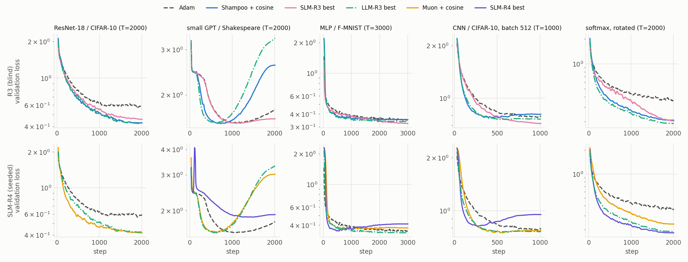
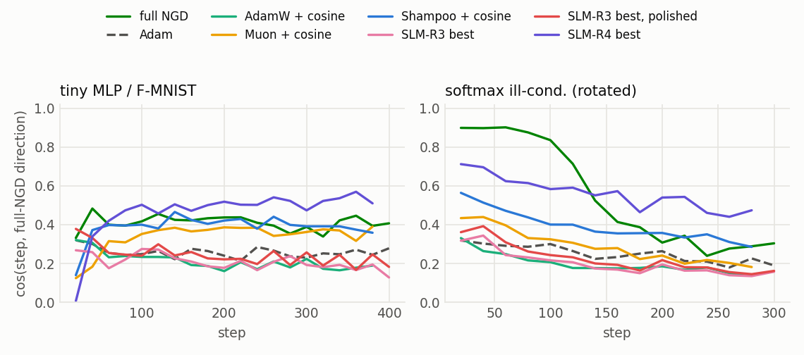
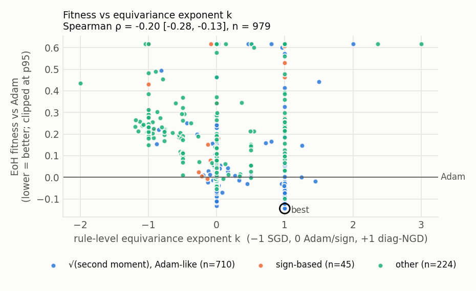
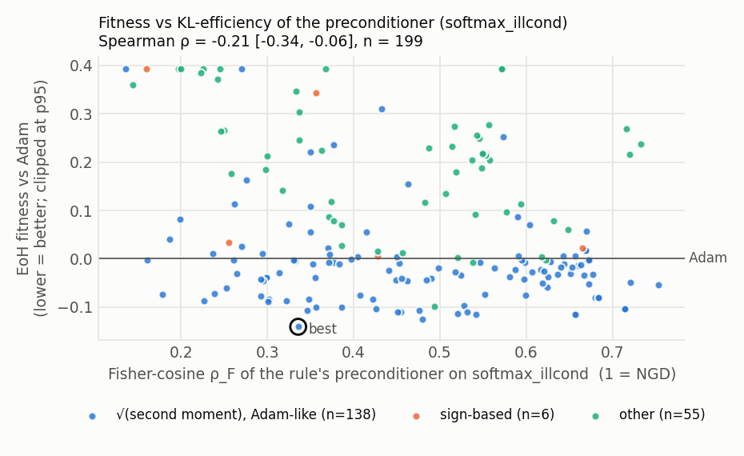
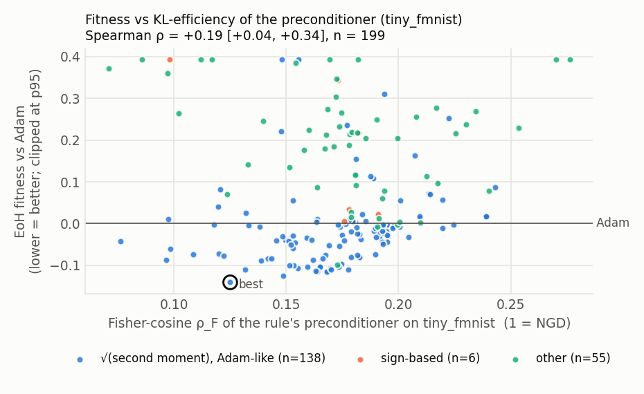

# EoH với hai backbone, SLM và LLM: tái phát hiện best practices của optimizer, nhìn qua lăng kính Natural Gradient

*Dự án cho buổi trình bày paper môn Tối ưu hóa (UET). Paper: F. Liu et al., "Evolution of Heuristics: Towards Efficient Automatic Algorithm Design Using Large Language Model", ICML 2024.*

> Bảng và hình trong báo cáo được sinh tự động bởi `make_report.py` từ kết quả chạy thật (giữa các marker `BEGIN/END`). Phần văn được viết sau khi có số liệu. Mọi con số "fitness" hay "Δ log-AUC" đều tính so với Adam đã tune lr: **âm là nhanh hơn Adam**.
>
> Hai backbone được đặt cạnh nhau: **SLM** là Qwen3.8-27B-FP8 chạy local, **LLM** là Claude Haiku 5.5 (effort low) gọi qua API. Tên run và tên rule mang tiền tố của backbone: SLM-R3 là run R3 với SLM, LLM-R3 best là rule tốt nhất của run R3 với LLM. Trong một đoạn chỉ nói về một backbone, R1–R4 và #k ngầm hiểu là của backbone đó.

## Tóm tắt

- **Bài toán.** Dùng EoH để tiến hóa update rule của optimizer cho mạng nơ-ron, với hai backbone sinh code đặt cạnh nhau: một **SLM** (Qwen3.8-27B-FP8, chạy local bằng vLLM, tắt thinking) và một **LLM** (Claude Haiku 5.5 qua API, effort low). Kết quả được đọc qua hai lăng kính: best practices của optimizer deep learning và natural gradient (NGD).
  - Ba run blind R1–R3 (template SGD, không seed, không nhắc tới Fisher hay NGD) chạy với cả hai backbone, cùng prompt, cùng ngân sách mẫu và cùng cách chấm.
  - R4 có seed (Shampoo, Muon và rule tốt nhất của R3) chỉ chạy với SLM.
  - **Tổng chi phí API của dự án là ~3$** (2553 lần gọi Haiku, tính theo giá niêm yết từ log token). SLM không tốn phí API.
- **SLM tái phát hiện hầu hết các best practice "rẻ".** Gồm momentum, Nesterov, Adam, bias correction, giảm lr theo thời gian, và cosine theo $t/T$ ngay khi được cho T. Rule blind tốt nhất có loss (trung bình hình học dọc quỹ đạo) thấp hơn Adam đã tune 9–13%, và thắng AdamW + warmup + cosine trên cả 4 task của R3. Nhưng SLM *không* tìm ra weight decay, có thử nhưng loại warmup, và **không tự tìm ra preconditioning ma trận**: chỉ 5/331 mẫu SLM-R3 có phép toán ma trận, và đều thua Adam.
- **LLM tìm ra preconditioning ma trận mà không cần seed.** 192/428 mẫu LLM-R3 (45%) dùng phép toán ma trận, và 177 trong số đó thắng Adam. Ý tưởng kiểu Shampoo có ngay trong quần thể khởi tạo.
  - Rule tốt nhất là Shampoo với số mũ −1/2 mỗi phía (kiểu Shampoo², $\approx F^{-1}$). Độ lớn bước lấy từ Adam (grafting), bước được trộn 0.7/0.3 với hướng Adam, có warmup 3% và cosine. Đây cùng họ với rule mà SLM chỉ đạt được khi có seed (SLM-R4).
  - Quần thể cuối gồm 10 biến thể Shampoo và 6 biến thể Muon, gần giống quần thể cuối của SLM-R4 (8 + 8).
  - Trên seed mới, rule này thắng Shampoo + cosine viết tay ở cả 4 task của R3, nhưng vẫn sau Shampoo² của SLM-R4 ở softmax đã xoay và CNN.
- **Với cùng ngân sách, LLM tốt hơn ở mọi run blind.**
  - Fitness tốt nhất: R1 −0.199 so với −0.144, R2 −0.178 so với −0.124, R3 −0.230 so với −0.095. Tỉ lệ mẫu hợp lệ là 99–100%, so với 67–96% của SLM.
  - Thought của LLM khớp với code hơn nhiều: 63% mẫu LLM-R3 tự nhận là "bậc hai/ma trận" có phép toán ma trận thật trong code, so với 5% ở SLM-R3.
  - LLM còn ghép thêm những kỹ thuật có tên tuổi mà SLM không dùng: warmup ngắn (có ở mọi rule cuối của LLM-R1 và LLM-R3), hệ số bước riêng cho từng tọa độ kiểu Rprop (tăng khi dấu gradient khớp với momentum, giảm khi ngược dấu), và chặn độ lớn bước bằng tanh/arctan.
- **Ở cả hai backbone, hàm fitness vẫn quyết định loại rule.**
  - Fitness trung bình (R1) sinh ra chuyên gia. SLM-R1 best nhanh hơn Adam ×3.5 trên softmax thẳng trục nhưng thua Adam trên Transformer và ResNet-18 held-out. LLM-R1 best thắng trên ResNet-18 nhưng vẫn thua Adam trên GPT và CNN batch 512.
  - Fitness robust (R2) cho rule cân bằng hơn. LLM-R2 best thắng Adam trên 4/5 task held-out, kể cả GPT (−0.148, ×1.46), task mà gần như mọi rule element-wise khác đều thua.
- **Hai backbone đi về phía NGD theo hai đường.** Theo P3/P4, "nâng số mũ" của preconditioner từ căn bậc hai lên bậc một là một bước về phía NGD.
  - SLM làm điều đó hai lần. R1 đi từ Adam ($m/\sqrt v$) sang $m/v$ ($k=+1$, bất biến với scale đường chéo như diag-NGD). R4 (có seed) đi từ Shampoo ($\approx F^{-1/2}$) sang Shampoo² ($\approx F^{-1}$), fitness −0.302 so với −0.180 của Shampoo.
  - LLM giữ $\sqrt v$ ở mọi rule element-wise ($k=0$), nhưng ở R3 tự tìm ra số mũ −1/2 cho preconditioner Kronecker. Trên softmax đã xoay, bước của rule này căn với hướng full NGD tốt hơn Shampoo (cos 0.47 so với 0.39; SLM-R4 0.56, Adam 0.25). Nó cũng ít bị phạt khi xoay bài hơn hẳn rule đường chéo (+0.23 so với +0.72 của SLM-R3 best; SLM-R4 +0.07): 30% bước còn lại là hướng Adam, vốn không đẳng biến với phép xoay.
  - Rule element-wise của cả hai backbone không vượt được trần của xấp xỉ đường chéo: cos với full NGD ngang Adam hoặc thấp hơn, và rotation penalty từ +0.8 đến +1.6.
- **Nhanh hơn chưa chắc tốt hơn.**
  - Shampoo² của SLM-R4 thắng mọi baseline trên các task search (kể cả trên seed mới), nhưng overfit sớm trên các task held-out dài (GPT, MLP với T=3000, CNN batch 512).
  - Rule ma trận của LLM-R3 không overfit trên MLP và CNN, nhưng overfit trên GPT (+0.17), giống Shampoo và Muon.
  - Chỉ các rule NAdam + cosine của SLM-R3 (blind) thắng Adam trên cả 5 task held-out.
  - Rule ma trận của cả hai backbone tốn 3–6 lần Adam mỗi bước. Rule của LLM còn dễ lỗi số, vì gọi `eigh` float32 mà không có nhánh dự phòng.
- **Hạn chế chính.** Mỗi cấu hình chỉ có 1 run cho mỗi backbone; task nhỏ, horizon ngắn; speedup tính theo số bước (mục 7.3, 9). LLM chưa chạy R4 và chưa qua polish.

## 1. Bối cảnh và câu hỏi nghiên cứu

**EoH** coi một heuristic là một cặp *thought* (mô tả ý tưởng bằng ngôn ngữ tự nhiên) và *code*. Thuật toán duy trì một quần thể các cặp này và dùng một language model làm toán tử biến đổi:

- **i1** sinh cá thể ban đầu từ template;
- **e1, e2** (exploration) tạo ý tưởng mới, khác hẳn hoặc lấy cảm hứng từ các cha mẹ;
- **m1, m2, m3** (modification) sửa cấu trúc, đổi tham số, hoặc rút gọn code.

Mỗi cá thể được chạy để tính fitness, và quần thể giữ lại các cá thể tốt nhất. Bản dùng ở đây là EoH V0.2 (pipeline bất đồng bộ), với vài patch nhỏ để gọi được hai loại backbone: SLM chạy local qua vLLM, và LLM qua Anthropic API (mục 2.2).

Ta dùng EoH để tiến hóa *update rule* của optimizer cho mạng nơ-ron, với mục tiêu hội tụ nhanh, rồi hỏi:

- **RQ1 — tái phát hiện.** EoH có tự tìm lại các best practice của optimizer deep learning không: momentum, scale thích nghi, schedule (warmup/annealing), regularization, preconditioning bậc hai? Rule tìm được có nhanh hơn các baseline best practice (AdamW với warmup và cosine, Muon, Shampoo) không, và có tổng quát hóa sang task chưa thấy không?
- **RQ2 — thiết kế bài toán.** Fitness và không gian tìm kiếm quyết định cơ chế nào nổi lên như thế nào? Ta có bốn run R1 → R4. Ba run đầu "blind", mỗi run sửa một điểm yếu mà run trước để lộ ra. R4 có seed, để kiểm tra riêng phần mà R3 không tự tìm ra.
- **RQ3 — nối với NGD.** Hai nhóm cơ chế "scale đường chéo" và "preconditioning ma trận" là các xấp xỉ khác nhau của hướng natural gradient $-F^{-1}g$. Ta đo trực tiếp xem rule tìm được gần NGD đến đâu, và tính chất này có giải thích được tốc độ hội tụ không.
- **RQ4 — backbone.** Thay SLM local bằng một LLM mạnh hơn (nhưng tốn phí API) thì điều gì thay đổi: loại cơ chế tìm được, chất lượng rule trên task search và task held-out, độ tin cậy của thought, và chi phí?

## 2. Bài toán đưa cho EoH: bốn run, hai backbone

### 2.1 Bốn run

| | R1 | R2 | R3 | R4 |
|---|---|---|---|---|
| Không gian tìm kiếm | rule **element-wise** trên vector tham số đã flatten: `step(p, g, state, t, lr)` | như R1 | rule **gọi riêng cho từng tensor**, biết tổng số bước **T**: `step(p, g, state, t, T, lr)`; được dùng norm, matmul, `torch.linalg` | như R3 |
| Fitness | log-AUC của *training loss* so với Adam đã tune, **trung bình** qua 4 task | **robust**: trung bình + phạt task tệ nhất thua Adam | robust, trên *validation loss* (dữ liệu held-out) | như R3 |
| Task | softmax ill-cond. (thẳng trục), MLP/F-MNIST, CNN/CIFAR-10, char-Transformer; 300–400 bước | như R1 | softmax ill-cond. **đã xoay**, MLP, CNN, char-Transformer; **T khác nhau**: 150/400/200/300 | như R3 |
| Quần thể khởi đầu | 20 mẫu i1 từ template SGD-momentum | 32 mẫu i1 | 32 mẫu i1 | **5 seed**: Shampoo, Muon và 3 rule tốt của SLM-R3 |
| Quản lý quần thể | pop 10, mặc định của EoH | pop 16, tối đa 2 cá thể mỗi khung code | như R2 | như R2 |
| Ngân sách | 1000 mẫu | 1000 mẫu | 400 mẫu | 250 mẫu |
| Blind? | có | có | có | **không** |
| Backbone | SLM, LLM | SLM, LLM | SLM, LLM | chỉ SLM |

Chi tiết thiết kế:

- **Cùng một thước đo cho mọi rule.** Learning rate của mọi rule, kể cả Adam, đều được tune như nhau: probe 7 giá trị trên lưới log ở 25% horizon, rồi refine 3 giá trị. fitness = 0 nghĩa là nhanh ngang Adam đã tune; fitness < 0 nghĩa là nhanh hơn.
- **R1–R3 "blind" về NGD.** Template là SGD-momentum, không có seed rule nào, và task description không nhắc tới Fisher, natural gradient, curvature hay tên optimizer nào. Có hai lưu ý:
  - "blind" chỉ có nghĩa là *ta* không gợi ý; cả hai backbone vẫn biết Adam, Shampoo, K-FAC từ dữ liệu huấn luyện;
  - task description của R3 có liệt kê các phép toán được dùng (`eigh`, `solve`, lũy thừa ma trận), tức R3 blind về đáp án nhưng không blind về không gian tìm kiếm.
- **R1 → R2.** SLM-R1 cho thấy fitness trung bình bị task softmax lấn át, và quần thể bị lấp đầy bởi các bản sao chỉ khác tham số. R2 sửa cả hai điểm này.
- **R2 → R3.** Mục tiêu dịch sang "best practices". R3 mở rộng không gian tìm kiếm theo đúng mục tiêu đó:
  - **T** cho phép annealing/warmup *theo tỉ lệ t/T* thay vì gắn với số bước tuyệt đối;
  - **validation loss** thưởng cho cả regularization ngầm;
  - **thao tác theo tensor** cho phép preconditioning ma trận;
  - **bài softmax đã xoay** tạo áp lực chọn lọc có chủ đích: rule đường chéo không thể precondition nó (xem P3), còn preconditioner ma trận thì có thể.
- **R3 → R4.** SLM-R3 không làm preconditioning ma trận tự xuất hiện (mục 4.3). R4 giữ nguyên mọi thứ của R3, chỉ thay quần thể khởi đầu bằng 5 seed: Shampoo và Muon viết tay (kèm warmup và cosine), SLM-R3#1, SLM-R3#6 (một khung code khác của R3) và SLM-R3#1 đã polish. Câu hỏi của R4 vì thế không còn là "EoH có tự tìm ra không" mà là "cho sẵn preconditioner bậc hai, EoH có cải tiến hay lai ghép được không". Báo cáo coi R4 là run **có hướng dẫn**. R4 chỉ chạy với SLM: với LLM, chính R3 đã trả lời câu hỏi "có tự tìm ra không" (mục 4.3).

<!-- BEGIN:search_config_R1 -->
**Task description sent to the LLM (verbatim):**

> Design a novel element-wise update rule (optimizer) for training neural networks that decreases the training loss as fast as possible. The rule is applied to all parameters at every step, and the harness tunes the learning rate lr separately for each task. Fitness is the average log training loss over the whole run (so early progress matters as much as the final loss), relative to Adam, averaged over four short training runs of a few hundred steps: ill-conditioned softmax regression, an MLP on Fashion-MNIST, a small CNN on CIFAR-10 and a small character-level transformer. The update of every coordinate may depend only on that coordinate's parameter value, gradient and its own state tensors, plus the step counter t and lr: any element-wise torch operation is allowed, but sums, means, norms, max or other reductions over elements, indexing, and use of the tensor shape or size are forbidden and are rejected automatically.

**Template (initial body = SGD-momentum):**

```python
import torch
import math


class UpdateRule:
    """Element-wise optimizer, constructed with no arguments.

    One instance handles all parameters of the network, flattened into a single
    1-D tensor, with a single state dict. The update of each entry may depend
    only on that entry's own values (p, g, state tensors) and on the
    scalars t and lr.
    """

    def init_state(self, p: torch.Tensor) -> dict:
        """Return the initial state: any number of tensors shaped like p."""
        return {"m": torch.zeros_like(p)}

    def step(self, p: torch.Tensor, g: torch.Tensor, state: dict, t: int, lr: float) -> torch.Tensor:
        """Return the update delta (same shape as p); the harness applies p += delta.

        Args:
            p:     current parameter values.
            g:     minibatch gradient of the training loss.
            state: the dict returned by init_state; update its tensors in place.
            t:     step counter, starting at 1.
            lr:    learning rate selected by the harness with a log-spaced sweep.
        """
        m = state["m"]
        m.mul_(0.9).add_(g)
        return -lr * m
```

**Reference scores of LR-tuned Adam** (mean log training loss over the whole run): softmax ill-cond. -0.943, MLP / F-MNIST -0.797, CNN / CIFAR-10 +0.266, char-Transformer +0.809
<!-- END:search_config_R1 -->

<details>
<summary><b>R3/R4</b>: task description và template gửi cho backbone (nguyên văn)</summary>

<!-- BEGIN:search_config_R3 -->
**Task description sent to the LLM (verbatim):**

> Design a novel optimizer (update rule) for training neural networks that decreases the held-out validation loss as fast as possible. The rule is applied separately to every parameter tensor (weight matrices, convolution kernels, embeddings, biases, normalisation gains) at every step; it receives the step counter t and the total number of steps T of the run, and the harness tunes the base learning rate lr per task. Fitness is the average log validation loss over the whole run (so early progress matters as much as the final value), relative to Adam with a tuned constant learning rate, on four training runs of different lengths T (200 to 600 steps): an ill-conditioned softmax regression with correlated input features, an MLP on Fashion-MNIST, a small CNN on CIFAR-10 and a small character-level transformer. The fitness also adds the largest per-task excess over Adam, so a rule that is slower than Adam on any single task is penalised: aim to be at least as fast as Adam on every task. The update may use any deterministic torch operations on its tensor: element-wise operations, reductions over the tensor (norms, means), and for matrices (reshape higher-order kernels to (out, -1)) matrix products and torch.linalg functions (e.g. eigh, solve, matrix powers); recompute expensive matrix functions only every few steps so that a step costs at most a few times an Adam step. Randomness is not allowed.

**Template (initial body = SGD-momentum):**

```python
import torch
import math


class UpdateRule:
    """Optimizer for one parameter tensor; the harness builds one instance (with no
    arguments) and one state for every parameter tensor of the network.

    Tensors keep their natural shapes: weight matrices (out, in), convolution
    kernels (out, in, kh, kw), embeddings (vocab, dim), biases and normalisation
    gains (n,).
    """

    def init_state(self, p: torch.Tensor) -> dict:
        """Return the initial state of this tensor: tensors and numbers."""
        return {"m": torch.zeros_like(p)}

    def step(self, p: torch.Tensor, g: torch.Tensor, state: dict, t: int, T: int, lr: float) -> torch.Tensor:
        """Return the update of this tensor (same shape as p); the harness applies p += delta.

        Args:
            p:     current values of this parameter tensor.
            g:     minibatch gradient of the training loss with respect to p.
            state: the dict returned by init_state for this tensor; update it in place.
            t:     step counter, from 1 to T.
            T:     total number of training steps of this run.
            lr:    base learning rate, selected per task by the harness with a log-spaced sweep.
        """
        m = state["m"]
        m.mul_(0.9).add_(g)
        return -lr * m
```

**Reference scores of LR-tuned Adam** (mean log validation loss over the whole run): softmax, rotated (T=150) +0.106, MLP / F-MNIST (T=400) -0.679, CNN / CIFAR-10 (T=200) +0.431, char-Transformer (T=300) +0.875
<!-- END:search_config_R3 -->

</details>

Task description của R3/R4 ghi "T từ 200 đến 600 bước"; đó là horizon của cấu hình R3 đầu tiên. R3 được khởi động lại với horizon ngắn hơn (150/400/200/300) để vừa ngân sách thời gian. Rule nhận T thật qua tham số, nên chỗ lệch này không ảnh hưởng tới phép đo. Hai backbone nhận đúng cùng một task description và template.

### 2.2 Hai backbone

| | SLM | LLM |
|---|---|---|
| Model | Qwen3.8-27B-FP8 (model mở 27B, "nhỏ" theo nghĩa tương đối: chạy được trên một GPU) | Claude Haiku 5.5 (`claude-haiku-5-5`) |
| Chạy ở đâu | local, vLLM trên một GPU H100 | Anthropic Messages API |
| Cách sinh | tắt thinking; T = 0.7, top-p = 0.8, top-k = 20; tối đa 4096 token ra | adaptive thinking với `effort: low`; sampling mặc định (Haiku 5.5 không nhận T hay top-p); tối đa 16000 token ra |
| Run | R1, R2, R3, R4 | R1, R2, R3 |
| Chi phí | không tốn phí API; cần thêm một GPU để chạy model | **~3$ cho cả dự án**: 2553 lần gọi, 5.5M token vào và 4.9M token ra (tính cả thinking), giá niêm yết $0.10 / $0.50 mỗi triệu token; khoảng 1.1$ cho một run 1000 mẫu |

Mọi thứ khác giống hệt nhau giữa hai backbone: task description, template, fitness, bộ task, kích thước quần thể, ngân sách mẫu, số luồng sinh và chấm, timeout, deadline và lưới lr (`scripts/run_haiku.sh` lấy đúng cấu hình của các run SLM). Mỗi lần gọi API được ghi vào `results/llm_usage.jsonl` (token vào và ra), nên chi phí ở trên là số đo, không phải ước lượng. Con số ~3$ gồm cả các run thử (smoke) và probe; chi phí từng run nằm ở dòng cuối của bảng dưới.

**Cấu hình và thống kê của các run** (mỗi run SLM đặt cạnh run LLM tương ứng)

<!-- BEGIN:eoh_summary -->
|  | SLM-R1 | LLM-R1 | SLM-R2 | LLM-R2 | SLM-R3 | LLM-R3 | SLM-R4 |
|---|---|---|---|---|---|---|---|
| Backbone | SLM: `qwen3.8-27b` on local vLLM, thinking off, T=0.7, top-p=0.8 | LLM: `claude-haiku-5-5` via the API, effort low, adaptive thinking | SLM: `qwen3.8-27b` on local vLLM, thinking off, T=0.7, top-p=0.8 | LLM: `claude-haiku-5-5` via the API, effort low, adaptive thinking | SLM: `qwen3.8-27b` on local vLLM, thinking off, T=0.7, top-p=0.8 | LLM: `claude-haiku-5-5` via the API, effort low, adaptive thinking | SLM: `qwen3.8-27b` on local vLLM, thinking off, T=0.7, top-p=0.8 |
| Fitness optimised | mean over tasks, training loss | mean over tasks, training loss | robust (mean + worst-task excess), training loss | robust (mean + worst-task excess), training loss | robust (mean + worst-task excess), validation loss | robust (mean + worst-task excess), validation loss | robust (mean + worst-task excess), validation loss |
| Rule interface | element-wise, `step(p, g, state, t, lr)` | element-wise, `step(p, g, state, t, lr)` | element-wise, `step(p, g, state, t, lr)` | element-wise, `step(p, g, state, t, lr)` | per tensor, `step(p, g, state, t, T, lr)` | per tensor, `step(p, g, state, t, T, lr)` | per tensor, `step(p, g, state, t, T, lr)` |
| Initial population | 20 i1 samples from the SGD-momentum template | 20 i1 samples from the SGD-momentum template | 32 i1 samples from the SGD-momentum template | 32 i1 samples from the SGD-momentum template | 32 i1 samples from the SGD-momentum template | 32 i1 samples from the SGD-momentum template | seeds: Shampoo + cosine -0.179, Muon + cosine -0.124, SLM-R3 best -0.094, SLM-R3 #6 (dual momentum) -0.093, SLM-R3 best, polished -0.103 |
| Population management | pop 10, EoH default | pop 10, EoH default | pop 16, max 2 per code skeleton | pop 16, max 2 per code skeleton | pop 16, max 2 per code skeleton | pop 16, max 2 per code skeleton | pop 16, max 2 per code skeleton |
| Samples (valid) | 1020 (979, 96%) | 1020 (1016, 100%) | 1032 (695, 67%) | 1032 (1032, 100%) | 432 (331, 77%) | 432 (428, 99%) | 250 (207, 83%) |
| Per operator (valid/total) | e1 226/234, e2 200/209, i1 19/20, m1 213/220, m2 227/228, m3 94/109 | e1 228/232, e2 213/213, i1 20/20, m1 210/210, m2 231/231, m3 114/114 | e1 141/227, e2 152/220, i1 29/32, m1 147/218, m2 154/230, m3 72/105 | e1 232/232, e2 217/217, i1 32/32, m1 210/210, m2 230/230, m3 111/111 | e1 52/90, e2 56/81, i1 19/32, m1 75/89, m2 87/97, m3 42/43 | e1 85/88, e2 83/83, i1 32/32, m1 83/83, m2 100/101, m3 45/45 | e1 40/58, e2 29/44, m1 51/57, m2 60/62, m3 27/29 |
| Best by own fitness | -0.1444 (#705, m2) | -0.1987 (#974, m1) | -0.1237 (#844, m1) | -0.1776 (#908, m1) | -0.0953 (#265, m2) | -0.2300 (#231, m2) | -0.3022 (#225, e2) |
| Best in final population | -0.1444 (evolved) | -0.1987 (evolved) | -0.1237 (evolved) | -0.1776 (evolved) | -0.0953 (evolved) | -0.2300 (evolved) | -0.3022 (evolved) |
| Best robust fitness | -0.1317 (#402) | -0.1986 (#974) | -0.1237 (#844) | -0.1776 (#908) | -0.0953 (#265) | -0.2300 (#231) | -0.3022 (#225) |
| Beat Adam on all 4 tasks | 46 | 276 | 131 | 275 | 106 | 230 | 81 |
| Distinct skeletons in final population | 8/10 | 8/10 | 11/16 | 15/16 | 11/16 | 13/16 | 13/16 |
| Wall-clock | 55 min | 63 min | 89 min | 63 min | 102 min | 84 min | 80 min |
| API cost (list price) | – (local GPU) | $1.12 (1026 calls, 2.1M input + 1.8M output tokens) | – (local GPU) | $1.16 (1034 calls, 2.2M input + 1.9M output tokens) | – (local GPU) | $0.65 (435 calls, 1.2M input + 1.1M output tokens) | – (local GPU) |
<!-- END:eoh_summary -->

SLM-R2 chỉ có 67% mẫu hợp lệ (SLM-R1 có 96%) vì một sự cố: khoảng 290 mẫu bị fail oan khi `prob.py` được sửa trong lúc run đang chạy. Mỗi evaluation chạy trong một tiến trình mới, nạp code mới nhưng dùng object problem đã pickle từ code cũ. Các mẫu còn lại không bị ảnh hưởng. Các run LLM không gặp sự cố này.

## 3. Cơ sở lý thuyết: NGD và bốn mệnh đề dùng để đọc kết quả

Ký hiệu: model $p_\theta(y\mid x)$, loss $L(\theta)=\mathbb E[-\log p_\theta(y\mid x)]$, gradient $g=\nabla L$, Fisher

$$F(\theta)=\mathbb E_{x}\,\mathbb E_{y\sim p_\theta(\cdot\mid x)}\big[\nabla_\theta\log p_\theta(y\mid x)\,\nabla_\theta\log p_\theta(y\mid x)^\top\big].$$

Với softmax cross-entropy, $F$ trùng với generalized Gauss–Newton (GGN): $F=\mathbb E_x[J^\top(\operatorname{diag}(p)-pp^\top)J]$ (Martens, 2020). Mọi optimizer có preconditioner đều viết được dưới dạng $\Delta\theta=-\eta\,P^{-1}m$; NGD là trường hợp $P=F$.

**P1 — NGD là steepest descent dưới ràng buộc KL.** Ta có $\mathrm{KL}(p_\theta\,\|\,p_{\theta+\delta})=\tfrac12\delta^\top F\delta+O(\|\delta\|^3)$. Bài toán $\min_\delta g^\top\delta$ với ràng buộc $\tfrac12\delta^\top F\delta\le\varepsilon$ có nghiệm $\delta^\star\propto-F^{-1}g$.

- Với GLM (softmax regression là một ví dụ), $F$ bằng đúng Hessian, nên NGD trùng với Newton và không phụ thuộc vào conditioning.
- NGD bất biến (đến bậc một) với mọi phép reparametrize trơn.

**P2 — Fisher-cosine: hiệu quả trên mỗi đơn vị KL.** Định nghĩa $\rho_F(u)=\dfrac{-g^\top u}{\|u\|_F\,\|g\|_{F^{-1}}}$.

- Theo Cauchy–Schwarz, $\rho_F\le1$, và dấu bằng xảy ra khi và chỉ khi $u\parallel-F^{-1}g$.
- $\rho_F$ chính là tỉ lệ tiến bộ so với NGD khi cùng ngân sách KL.
- **Kantorovich.** Với $u=-Pg$: $\rho_F\ge2\sqrt\kappa/(1+\kappa)$, trong đó $\kappa=\operatorname{cond}(P^{1/2}FP^{1/2})$. Cũng chính $\kappa$ này quyết định tốc độ hội tụ $\big(\tfrac{\kappa-1}{\kappa+1}\big)^2$ trên bài toán bậc hai.

**P3 — Preconditioner đường chéo (nhóm 2).**

- **Số mũ đẳng biến.** Một rule có dạng $|\delta_i|\propto|m_i|^bF_{ii}^{-\alpha}$, khi reparametrize đường chéo $\varphi=D\theta$, biến đổi theo $\delta_\varphi=D^{k}\delta_\theta$ với $k=2\alpha-b$. Chỉ khi $k=+1$ thì update mới bất biến. Các giá trị: SGD −1, Adam/sign 0, diag-NGD +1.
- **Không đẳng biến với phép xoay.** Với $\theta=Q\psi$, $Q$ trực giao: SGD (khởi tạo bằng 0) và full NGD đều đẳng biến, còn rule element-wise thì không. Vì vậy rule đường chéo chỉ khử được ill-conditioning nằm *dọc theo trục*.
- **Adam là "căn bậc hai" của NGD đường chéo.** Adam là $\operatorname{diag}(F_{\text{emp}})^{-1/2}$ (empirical Fisher); diag-NGD là $\operatorname{diag}(F)^{-1}$ (Kunstner et al., 2019 bàn về sự khác nhau giữa Fisher và empirical Fisher).

**P4 — Preconditioner Kronecker (nhóm 5) là xấp xỉ NGD theo từng layer.**

- **Fisher của một layer tuyến tính.** Xét layer $s=Wa$ với $\delta=\partial\ell/\partial s$. Gradient là $G=\mathbb E[\delta a^\top]$, và block Fisher là $F_W=\mathbb E[(aa^\top)\otimes(\delta\delta^\top)]$.
- **K-FAC** (Martens & Grosse, 2015) xấp xỉ $F_W\approx A\otimes S$ với $A=\mathbb E[aa^\top]$, $S=\mathbb E[\delta\delta^\top]$. Bước natural gradient của layer khi đó là $S^{-1}GA^{-1}$.
- **Shampoo** (Gupta et al., 2018) chỉ dùng gradient: $L=\sum GG^\top$, $R=\sum G^\top G$, và update $L^{-1/4}GR^{-1/4}$.
  - Với một mẫu, $G=\delta a^\top$ cho $GG^\top=\|a\|^2\delta\delta^\top$ và $G^\top G=\|\delta\|^2aa^\top$. Vậy $L$ và $R$ ước lượng chính các nhân tử $S$ và $A$ của K-FAC (bản empirical).
  - Số mũ $-1/4$ mỗi phía ứng với $(L\otimes R)^{-1/4}\approx F_{\text{emp}}^{-1/2}$, tức "căn bậc hai" của NGD Kronecker, giống quan hệ giữa Adam và diag-NGD.
  - Shampoo² (số mũ $-1/2$) gần với K-FAC/NGD (Morwani et al., 2024).
- **Muon** (UV^T của momentum) là Shampoo với thống kê tức thời: $(MM^\top)^{-1/2}M$. Đó là steepest descent dưới spectral norm.
- **Hệ quả kiểm chứng được.** Preconditioner Kronecker **đẳng biến với phép xoay đầu vào**: $A\to QAQ^\top$ thì preconditioner xoay theo. Vì vậy, khác với nhóm 2, nhóm 5 khử được ill-conditioning *không thẳng trục*. Đây chính là lý do R3 có bài softmax đã xoay.

*Bối cảnh thêm.* Trong chế độ NTK, NGD hội tụ với tốc độ không phụ thuộc conditioning của Gram matrix (Zhang, Martens & Grosse, 2019). Như vậy "hội tụ nhanh" và "gần NGD" có liên hệ lý thuyết, không chỉ là phép loại suy.

Chứng minh ngắn của P1–P4 nằm ở Phụ lục A.

## 4. Kết quả tìm kiếm: SLM và LLM

<!-- BEGIN:search_progress -->

<!-- END:search_progress -->

*Best-so-far theo số mẫu; mỗi run của SLM đặt cạnh run tương ứng của LLM (gạch-chấm). Panel 1 và 2 là R1, R2 (training loss, rule element-wise); panel 3 là R3/R4 (validation loss, rule theo tensor). Các panel đo trên các bài khác nhau nên fitness không so trực tiếp được giữa các panel. Đường đứt nét xám là baseline viết tay chấm trên thiết lập R3. SLM-R4 xuất phát từ seed tốt nhất của nó (Shampoo, −0.180).*

Ở cả ba run blind, LLM vượt SLM từ những mẫu đầu tiên và vẫn cải thiện tới cuối run. Khoảng cách lớn nhất nằm ở R3. LLM-R3 vượt Shampoo + cosine viết tay từ khoảng mẫu thứ 100, còn SLM-R3 dừng ở −0.095. Rule có seed của SLM (SLM-R4) vẫn là tốt nhất trên thiết lập này.

### 4.1 R1: fitness trung bình

**SLM-R1.**

- **Hội tụ rồi bão hòa.** 55 phút, 1020 mẫu (96% hợp lệ). Best −0.144 đạt ở mẫu #705, sau đó đứng yên suốt 315 mẫu cuối.
- **Quần thể sập về một ý.** Đó là momentum chia cho $\sqrt{v_\text{nhanh}\,v_\text{chậm}}$, về thực chất là $m/v$ không căn, nhân thêm một hệ số "boost" lớn ở các bước đầu rồi giảm dần. 9/10 rule cuối có số mũ đẳng biến $k=+1$, đúng như diag-NGD (P3), trong khi Adam có $k=0$.
- **Fitness trung bình bị một task lấn át.** Rule tốt nhất nhanh hơn Adam ×3.5 trên softmax thẳng trục, nhưng không bao giờ đạt loss cuối của Adam trên char-Transformer (mục 7.1). SLM-R1 có 46 rule thắng Adam trên cả 4 task, tốt nhất là #402 (fitness −0.132), nhưng fitness trung bình không chọn chúng.

<details>
<summary>SLM-R1: các lần đạt best mới (operator, fitness, k của rule, motif thêm/bớt so với best trước, thought của SLM)</summary>

<!-- BEGIN:timeline_R1 -->
- **#1** [i1] fitness +0.0018 k=+0.00 
  > A sign-aware adaptive optimizer that uses a fast-decaying momentum for the gradient sign and a slow-decaying magnitude accumulator to scale the step size inversely proportional to the accumulated gradient magnitude, combined with a small epsilon for stability.

- **#2** [i1] fitness -0.0376 k=-0.00 +second_moment +sqrt +t_schedule -abs
  > A heavy-ball momentum method with a decaying learning rate schedule that accelerates early convergence while maintaining stability through exponential moving average of gradients.

- **#51** [m1] fitness -0.0538 k=+0.00 +sign +saturation
  > A sign-adaptive momentum optimizer with a warmup-aware step size that amplifies updates when the momentum and gradient align, using a soft saturation function to prevent divergence while maintaining a decaying schedule for stability.

- **#60** [e1] fitness -0.0735 k=-0.00 +bias_correction +exp_log -sign -saturation
  > A dual-timescale adaptive optimizer that combines fast momentum for direction with a slowly-adapted, bias-corrected second-moment estimate to dynamically scale the step size, featuring an aggressive early-training boost that decays exponentially to ensure stability in later steps.

- **#74** [m2] fitness -0.0833 k=-0.00 +sign +saturation -bias_correction
  > A momentum optimizer with a decaying step size and a soft-saturation nonlinearity that amplifies updates when the momentum and gradient signs align, using a faster exponential decay schedule and a stronger saturation gain to accelerate early convergence while maintaining stability.

- **#164** [m2] fitness -0.1041 k=+1.00 +bias_correction -sign -saturation
  > A dual-timescale adaptive optimizer with fast momentum for direction, a bias-corrected second-moment estimate for scale, and a step-dependent exponential boost that decays from an aggressive early-training acceleration to a stable baseline, using a hybrid denominator that blends instantaneous and long-term gradient magnitudes to prevent scale instability while maximizing early loss reduction.

- **#180** [m1] fitness -0.1042 k=+1.00 
  > A dual-timescale adaptive optimizer with fast momentum for direction, a bias-corrected second-moment estimate for scale, and a step-dependent exponential boost that decays from an aggressive early-training acceleration to a stable baseline, using a hybrid denominator that blends instantaneous and long-term gradient magnitudes to prevent scale instability while maximizing early loss reduction.

- **#262** [m2] fitness -0.1045 k=+1.00 
  > A dual-timescale adaptive optimizer with fast momentum for direction, a bias-corrected second-moment estimate for scale, and a step-dependent exponential boost that decays from an aggressive early-training acceleration to a stable baseline, using a hybrid denominator that blends instantaneous and long-term gradient magnitudes to prevent scale instability while maximizing early loss reduction.

- **#308** [e2] fitness -0.1152 k=+1.00 
  > A dual-timescale adaptive optimizer with fast momentum for direction, a bias-corrected second-moment estimate for scale, and a step-dependent exponential boost that decays from an aggressive early-training acceleration to a stable baseline, using a hybrid denominator that blends instantaneous and long-term gradient magnitudes to prevent scale instability while maximizing early loss reduction.

- **#402** [m2] fitness -0.1317 k=-0.00 
  > A dual-momentum adaptive optimizer with fast and slow gradient magnitude tracking, using a harmonic mean denominator for scale normalization and a linearly decaying boost factor to accelerate early training while stabilizing convergence

- **#589** [m2] fitness -0.1407 k=+1.00 
  > A dual-momentum adaptive optimizer with fast and slow exponential moving averages for gradient magnitude, using a geometric mean denominator for scale normalization and a time-decaying linear boost to accelerate early convergence while maintaining stability in later training steps.

- **#705** [m2] fitness -0.1444 k=+1.00 
  > A dual-momentum adaptive optimizer with fast and slow gradient magnitude tracking, using a geometric mean denominator for scale normalization and a quadratically decaying boost factor to accelerate early training while stabilizing convergence
<!-- END:timeline_R1 -->

</details>

<details>
<summary>SLM-R1: code của 3 rule đứng đầu quần thể cuối</summary>

<!-- BEGIN:top_rules_R1 -->
**SLM-R1#1** — fitness -0.1444

> A dual-momentum adaptive optimizer with fast and slow gradient magnitude tracking, using a geometric mean denominator for scale normalization and a quadratically decaying boost factor to accelerate early training while stabilizing convergence

```python
import torch
import math


class UpdateRule:
    """Element-wise optimizer, constructed with no arguments.

    One instance handles all parameters of the network, flattened into a single
    1-D tensor, with a single state dict. The update of each entry may depend
    only on that entry's own values (p, g, state tensors) and on the
    scalars t and lr.
    """

    def init_state(self, p: torch.Tensor) -> dict:
        """Return the initial state: any number of tensors shaped like p."""
        return {
            "m_fast": torch.zeros_like(p),
            "m_slow": torch.zeros_like(p),
            "v_fast": torch.zeros_like(p),
            "v_slow": torch.zeros_like(p)
        }

    def step(self, p: torch.Tensor, g: torch.Tensor, state: dict, t: int, lr: float) -> torch.Tensor:
        """Return the update delta (same shape as p); the harness applies p += delta.

        Args:
            p:     current parameter values.
            g:     minibatch gradient of the training loss.
            state: the dict returned by init_state; update its tensors in place.
            t:     step counter, starting at 1.
            lr:    learning rate selected by the harness with a log-spaced sweep.
        """
        m_fast = state["m_fast"]
        m_slow = state["m_slow"]
        v_fast = state["v_fast"]
        v_slow = state["v_slow"]

        # Fast momentum (beta1_fast = 0.90)
        m_fast.mul_(0.90).add_(g)

        # Slow momentum (beta1_slow = 0.995)
        m_slow.mul_(0.995).add_(g)

        # Fast second moment (beta2_fast = 0.98)
        v_fast.mul_(0.98).addcmul_(g, g, value=0.02)

        # Slow second moment (beta2_slow = 0.9995)
        v_slow.mul_(0.9995).addcmul_(g, g, value=0.0005)

        # Bias correction for fast second moment
        bias_corr_fast = 1.0 - (0.98 ** t)
        v_fast_corrected = v_fast / bias_corr_fast

        # Bias correction for slow second moment
        bias_corr_slow = 1.0 - (0.9995 ** t)
        v_slow_corrected = v_slow / bias_corr_slow

        # Geometric mean of fast and slow second moments for stable scale estimation
        # G = sqrt(v_fast * v_slow)
        eps = 1e-8
        geometric_mean = torch.sqrt(v_fast_corrected * v_slow_corrected + eps)

        # Use geometric mean as denominator
        denom = geometric_mean

        # Blend fast and slow momentum for direction
        # Weight fast momentum more heavily early on
        blend_weight = 0.8 + 0.2 * math.exp(-t / 100.0)
        blended_momentum = blend_weight * m_fast + (1.0 - blend_weight) * m_slow

        # Base adaptive update
        base_update = blended_momentum / denom

        # Quadratically decaying boost: starts at 6.0, decays to 1.0 by t=200
        progress = min(1.0, t / 200.0)
        boost = 1.0 + 5.0 * (1.0 - progress) ** 2

        return -lr * boost * base_update
```

**SLM-R1#2** — fitness -0.1431

> A dual-timescale momentum optimizer with geometric mean second-moment scaling and a linearly decaying early-step boost, using faster momentum decay and a steeper initial boost schedule to accelerate early convergence

```python
import torch
import math


class UpdateRule:
    """Element-wise optimizer, constructed with no arguments.

    One instance handles all parameters of the network, flattened into a single
    1-D tensor, with a single state dict. The update of each entry may depend
    only on that entry's own values (p, g, state tensors) and on the
    scalars t and lr.
    """

    def init_state(self, p: torch.Tensor) -> dict:
        """Return the initial state: any number of tensors shaped like p."""
        return {
            "m_fast": torch.zeros_like(p),
            "m_slow": torch.zeros_like(p),
            "v_fast": torch.zeros_like(p),
            "v_slow": torch.zeros_like(p)
        }

    def step(self, p: torch.Tensor, g: torch.Tensor, state: dict, t: int, lr: float) -> torch.Tensor:
        """Return the update delta (same shape as p); the harness applies p += delta.

        Args:
            p:     current parameter values.
            g:     minibatch gradient of the training loss.
            state: the dict returned by init_state; update its tensors in place.
            t:     step counter, starting at 1.
            lr:    learning rate selected by the harness with a log-spaced sweep.
        """
        m_fast = state["m_fast"]
        m_slow = state["m_slow"]
        v_fast = state["v_fast"]
        v_slow = state["v_slow"]

        # Update fast momentum (beta1_fast = 0.9)
        m_fast.mul_(0.9).add_(g)

        # Update slow momentum (beta1_slow = 0.995)
        m_slow.mul_(0.995).add_(g)

        # Update fast second moment (beta2_fast = 0.98)
        v_fast.mul_(0.98).addcmul_(g, g, value=0.02)

        # Update slow second moment (beta2_slow = 0.9995)
        v_slow.mul_(0.9995).addcmul_(g, g, value=0.0005)

        # Bias correction for fast second moment
        bias_corr_fast = 1.0 - (0.98 ** t)
        v_fast_corrected = v_fast / bias_corr_fast

        # Bias correction for slow second moment
        bias_corr_slow = 1.0 - (0.9995 ** t)
        v_slow_corrected = v_slow / bias_corr_slow

        # Geometric mean of fast and slow second moments
        eps = 1e-8
        geometric_mean = torch.sqrt(v_fast_corrected * v_slow_corrected + eps)

        # Blend fast and slow momentum with linear decay weight
        # Weight fast momentum more heavily early on, transitioning to slow
        blend_weight = 0.8 + 0.2 * (1.0 - min(1.0, t / 100.0))
        blended_momentum = blend_weight * m_fast + (1.0 - blend_weight) * m_slow

        # Base adaptive update
        base_update = blended_momentum / geometric_mean

        # Linearly decaying boost: starts at 6.0, decays to 1.0 by t=100
        progress = min(1.0, t / 100.0)
        boost = 1.0 + 5.0 * (1.0 - progress)

        return -lr * boost * base_update
```

**SLM-R1#3** — fitness -0.1407

> A dual-momentum adaptive optimizer with fast and slow exponential moving averages for gradient magnitude, using a geometric mean denominator for scale normalization and a time-decaying linear boost to accelerate early convergence while maintaining stability in later training steps.

```python
import torch
import math


class UpdateRule:
    """Element-wise optimizer, constructed with no arguments.

    One instance handles all parameters of the network, flattened into a single
    1-D tensor, with a single state dict. The update of each entry may depend
    only on that entry's own values (p, g, state tensors) and on the
    scalars t and lr.
    """

    def init_state(self, p: torch.Tensor) -> dict:
        """Return the initial state: any number of tensors shaped like p."""
        return {
            "m_fast": torch.zeros_like(p),
            "m_slow": torch.zeros_like(p),
            "v_fast": torch.zeros_like(p),
            "v_slow": torch.zeros_like(p)
        }

    def step(self, p: torch.Tensor, g: torch.Tensor, state: dict, t: int, lr: float) -> torch.Tensor:
        """Return the update delta (same shape as p); the harness applies p += delta.

        Args:
            p:     current parameter values.
            g:     minibatch gradient of the training loss.
            state: the dict returned by init_state; update its tensors in place.
            t:     step counter, starting at 1.
            lr:    learning rate selected by the harness with a log-spaced sweep.
        """
        m_fast = state["m_fast"]
        m_slow = state["m_slow"]
        v_fast = state["v_fast"]
        v_slow = state["v_slow"]

        # Update fast momentum (beta1_fast = 0.9)
        m_fast.mul_(0.9).add_(g)
        
        # Update slow momentum (beta1_slow = 0.99)
        m_slow.mul_(0.99).add_(g)
        
        # Update fast second moment (beta2_fast = 0.98)
        v_fast.mul_(0.98).addcmul_(g, g, value=0.02)
        
        # Update slow second moment (beta2_slow = 0.999)
        v_slow.mul_(0.999).addcmul_(g, g, value=0.001)

        # Bias correction for fast second moment
        bias_corr_fast = 1.0 - (0.98 ** t)
        v_fast_corrected = v_fast / bias_corr_fast

        # Hybrid denominator: geometric mean of fast and slow second moments
        # Add small epsilon for numerical stability
        denom = torch.sqrt(v_fast_corrected * v_slow + 1e-8)

        # Combine fast and slow momentum for direction
        # Weight fast momentum more heavily early on, slow momentum later
        alpha = 0.5 + 0.5 * math.exp(-t / 50.0)
        combined_momentum = alpha * m_fast + (1.0 - alpha) * m_slow

        # Base adaptive update
        base_update = combined_momentum / denom

        # Time-decaying linear boost: aggressive early, stable later
        # At t=1: ~4.0, t=50: ~2.5, t=100: ~1.8, t=200: ~1.2
        boost = 1.0 + 3.0 * math.exp(-t / 30.0)

        return -lr * boost * base_update
```
<!-- END:top_rules_R1 -->

</details>

**LLM-R1.**

- **Tốt hơn và chưa bão hòa.** 63 phút, 1020 mẫu (99.6% hợp lệ). Best −0.199 ở mẫu #974; best mới vẫn xuất hiện ở #869, #898 và #974, tức search chưa bão hòa khi hết ngân sách. 276 mẫu thắng Adam trên cả 4 task (SLM-R1: 46).
- **Rule tốt nhất là Adam + Nesterov, có chặn bước, cộng một hệ số bước riêng cho từng tọa độ.**
  - Hướng đi là Nesterov look-ahead, chuẩn hóa kiểu Adam (có bias correction), rồi chặn bằng $\tfrac{2}{\pi}\arctan$.
  - Hướng đó được nhân với một hệ số $s_i$ của từng tọa độ. $s_i$ tăng 5% mỗi bước khi dấu của $g_i$ khớp với momentum, giảm 5% khi ngược dấu, và bị kẹp trong $[0.1, 10]$. Đây là kiểu Rprop (Riedmiller & Braun, 1993).
  - Lr có warmup 20 bước, rồi giảm theo $1/(1+0.01t)$.
- **Mọi rule cuối có cùng ba thành phần:** hệ số theo dấu (10/10), chặn bước (10/10) và warmup (10/10). Thought gọi tên nhiều kỹ thuật có sẵn: AdaBelief (Zhuang et al., 2020), "cautious" masking, tức giảm bước ở tọa độ có gradient ngược dấu momentum (Liang et al., 2024), và Rprop.
- **Khác SLM-R1 ở số mũ.** LLM-R1 giữ $\sqrt v$, nên $k_\text{rule}=0$ như Adam (cả 3 rule đứng đầu; mục 8.1), còn SLM-R1 hội tụ về $m/v$ ($k=+1$). Dù vậy, trên bộ task search với seed mới, LLM-R1 best thắng Adam ở cả 4 task, kể cả char-Transformer (mục 7.1).

<details>
<summary>LLM-R1: các lần đạt best mới</summary>

<!-- BEGIN:timeline_R1_haiku -->
- **#1** [i1] fitness -0.0240 
  > Adam-style optimizer with AdaBelief-style gradient-residual second moment, bias correction, and per-element update clipping to keep early steps stable.

- **#2** [i1] fitness -0.0445 +second_moment
  > Adam-style diagonal preconditioning with bias-corrected Nesterov lookahead momentum and elementwise clipping of the normalized step to [-1, 1] for stability under ill-conditioning.

- **#5** [i1] fitness -0.0604 +t_schedule -saturation
  > Adam-style element-wise update with Nesterov-corrected first moment, bias correction, and a cautious mask that suppresses steps where the gradient disagrees with the momentum direction.

- **#10** [i1] fitness -0.0607 -second_moment
  > Use an AdaBelief-style Adam variant with bias-corrected first and second moments, a short linear warmup, and cautious masking that damps updates whose sign disagrees with the current gradient.

- **#44** [e2] fitness -0.0629 +second_moment +saturation
  > Each coordinate keeps a Rprop-style step multiplier that grows when its gradient sign persists and shrinks when it flips, and applies a tanh-bounded, RMS-normalized momentum direction scaled by that multiplier.

- **#47** [m2] fitness -0.0690 -second_moment -t_schedule
  > Element-wise AdaBelief-style update: track an EMA of the squared deviation (g − m) as the variance, take a Nesterov-lookahead momentum step normalized by its root, soft-bound it with tanh (c = 1.0), and scale it by a gentler sign-agreement gate with floor 0.4.

- **#64** [m1] fitness -0.0700 +abs
  > Element-wise AdaBelief-style update that applies a Nesterov-lookahead momentum step, normalized by the root of a bias-corrected belief variance, bounded by softsign, and scaled by a sign-agreement gate between momentum and gradient.

- **#65** [m1] fitness -0.1105 +second_moment +t_schedule -abs
  > Each coordinate keeps an Adam-style bias-corrected first and second moment, scales its step by a per-coordinate multiplier that grows when the gradient agrees in sign with the momentum and shrinks when it disagrees, and applies a tanh-bounded normalized update with warmup.

- **#139** [m2] fitness -0.1175 +sign
  > Parameters: momentum decay b1, second-moment decay b2, scale-adaptation rate, scale bounds, epsilon, and warmup length.

- **#153** [m1] fitness -0.1435 +abs +uses_p -sign
  > Replace the RMS-only denominator with a per-coordinate geometric mean of the RMS gradient and the secant curvature estimate, and use Nesterov-style lookahead momentum so each step is divided by this combined local scale.

- **#171** [m2] fitness -0.1469 +sign -abs -uses_p
  > New algorithm: Use Nesterov-style bias-corrected moments with a faster-decaying second moment (β2 = 0.95), adapt a per-coordinate gain with a stronger, wider sign-agreement rule (rate 0.05, clamp [0.2, 5]), apply a softer tanh bound with range ±2, and warm up over 5 steps.

- **#333** [m1] fitness -0.1539 +exp_log
  > Modified algorithm: bias-corrected Nesterov lookahead momentum, normalized by RMS gradient, squashed with tanh, scaled by a sign-agreement gain that is clamped to a bounded range, with linear warmup followed by inverse-square-root decay.

- **#462** [m1] fitness -0.1679 -exp_log
  > Element-wise Adam-style normalized Nesterov momentum, with each coordinate's step scale adapted Rprop-style by gradient-momentum sign agreement, clamped, squashed by tanh, and passed through warmup and inverse-sqrt decay.

- **#545** [m1] fitness -0.1828 +exp_log
  > Replace soft-sign squashing with a z/sqrt(1+z²) bounded direction, drive the per-coordinate sign-agreement gain with an exponential of momentum-gradient agreement, and use Adam-style normalization with Nesterov lookahead, linear warmup, and inverse-time decay.

- **#586** [m1] fitness -0.1831 
  > Element-wise Nesterov-style update that normalizes the lookahead gradient by its RMS, bounds it with the soft-sign d/√(1+d²), and scales it by a per-coordinate sign-agreement gain with warmup and inverse-time decay.

- **#768** [m1] fitness -0.1907 -exp_log
  > Each coordinate keeps an Adam-normalized Nesterov look-ahead direction, clamps it to [-2, 2] instead of squashing it, scales it by a sign-agreement Rprop step that moves smoothly by factors of 1±0.05, and applies linear warmup over 20 steps with a 1/(1+0.01t) decay.

- **#869** [m1] fitness -0.1954 
  > Each coordinate keeps an Adam-normalized momentum, scales it by a sign-agreement Rprop-style step size, bounds the result with tanh instead of softsign, and applies warmup with 1/(1+0.01t) decay.

- **#898** [m1] fitness -0.1960 
  > Replace tanh bounding with a rational softsign-like bound on the Adam-normalized Nesterov momentum, keeping the Rprop-style sign-agreement scale and warmup with 1/(1+0.01t) decay.

- **#974** [m1] fitness -0.1987 
  > Replace the tanh-style bound with an arctan bound on the Adam-normalized Nesterov look-ahead, scale it by a per-coordinate Rprop-style sign-agreement factor, and apply warmup with 1/(1+0.01t) decay.
<!-- END:timeline_R1_haiku -->

</details>

<details>
<summary>LLM-R1: code của 3 rule đứng đầu quần thể cuối</summary>

<!-- BEGIN:top_rules_R1_haiku -->
**LLM-R1#1** — fitness -0.1987

> Replace the tanh-style bound with an arctan bound on the Adam-normalized Nesterov look-ahead, scale it by a per-coordinate Rprop-style sign-agreement factor, and apply warmup with 1/(1+0.01t) decay.

```python
import torch
import math


class UpdateRule:
    """Element-wise optimizer, constructed with no arguments.

    One instance handles all parameters of the network, flattened into a single
    1-D tensor, with a single state dict. The update of each entry may depend
    only on that entry's own values (p, g, state tensors) and on the
    scalars t and lr.
    """

    def __init__(self):
        self.b1 = 0.9
        self.b2 = 0.999
        self.eps = 1e-8
        self.grow = 0.05
        self.s_min = 0.1
        self.s_max = 10.0
        self.warm_steps = 20.0
        self.decay_rate = 0.01
        self.nes = 0.5

    def init_state(self, p: torch.Tensor) -> dict:
        """Return the initial state: any number of tensors shaped like p."""
        return {
            "m": torch.zeros_like(p),
            "v": torch.zeros_like(p),
            "s": torch.ones_like(p),
        }

    def step(self, p: torch.Tensor, g: torch.Tensor, state: dict, t: int, lr: float) -> torch.Tensor:
        """Return the update delta (same shape as p); the harness applies p += delta.

        Args:
            p:     current parameter values.
            g:     minibatch gradient of the training loss.
            state: the dict returned by init_state; update its tensors in place.
            t:     step counter, starting at 1.
            lr:    learning rate selected by the harness with a log-spaced sweep.
        """
        m = state["m"]
        v = state["v"]
        s = state["s"]

        agree = torch.sign(g * m)
        s.mul_(1.0 + self.grow * agree).clamp_(self.s_min, self.s_max)

        m.mul_(self.b1).add_(g, alpha=1.0 - self.b1)
        v.mul_(self.b2).addcmul_(g, g, value=1.0 - self.b2)

        bc1 = 1.0 - self.b1 ** t
        bc2 = 1.0 - self.b2 ** t

        mix = self.nes * self.b1 * m + (1.0 - self.nes * self.b1) * g
        look = mix / bc1
        x = look / (torch.sqrt(v / bc2) + self.eps)
        u = (2.0 / math.pi) * torch.atan(x)

        warm = min(1.0, t / self.warm_steps)
        decay = 1.0 / (1.0 + self.decay_rate * t)

        return -(lr * warm * decay) * s * u
```

**LLM-R1#2** — fitness -0.1986

> Replace Adam's tanh-bounded normalized update with an arctangent bound on the Nesterov-lookahead Adam direction, scaled per coordinate by a sign-agreement factor, with warmup and 1/(1+0.01t) decay.

```python
import torch
import math


class UpdateRule:
    """Element-wise optimizer, constructed with no arguments.

    One instance handles all parameters of the network, flattened into a single
    1-D tensor, with a single state dict. The update of each entry may depend
    only on that entry's own values (p, g, state tensors) and on the
    scalars t and lr.
    """

    def __init__(self):
        self.b1 = 0.9
        self.b2 = 0.999
        self.eps = 1e-8
        self.grow = 0.05
        self.s_min = 0.1
        self.s_max = 10.0
        self.warm_steps = 20.0
        self.decay_rate = 0.01
        self.nes = 0.5

    def init_state(self, p: torch.Tensor) -> dict:
        """Return the initial state: any number of tensors shaped like p."""
        return {
            "m": torch.zeros_like(p),
            "v": torch.zeros_like(p),
            "s": torch.ones_like(p),
        }

    def step(self, p: torch.Tensor, g: torch.Tensor, state: dict, t: int, lr: float) -> torch.Tensor:
        """Return the update delta (same shape as p); the harness applies p += delta.

        Args:
            p:     current parameter values.
            g:     minibatch gradient of the training loss.
            state: the dict returned by init_state; update its tensors in place.
            t:     step counter, starting at 1.
            lr:    learning rate selected by the harness with a log-spaced sweep.
        """
        m = state["m"]
        v = state["v"]
        s = state["s"]

        agree = torch.sign(g * m)
        s.mul_(1.0 + self.grow * agree).clamp_(self.s_min, self.s_max)

        m.mul_(self.b1).add_(g, alpha=1.0 - self.b1)
        v.mul_(self.b2).addcmul_(g, g, value=1.0 - self.b2)

        bc1 = 1.0 - self.b1 ** t
        bc2 = 1.0 - self.b2 ** t

        mix = self.nes * self.b1 * m + (1.0 - self.nes * self.b1) * g
        look = mix / bc1
        x = look / (torch.sqrt(v / bc2) + self.eps)
        u = (2.0 / math.pi) * torch.atan(x)

        warm = min(1.0, t / self.warm_steps)
        decay = 1.0 / (1.0 + self.decay_rate * t)

        return -(lr * warm * decay) * s * u
```

**LLM-R1#3** — fitness -0.1960

> Replace tanh bounding with a rational softsign-like bound on the Adam-normalized Nesterov momentum, keeping the Rprop-style sign-agreement scale and warmup with 1/(1+0.01t) decay.

```python
import torch
import math


class UpdateRule:
    """Element-wise optimizer, constructed with no arguments.

    One instance handles all parameters of the network, flattened into a single
    1-D tensor, with a single state dict. The update of each entry may depend
    only on that entry's own values (p, g, state tensors) and on the
    scalars t and lr.
    """

    def __init__(self):
        self.b1 = 0.9
        self.b2 = 0.999
        self.eps = 1e-8
        self.grow = 0.05
        self.s_min = 0.1
        self.s_max = 10.0
        self.warm_steps = 20.0
        self.decay_rate = 0.01
        self.nes = 0.5

    def init_state(self, p: torch.Tensor) -> dict:
        """Return the initial state: any number of tensors shaped like p."""
        return {
            "m": torch.zeros_like(p),
            "v": torch.zeros_like(p),
            "s": torch.ones_like(p),
        }

    def step(self, p: torch.Tensor, g: torch.Tensor, state: dict, t: int, lr: float) -> torch.Tensor:
        """Return the update delta (same shape as p); the harness applies p += delta.

        Args:
            p:     current parameter values.
            g:     minibatch gradient of the training loss.
            state: the dict returned by init_state; update its tensors in place.
            t:     step counter, starting at 1.
            lr:    learning rate selected by the harness with a log-spaced sweep.
        """
        m = state["m"]
        v = state["v"]
        s = state["s"]

        agree = torch.sign(g * m)
        s.mul_(1.0 + self.grow * agree).clamp_(self.s_min, self.s_max)

        m.mul_(self.b1).add_(g, alpha=1.0 - self.b1)
        v.mul_(self.b2).addcmul_(g, g, value=1.0 - self.b2)

        bc1 = 1.0 - self.b1 ** t
        bc2 = 1.0 - self.b2 ** t

        mix = self.nes * self.b1 * m + (1.0 - self.nes * self.b1) * g
        look = mix / bc1
        x = look / (torch.sqrt(v / bc2) + self.eps)
        u = x / torch.sqrt(1.0 + x * x)

        warm = min(1.0, t / self.warm_steps)
        decay = 1.0 / (1.0 + self.decay_rate * t)

        return -(lr * warm * decay) * s * u
```
<!-- END:top_rules_R1_haiku -->

</details>

### 4.2 R2: fitness robust, chặn bản sao

**SLM-R2.**

- **Rule cân bằng hơn.** 89 phút, 1032 mẫu, best −0.124 (#844). Fitness robust buộc rule không được thua Adam ở task nào. Trên seed mới, SLM-R2 best đạt −0.43 / −0.05 / −0.03 / −0.003 (softmax / MLP / CNN / char-Transformer), so với −0.61 / −0.04 / −0.01 / +0.06 của SLM-R1 best.
- **Cơ chế mới nổi lên:**
  - **Nesterov momentum** (thought ghi "Nesterov-accelerated");
  - **momentum hai tốc độ**, trộn với nhau theo một hệ số thay đổi theo thời gian;
  - **scale theo tỉ lệ $|m|/\sqrt v$ có chặn**, gần với tỉ lệ tín hiệu/nhiễu của gradient. 11/16 rule trong quần thể cuối có bước chặn (`clamp`) kiểu này.
- **Đa dạng được giữ, và search lâu hơn có trả công.** Quần thể cuối có 11 khung code khác nhau trên 16 cá thể. Best vẫn cải thiện mạnh ở cuối run: −0.069 ở mẫu #774, −0.124 ở #844. SLM-R1 thì ngược lại, đứng yên suốt 315 mẫu cuối.

<details>
<summary>SLM-R2: các lần đạt best mới</summary>

<!-- BEGIN:timeline_R2 -->
- **#1** [i1] fitness -0.0001 k=-0.00 
  > A momentum-based optimizer that uses an adaptive learning rate scaled by the inverse of the square root of the exponential moving average of the squared gradient, with bias correction to ensure stability in early steps.

- **#4** [i1] fitness -0.0007 k=-0.00 
  > A second-order adaptive optimizer that combines exponential moving averages of the gradient and squared gradient with a bias-corrected, adaptive learning rate scaled by the inverse square root of the second moment, ensuring fast convergence in early steps while maintaining stability across diverse loss landscapes.

- **#5** [i1] fitness -0.0008 k=+0.00 
  > An adaptive second-moment optimizer with a dynamic bias correction factor that accelerates early convergence by scaling the effective learning rate based on the ratio of the first and second moment estimates, ensuring robust performance across ill-conditioned and standard tasks while matching or exceeding Adam's speed.

- **#8** [i1] fitness -0.0160 k=-0.00 +sign +saturation -bias_correction
  > A sign-based update with a gradient magnitude-adaptive learning rate that uses a fast exponential moving average of the gradient to accelerate early convergence while maintaining stability through sign consistency checks.

- **#50** [e2] fitness -0.0323 k=+0.00 -sign -saturation
  > A momentum-based optimizer that employs a heavy-ball-like update with a time-decaying adaptive learning rate that shrinks the effective step size as the accumulated squared gradient magnitude grows, specifically using the inverse of the square root of the cumulative sum of squared gradients to normalize the momentum term, while omitting bias correction to allow for larger initial steps driven by the raw gradient magnitude in early training phases.

- **#100** [e2] fitness -0.0339 k=-0.00 +sign +saturation +bias_correction
  > An adaptive optimizer that uses a fast exponential moving average of gradient magnitudes to dynamically scale the step size, combined with a momentum term that is amplified when the gradient direction is consistent with the recent history, thereby accelerating convergence in stable regions while maintaining robustness against noise in ill-conditioned landscapes.

- **#130** [e1] fitness -0.0358 k=-0.00 +t_schedule
  > A dual-timescale adaptive optimizer that combines a fast gradient magnitude tracker with a slow direction-smoothing momentum, using a dynamic epsilon that shrinks with step count to allow larger initial steps while maintaining stability, and applies a sign-aware scaling factor that amplifies updates when the gradient and momentum align, thereby accelerating convergence in early training while preserving robustness in later stages.

- **#154** [m1] fitness -0.0381 k=-0.00 -bias_correction
  > A momentum-based update with a gradient-norm-adaptive step size that uses a fast exponential moving average of the gradient and a decaying exploration term to accelerate early convergence while maintaining stability through sign consistency checks.

- **#173** [m2] fitness -0.0489 k=-0.00 -t_schedule
  > A momentum-accelerated optimizer with an adaptive learning rate based on the ratio of the current gradient to the exponentially weighted average of squared gradients, incorporating a sign-consistency boost to amplify updates when the gradient direction is stable and dampen them during oscillation to maximize early convergence speed across diverse tasks.

- **#199** [m2] fitness -0.0493 k=-0.00 
  > A momentum-accelerated optimizer with adaptive learning rate based on the ratio of current gradient to exponentially weighted average of squared gradients, incorporating a sign-consistency boost to amplify updates when gradient direction is stable and dampen them during oscillation to maximize early convergence speed across diverse tasks.

- **#529** [m2] fitness -0.0564 k=-0.00 -sign -saturation
  > A Nesterov momentum optimizer with a fast exponential moving average of the squared gradient magnitude to provide adaptive step size scaling, using a faster decay rate for the magnitude estimator to respond quickly to gradient changes while maintaining stability through a minimum denominator floor.

- **#560** [e1] fitness -0.0665 k=-0.00 +sign +saturation +bias_correction +t_schedule
  > A dual-timescale adaptive optimizer that uses a fast exponential moving average of the gradient for direction and a slow exponential moving average of the squared gradient for magnitude normalization, combined with a time-dependent bias correction and a sign-alignment boost to accelerate early convergence while ensuring stability across ill-conditioned and diverse tasks.

- **#774** [m1] fitness -0.0692 k=-0.00 -sign -saturation -bias_correction
  > A modified Nesterov-accelerated adaptive optimizer that uses a dual-momentum approach with a fast exponential moving average of squared gradients for per-coordinate scaling, incorporating a time-dependent epsilon floor for improved numerical stability in early steps.

- **#811** [m1] fitness -0.1218 k=+0.00 +saturation +abs +bias_correction +exp_log
  > A modified dual-timescale adaptive optimizer that replaces the linear momentum blend with a time-varying exponential decay of the fast momentum relative to the slow momentum, and applies a curvature-adaptive scaling factor based on the ratio of the fast momentum magnitude to the second moment estimate to enhance early convergence while maintaining stability

- **#844** [m1] fitness -0.1237 k=-0.00 -exp_log
  > A modified dual-momentum adaptive optimizer that uses a time-varying convex combination of fast and slow momentum estimates, scaled by a bounded ratio of the fast momentum magnitude to the square root of the second moment estimate to enhance early convergence while ensuring stability relative to Adam.
<!-- END:timeline_R2 -->

</details>

<details>
<summary>SLM-R2: code của 3 rule đứng đầu quần thể cuối</summary>

<!-- BEGIN:top_rules_R2 -->
**SLM-R2#1** — fitness -0.1237

> A modified dual-momentum adaptive optimizer that uses a time-varying convex combination of fast and slow momentum estimates, scaled by a bounded ratio of the fast momentum magnitude to the square root of the second moment estimate to enhance early convergence while ensuring stability relative to Adam.

```python
import torch
import math


class UpdateRule:
    """Element-wise optimizer, constructed with no arguments.

    One instance handles all parameters of the network, flattened into a single
    1-D tensor, with a single state dict. The update of each entry may depend
    only on that entry's own values (p, g, state tensors) and on the
    scalars t and lr.
    """

    def init_state(self, p: torch.Tensor) -> dict:
        """Return the initial state: any number of tensors shaped like p."""
        return {
            "m_fast": torch.zeros_like(p),
            "m_slow": torch.zeros_like(p),
            "v": torch.zeros_like(p)
        }

    def step(self, p: torch.Tensor, g: torch.Tensor, state: dict, t: int, lr: float) -> torch.Tensor:
        """Return the update delta (same shape as p); the harness applies p += delta.

        Args:
            p:     current parameter values.
            g:     minibatch gradient of the training loss.
            state: the dict returned by init_state; update its tensors in place.
            t:     step counter, starting at 1.
            lr:     learning rate selected by the harness with a log-spaced sweep.
        """
        m_fast = state["m_fast"]
        m_slow = state["m_slow"]
        v = state["v"]
        
        beta1_fast = 0.9
        beta1_slow = 0.99
        beta2 = 0.999
        eps = 1e-8
        
        # Update fast momentum
        m_fast.mul_(beta1_fast).add_(g, alpha=1.0 - beta1_fast)
        
        # Update slow momentum
        m_slow.mul_(beta1_slow).add_(g, alpha=1.0 - beta1_slow)
        
        # Update second moment estimate
        v.mul_(beta2).addcmul_(g, g, value=1.0 - beta2)
        
        # Bias correction for second moment
        bias_correction2 = 1.0 - beta2 ** t
        v_hat = v / bias_correction2
        
        # Time-varying convex combination: fast momentum dominates early, slow takes over later
        # Using a smooth transition based on step count
        # alpha starts near 1 (fast) and decays towards 0 (slow)
        # Using a rational function for stability and element-wise compatibility
        # alpha = 1 / (1 + t/20)
        alpha = 1.0 / (1.0 + t / 20.0)
        
        # Combined momentum
        combined_m = alpha * m_fast + (1.0 - alpha) * m_slow
        
        # Adaptive scaling factor based on curvature
        # Scale by the ratio of fast momentum magnitude to sqrt(second moment)
        # This boosts steps where momentum is consistent relative to noise
        abs_m_fast = torch.abs(m_fast)
        sqrt_v_hat = torch.sqrt(v_hat)
        
        # Ratio: |m_fast| / sqrt(v_hat)
        # Clip to prevent explosion and ensure stability
        ratio = abs_m_fast / (sqrt_v_hat + eps)
        ratio = ratio.clamp(max=1.5)
        
        # Base adaptive step (Adam-like)
        denom = sqrt_v_hat + eps
        base_step = combined_m / denom
        
        # Apply adaptive scaling
        delta = -lr * base_step * ratio
        
        return delta
```

**SLM-R2#2** — fitness -0.1229

> An adaptive optimizer that employs a dual-momentum scheme with a time-varying convex combination of fast and slow momenta, where the step size is modulated by a stability-clamped ratio of the fast momentum magnitude to the square root of the bias-corrected second moment, promoting early convergence while maintaining robustness in later stages.

```python
import torch
import math


class UpdateRule:
    """Element-wise optimizer, constructed with no arguments.

    One instance handles all parameters of the network, flattened into a single
    1-D tensor, with a single state dict. The update of each entry may depend
    only on that entry's own values (p, g, state tensors) and on the
    scalars t and lr.
    """

    def init_state(self, p: torch.Tensor) -> dict:
        """Return the initial state: any number of tensors shaped like p."""
        return {
            "m_fast": torch.zeros_like(p),
            "m_slow": torch.zeros_like(p),
            "v": torch.zeros_like(p)
        }

    def step(self, p: torch.Tensor, g: torch.Tensor, state: dict, t: int, lr: float) -> torch.Tensor:
        """Return the update delta (same shape as p); the harness applies p += delta.

        Args:
            p:     current parameter values.
            g:     minibatch gradient of the training loss.
            state: the dict returned by init_state; update its tensors in place.
            t:     step counter, starting at 1.
            lr:     learning rate selected by the harness with a log-spaced sweep.
        """
        m_fast = state["m_fast"]
        m_slow = state["m_slow"]
        v = state["v"]

        beta1_fast = 0.9
        beta1_slow = 0.99
        beta2 = 0.999
        eps = 1e-8

        # Update fast momentum
        m_fast.mul_(beta1_fast).add_(g, alpha=1.0 - beta1_fast)
        
        # Update slow momentum
        m_slow.mul_(beta1_slow).add_(g, alpha=1.0 - beta1_slow)
        
        # Update second moment estimate
        v.mul_(beta2).addcmul_(g, g, value=1.0 - beta2)
        
        # Bias correction for second moment
        bias_correction2 = 1.0 - beta2 ** t
        v_hat = v / bias_correction2
        
        # Time-varying convex combination: fast momentum dominates early, slow takes over later
        alpha = 1.0 / (1.0 + t / 20.0)
        
        # Combined momentum
        combined_m = alpha * m_fast + (1.0 - alpha) * m_slow
        
        # Adaptive scaling factor based on curvature
        abs_m_fast = torch.abs(m_fast)
        sqrt_v_hat = torch.sqrt(v_hat)
        
        # Ratio: |m_fast| / sqrt(v_hat)
        ratio = abs_m_fast / (sqrt_v_hat + eps)
        ratio = ratio.clamp(max=1.5)
        
        # Base adaptive step (Adam-like)
        denom = sqrt_v_hat + eps
        base_step = combined_m / denom
        
        # Apply adaptive scaling
        delta = -lr * base_step * ratio
        
        return delta
```

**SLM-R2#3** — fitness -0.1218

> A modified dual-timescale adaptive optimizer that replaces the linear momentum blend with a time-varying exponential decay of the fast momentum relative to the slow momentum, and applies a curvature-adaptive scaling factor based on the ratio of the fast momentum magnitude to the second moment estimate to enhance early convergence while maintaining stability

```python
import torch
import math


class UpdateRule:
    """Element-wise optimizer, constructed with no arguments.

    One instance handles all parameters of the network, flattened into a single
    1-D tensor, with a single state dict. The update of each entry may depend
    only on that entry's own values (p, g, state tensors) and on the
    scalars t and lr.
    """

    def init_state(self, p: torch.Tensor) -> dict:
        """Return the initial state: any number of tensors shaped like p."""
        return {
            "m_fast": torch.zeros_like(p),
            "m_slow": torch.zeros_like(p),
            "v": torch.zeros_like(p)
        }

    def step(self, p: torch.Tensor, g: torch.Tensor, state: dict, t: int, lr: float) -> torch.Tensor:
        """Return the update delta (same shape as p); the harness applies p += delta.

        Args:
            p:     current parameter values.
            g:     minibatch gradient of the training loss.
            state: the dict returned by init_state; update its tensors in place.
            t:     step counter, starting at 1.
            lr:    learning rate selected by the harness with a log-spaced sweep.
        """
        m_fast = state["m_fast"]
        m_slow = state["m_slow"]
        v = state["v"]
        
        beta1_fast = 0.9
        beta1_slow = 0.99
        beta2 = 0.999
        eps = 1e-8
        
        # Update fast momentum
        m_fast.mul_(beta1_fast).add_(g, alpha=1.0 - beta1_fast)
        
        # Update slow momentum
        m_slow.mul_(beta1_slow).add_(g, alpha=1.0 - beta1_slow)
        
        # Update second moment estimate
        v.mul_(beta2).addcmul_(g, g, value=1.0 - beta2)
        
        # Bias correction for second moment
        bias_correction2 = 1.0 - beta2 ** t
        v_hat = v / bias_correction2
        
        # Time-varying exponential decay: fast momentum dominates early, slow takes over later
        # Decay factor: exp(-t/50) starts at ~0.98 and decays to ~0.37 by t=50
        decay_factor = torch.exp(torch.tensor(-t / 50.0, device=p.device))
        
        # Combine: fast * decay + slow * (1 - decay)
        combined_m = decay_factor * m_fast + (1.0 - decay_factor) * m_slow
        
        # Curvature-adaptive scaling: scale by sqrt(|m_fast| / v_hat) to emphasize high-confidence directions
        # This is equivalent to |m_fast| / sqrt(v_hat) * sign(m_fast)
        # But we want to preserve sign of combined_m, so use sign of combined_m
        # Actually, let's use a simpler adaptive scaling: 
        # scale = sqrt(v_hat) / (|m_fast| + eps) -> this would be inverse, we want to boost when m_fast is large relative to v
        # Let's use: adaptive_scale = (|m_fast| + eps) / (sqrt(v_hat) + eps)
        # This boosts steps when momentum is large relative to variance
        
        abs_m_fast = torch.abs(m_fast)
        sqrt_v_hat = torch.sqrt(v_hat)
        
        # Adaptive scaling factor: larger when momentum is significant relative to variance
        adaptive_scale = (abs_m_fast + eps) / (sqrt_v_hat + eps)
        
        # Clip the adaptive scale to prevent explosion
        adaptive_scale = adaptive_scale.clamp(max=2.0)
        
        # Base adaptive step
        denom = sqrt_v_hat + eps
        base_step = combined_m / denom
        
        # Apply adaptive scaling
        delta = -lr * base_step * adaptive_scale
        
        return delta
```
<!-- END:top_rules_R2 -->

</details>

**LLM-R2.**

- **Tốt hơn, cùng họ với LLM-R1.** 63 phút, 1032 mẫu (100% hợp lệ), best −0.178 (#908). 275 mẫu thắng Adam trên cả 4 task (SLM-R2: 131).
- **Rule tốt nhất** là Nesterov look-ahead chuẩn hóa bởi RMS, nhân với một "bộ nhớ đồng thuận" $s_i$ cho từng tọa độ. $s_i$ được cập nhật mượt theo $\tanh(g_i m_i/v_i)$ và kẹp trong $[0.2, 5]$. Lr có warmup tuyến tính 10 bước nhưng không giảm về sau. Chỉ 21% mẫu LLM-R2 có lịch lr theo $t$ ngoài bias correction (SLM-R2: 45%).
- **Đa dạng cao hơn:** quần thể cuối có 15/16 khung code khác nhau (SLM-R2: 11/16). Best vẫn cải thiện ở cuối run (#908).

<details>
<summary>LLM-R2: các lần đạt best mới</summary>

<!-- BEGIN:timeline_R2_haiku -->
- **#1** [i1] fitness -0.0133 
  > Nesterov-accelerated Adam: bias-corrected first and second moments are combined with a current-gradient lookahead term, and each coordinate is scaled by its own root-mean-square gradient.

- **#3** [i1] fitness -0.0232 
  > Adam-style element-wise update with bias-corrected first and second moments, where each coordinate's step is damped when its momentum disagrees in sign with the current gradient.

- **#4** [i1] fitness -0.0235 
  > Cautious bias-corrected Adam: element-wise first and second moments with faster second-moment decay, a normalized update, and damping of coordinates where momentum opposes the current gradient.

- **#9** [i1] fitness -0.0298 +saturation -second_moment
  > Belief-adaptive momentum: each coordinate keeps an EMA of the gradient and an EMA of the squared deviation of the gradient from that momentum (AdaBelief-style), then steps by the bias-corrected momentum divided by the belief scale, clipped element-wise for stability.

- **#20** [i1] fitness -0.0352 +second_moment
  > Adam-style adaptive moments with a Nesterov-style look-ahead numerator, bias-corrected per coordinate, followed by a smooth elementwise bound on the normalized step so early and ill-conditioned coordinates cannot overshoot.

- **#25** [i1] fitness -0.0447 +t_schedule -saturation
  > Nadam-style element-wise update: bias-corrected Nesterov first moment divided by the bias-corrected RMS of the gradient (beta1=0.9, beta2=0.99), so each coordinate takes an adaptive, look-ahead step.

- **#28** [i1] fitness -0.0622 -second_moment -t_schedule
  > Bias-corrected AdaBelief-style update that normalizes the momentum by the root of an EMA of squared deviation between gradient and momentum, with half-damping on coordinates where momentum and gradient disagree in sign.

- **#34** [m1] fitness -0.0622 +second_moment +sign +saturation
  > Nesterov-lookahead Adam, where each coordinate's step is scaled by a sigmoid of an EMA of gradient-momentum sign agreement, so consistently signed coordinates take up to twice the step.

- **#42** [e2] fitness -0.0663 
  > Each coordinate's step is its bias-corrected momentum divided by its RMS gradient, scaled by a per-coordinate multiplicative step-size memory that grows by 2% when consecutive gradients agree in sign and shrinks by 2% when they disagree, clamped to [0.2, 5].

- **#99** [m2] fitness -0.0810 +exp_log -sign
  > New algorithm: an Adam-style update with bias-corrected momentum and second moment, where each coordinate's step is scaled by a bounded log-multiplier that tracks the sign agreement between its gradient and momentum, and the normalized step is clipped rather than tanh-squashed to keep progress fast.

- **#103** [m2] fitness -0.0909 +sign -exp_log
  > New algorithm: Adam-style bias-corrected momentum and RMS normalization with a faster second-moment decay (β2 = 0.99), scaled by a per-coordinate sign-agreement step memory that grows or shrinks by 5% and is clamped to [0.1, 10].

- **#140** [m1] fitness -0.1114 +exp_log -sign
  > Element-wise Adam-style update with a Nadam-style lookahead numerator, plus a smooth tanh-based sign-agreement step-size memory that scales each coordinate's step within [0.2, 5].

- **#173** [m1] fitness -0.1292 -exp_log
  > Element-wise Nesterov-style bias-corrected momentum, normalized by gradient RMS, soft-clipped with d/sqrt(1+d^2), and scaled by a per-coordinate step memory adapted via tanh of gradient-momentum agreement.

- **#370** [m1] fitness -0.1369 +sign +exp_log
  > Each coordinate keeps an Adam-style bias-corrected Nesterov direction, scales it by a sign-agreement step size that grows or shrinks exponentially, and damps the update by 50% when the gradient disagrees in sign with the momentum.

- **#448** [m1] fitness -0.1576 +t_schedule -exp_log
  > Nesterov-style lookahead momentum is combined with bias-corrected RMS normalization, and each coordinate's step size is modulated by a multiplicative sign-agreement memory clamped to [0.2, 5] and ramped in over the first steps.

- **#467** [m1] fitness -0.1687 
  > Replace the Adam-style lookahead with a cautious update: the Nesterov-lookahead direction is normalized by its bias-corrected RMS, scaled by the sign-agreement memory and warm-up ramp, and damped by half wherever it disagrees in sign with the current gradient.

- **#908** [m1] fitness -0.1776 -sign
  > Adam-style RMS-normalized Nesterov lookahead with a smooth tanh agreement memory that adaptively scales each coordinate's step size, plus a linear warm-up.
<!-- END:timeline_R2_haiku -->

</details>

<details>
<summary>LLM-R2: code của 3 rule đứng đầu quần thể cuối</summary>

<!-- BEGIN:top_rules_R2_haiku -->
**LLM-R2#1** — fitness -0.1776

> Adam-style RMS-normalized Nesterov lookahead with a smooth tanh agreement memory that adaptively scales each coordinate's step size, plus a linear warm-up.

```python
import torch
import math


class UpdateRule:
    """Element-wise optimizer, constructed with no arguments.

    One instance handles all parameters of the network, flattened into a single
    1-D tensor, with a single state dict. The update of each entry may depend
    only on that entry's own values (p, g, state tensors) and on the
    scalars t and lr.
    """

    def __init__(self):
        self.b1 = 0.9
        self.b2 = 0.999
        self.grow = 0.1
        self.smin = 0.2
        self.smax = 5.0
        self.eps = 1e-8
        self.warm = 10.0

    def init_state(self, p: torch.Tensor) -> dict:
        """Return the initial state: any number of tensors shaped like p."""
        return {
            "m": torch.zeros_like(p),
            "v": torch.zeros_like(p),
            "s": torch.ones_like(p),
        }

    def step(self, p: torch.Tensor, g: torch.Tensor, state: dict, t: int, lr: float) -> torch.Tensor:
        """Return the update delta (same shape as p); the harness applies p += delta.

        Args:
            p:     current parameter values.
            g:     minibatch gradient of the training loss.
            state: the dict returned by init_state; update its tensors in place.
            t:     step counter, starting at 1.
            lr:    learning rate selected by the harness with a log-spaced sweep.
        """
        m, v, s = state["m"], state["v"], state["s"]

        bc1 = 1.0 - self.b1 ** t
        bc2 = 1.0 - self.b2 ** t

        # Smooth, scale-free agreement between gradient and previous momentum.
        a = torch.tanh(g * m / (v + self.eps))
        s.mul_(1.0 + self.grow * a).clamp_(self.smin, self.smax)

        # Moment updates.
        m.mul_(self.b1).add_(g, alpha=1.0 - self.b1)
        v.mul_(self.b2).addcmul_(g, g, value=1.0 - self.b2)

        mhat = m / bc1
        vhat = v / bc2

        # Nesterov lookahead direction, normalized by RMS.
        look = self.b1 * mhat + (1.0 - self.b1) * g / bc1
        u = look / (vhat.sqrt() + self.eps)

        # Mild agreement modulation in [0.5, 1.5] instead of a hard gate.
        mod = 1.0 + 0.5 * a
        ramp = min(1.0, t / self.warm)

        return -(lr * ramp) * s * mod * u
```

**LLM-R2#2** — fitness -0.1687

> Replace the Adam-style lookahead with a cautious update: the Nesterov-lookahead direction is normalized by its bias-corrected RMS, scaled by the sign-agreement memory and warm-up ramp, and damped by half wherever it disagrees in sign with the current gradient.

```python
import torch
import math


class UpdateRule:
    """Element-wise optimizer, constructed with no arguments.

    One instance handles all parameters of the network, flattened into a single
    1-D tensor, with a single state dict. The update of each entry may depend
    only on that entry's own values (p, g, state tensors) and on the
    scalars t and lr.
    """

    def __init__(self):
        self.b1 = 0.9
        self.b2 = 0.999
        self.grow = 0.1
        self.smin = 0.2
        self.smax = 5.0
        self.eps = 1e-8
        self.warm = 10.0

    def init_state(self, p: torch.Tensor) -> dict:
        """Return the initial state: any number of tensors shaped like p."""
        return {
            "m": torch.zeros_like(p),
            "v": torch.zeros_like(p),
            "s": torch.ones_like(p),
        }

    def step(self, p: torch.Tensor, g: torch.Tensor, state: dict, t: int, lr: float) -> torch.Tensor:
        """Return the update delta (same shape as p); the harness applies p += delta.

        Args:
            p:     current parameter values.
            g:     minibatch gradient of the training loss.
            state: the dict returned by init_state; update its tensors in place.
            t:     step counter, starting at 1.
            lr:    learning rate selected by the harness with a log-spaced sweep.
        """
        m, v, s = state["m"], state["v"], state["s"]

        # Sign-agreement step memory, using the previous first moment.
        agree = torch.sign(g * m)
        s.mul_(1.0 + self.grow * agree).clamp_(self.smin, self.smax)

        # Moment updates.
        m.mul_(self.b1).add_(g, alpha=1.0 - self.b1)
        v.mul_(self.b2).addcmul_(g, g, value=1.0 - self.b2)

        bc1 = 1.0 - self.b1 ** t
        bc2 = 1.0 - self.b2 ** t

        mhat = m / bc1
        # Nesterov-style lookahead direction.
        look = self.b1 * mhat + (1.0 - self.b1) * g / bc1
        vhat = v / bc2

        # Cautious gate: full step where lookahead agrees with gradient, half otherwise.
        gate = torch.where(look * g > 0, torch.ones_like(look), 0.5 * torch.ones_like(look))

        ramp = min(1.0, t / self.warm)

        return -(lr * ramp) * s * gate * look / (vhat.sqrt() + self.eps)
```

**LLM-R2#3** — fitness -0.1613

> Replace the hard half-step gate with a smooth tanh agreement damping, keeping Nesterov-lookahead RMS-normalized momentum and sign-agreement step memory with a warm-up ramp.

```python
import torch
import math


class UpdateRule:
    """Element-wise optimizer, constructed with no arguments.

    One instance handles all parameters of the network, flattened into a single
    1-D tensor, with a single state dict. The update of each entry may depend
    only on that entry's own values (p, g, state tensors) and on the
    scalars t and lr.
    """

    def __init__(self):
        self.b1 = 0.9
        self.b2 = 0.999
        self.grow = 0.1
        self.smin = 0.2
        self.smax = 5.0
        self.eps = 1e-8
        self.warm = 10.0

    def init_state(self, p: torch.Tensor) -> dict:
        """Return the initial state: any number of tensors shaped like p."""
        return {
            "m": torch.zeros_like(p),
            "v": torch.zeros_like(p),
            "s": torch.ones_like(p),
        }

    def step(self, p: torch.Tensor, g: torch.Tensor, state: dict, t: int, lr: float) -> torch.Tensor:
        """Return the update delta (same shape as p); the harness applies p += delta.

        Args:
            p:     current parameter values.
            g:     minibatch gradient of the training loss.
            state: the dict returned by init_state; update its tensors in place.
            t:     step counter, starting at 1.
            lr:    learning rate selected by the harness with a log-spaced sweep.
        """
        m, v, s = state["m"], state["v"], state["s"]

        # Sign-agreement step memory relative to the previous first moment.
        agree = torch.sign(g * m)
        s.mul_(1.0 + self.grow * agree).clamp_(self.smin, self.smax)

        # Moment updates.
        m.mul_(self.b1).add_(g, alpha=1.0 - self.b1)
        v.mul_(self.b2).addcmul_(g, g, value=1.0 - self.b2)

        bc1 = 1.0 - self.b1 ** t
        bc2 = 1.0 - self.b2 ** t

        mhat = m / bc1
        vhat = v / bc2

        # Nesterov-style lookahead direction, normalized by bias-corrected RMS.
        look = self.b1 * mhat + (1.0 - self.b1) * g / bc1
        u = look / (vhat.sqrt() + self.eps)

        # Scale-free agreement between lookahead and gradient in [-1, 1].
        a = torch.tanh(look * g / (vhat + self.eps))
        # Smooth gate: 0.5 when disagreeing, approaching 1 when agreeing.
        gate = 0.75 + 0.25 * a

        ramp = min(1.0, t / self.warm)

        return -(lr * ramp) * s * gate * u
```
<!-- END:top_rules_R2_haiku -->

</details>

### 4.3 R3: theo tensor, biết T, validation loss, softmax đã xoay

Đây là run mà hai backbone khác nhau về chất.

**SLM-R3.**

- **Rule tốt nhất là NAdam + cosine annealing theo t/T.** 102 phút, 432 mẫu, best −0.095 (#265). Rule là Nesterov momentum chia cho căn của EMA bình phương gradient, với lr nhân $\tfrac12(1+\cos\pi t/T)$ và có sàn 1%. 16/16 rule trong quần thể cuối dùng T, 12/16 dùng cosine. Như vậy, ngay khi được cho T, SLM chuyển từ lịch theo số bước tuyệt đối (R1, R2) sang lịch theo tỉ lệ $t/T$.
- **Preconditioning ma trận không tự xuất hiện.** Chỉ 5/331 mẫu hợp lệ (2%) có phép toán ma trận thật, và cả 5 đều thua Adam (tốt nhất +0.101). Trên cùng bài này, Shampoo viết tay đạt −0.180 và Muon −0.125. *(Đính chính: bản nháp trước ghi "17 mẫu, tốt nhất −0.041" vì đếm nhầm cả `torch.linalg.norm`, vốn chỉ là chuẩn hóa bằng một số vô hướng.)*
- **Thought nói một đằng, code làm một nẻo.**
  - 108/331 mẫu (33%) tự mô tả là "second-order", "Hessian", "spectral", "low-rank covariance" hay "Newton". Chỉ 5 trong số đó có phép toán ma trận trong code; phần còn lại là rule đường chéo kiểu Adam.
  - Rule tốt nhất tự gọi mình là "diagonal Newton correction".
  - SLM-R3#11 mô tả "low-rank approximation of the gradient covariance … refreshed every 5 steps", nhưng code là RMSProp + Nesterov + cosine. Trong comment, SLM tự cân nhắc rồi bỏ ý tưởng ma trận vì "O(N^2) … is too expensive".
  - Không thought nào nhắc tới Fisher hay natural gradient.
- **Vì sao ý tưởng bậc hai không sống sót:**
  1. *Bài toán đánh lừa (deceptive).* Preconditioner ma trận cần damping, cập nhật thưa và grafting độ lớn bước thì mới mạnh. Bản cài đặt thô ban đầu thua rule dẫn đầu nên bị loại ngay, không kịp được tinh chỉnh.
  2. *Chặn bản sao chỉ chặn trùng code, không chặn trùng ý tưởng.* Quần thể cuối có 11 khung code khác nhau, nhưng gần như cùng một ý.
  3. *Lỗi bị bỏ đi mà không ai sửa.* Các lần thử bậc hai hỏng vì quá chậm, hết bộ nhớ hay sai shape bị loại, và SLM không được biết lý do.

<details>
<summary>SLM-R3: các lần đạt best mới</summary>

<!-- BEGIN:timeline_R3 -->
- **#2** [i1] fitness -0.0003 
  > A per-tensor adaptive optimizer that combines momentum with a dynamically scaled second-moment normalization, where the scaling factor is adjusted using a moving average of the gradient norm ratio to ensure robustness across ill-conditioned and well-conditioned tasks, effectively mimicking Adam's adaptive behavior while maintaining stability through careful hyperparameter tuning and step-dependent learning rate adjustments.

- **#5** [i1] fitness -0.0009 +tensor_reduction
  > A second-order-approximated adaptive gradient method that uses a low-rank diagonal preconditioner derived from the recent gradient history's covariance, combined with a momentum term and a schedule that decays the effective step size to ensure stability while maintaining fast initial convergence, effectively generalizing Adam with a more robust variance estimate that handles ill-conditioning better by explicitly normalizing per-parameter curvature estimates via a running average of squared gradients and a bias-corrected inverse square root, with an additional trust-region-like damping based on the ratio of current gradient norm to historical mean gradient norm to prevent overshooting in high-curvature regions, and a linear warmup followed by a cosine decay of the learning rate multiplier to balance early speed and late stability.

- **#7** [i1] fitness -0.0208 +uses_T +t_schedule -tensor_reduction
  > A second-order adaptive optimizer that combines a momentum-smoothed gradient with a diagonal preconditioner derived from the exponential moving average of squared gradients, applying a step-size schedule that linearly decays from the base learning rate to zero over the training horizon to ensure stable convergence while maximizing early progress relative to Adam.

- **#26** [i1] fitness -0.0645 +tensor_reduction -bias_correction -uses_T -t_schedule
  > A second-order preconditioned momentum method that maintains a running estimate of the gradient covariance and applies a regularized inverse square root via a low-rank approximation refreshed every 5 steps, combined with adaptive learning rate scaling based on the gradient norm to ensure fast early convergence and stability comparable to Adam.

- **#62** [e2] fitness -0.0886 +bias_correction +uses_T +cosine +t_schedule -tensor_reduction
  > A second-order preconditioned momentum optimizer that applies a diagonal Newton correction to the Nesterov-accelerated gradient, using a running average of squared gradients to stabilize the curvature estimate and a cosine-annealed learning rate to balance early speed and late precision.

- **#69** [e1] fitness -0.0921 
  > A spectral preconditioned optimizer that uses a low-rank approximation of the gradient covariance matrix refreshed every 5 steps to compute an inverse square root preconditioner, combined with a heavy-ball momentum term and a cosine-annealed learning rate schedule that maintains high initial step sizes while ensuring stability at the end of training.

- **#143** [m2] fitness -0.0931 
  > A second-order preconditioned momentum optimizer that applies a diagonal Newton correction to the Nesterov-accelerated gradient, using a running average of squared gradients to stabilize the curvature estimate and a cosine-annealed learning rate to balance early speed and late precision.

- **#163** [m2] fitness -0.0941 
  > A second-order preconditioned momentum optimizer that applies a diagonal Newton correction to the Nesterov-accelerated gradient, using a running average of squared gradients to stabilize the curvature estimate and a cosine-annealed learning rate to balance early speed and late precision.

- **#265** [m2] fitness -0.0953 
  > A second-order preconditioned momentum optimizer that applies a diagonal Newton correction to the Nesterov-accelerated gradient, using a running average of squared gradients to stabilize the curvature estimate and a cosine-annealed learning rate to balance early speed and late precision.
<!-- END:timeline_R3 -->

</details>

<details>
<summary>SLM-R3: code của 3 rule đứng đầu quần thể cuối</summary>

<!-- BEGIN:top_rules_R3 -->
**SLM-R3#1** — fitness -0.0953

> A second-order preconditioned momentum optimizer that applies a diagonal Newton correction to the Nesterov-accelerated gradient, using a running average of squared gradients to stabilize the curvature estimate and a cosine-annealed learning rate to balance early speed and late precision.

```python
import torch
import math


class UpdateRule:
    """Optimizer for one parameter tensor; the harness builds one instance (with no
    arguments) and one state for every parameter tensor of the network.

    Tensors keep their natural shapes: weight matrices (out, in), convolution
    kernels (out, in, kh, kw), embeddings (vocab, dim), biases and normalisation
    gains (n,).
    """

    def init_state(self, p: torch.Tensor) -> dict:
        """Return the initial state of this tensor: tensors and numbers."""
        return {
            "m": torch.zeros_like(p),
            "v": torch.zeros_like(p),
            "beta1": 0.9,
            "beta2": 0.999,
            "eps": 1e-8
        }

    def step(self, p: torch.Tensor, g: torch.Tensor, state: dict, t: int, T: int, lr: float) -> torch.Tensor:
        """Return the update of this tensor (same shape as p); the harness applies p += delta.

        Args:
            p:     current values of this parameter tensor.
            g:     minibatch gradient of the training loss with respect to p.
            state: the dict returned by init_state for this tensor; update it in place.
            t:     step counter, from 1 to T.
            T:     total number of training steps of this run.
            lr:    base learning rate, selected per task by the harness with a log-spaced sweep.
        """
        m = state["m"]
        v = state["v"]
        beta1 = state["beta1"]
        beta2 = state["beta2"]
        eps = state["eps"]

        # Update momentum
        m.mul_(beta1).add_(g)
        
        # Nesterov lookahead direction
        nesterov_grad = beta1 * m + g

        # Update second moment (squared gradient magnitude)
        v.mul_(beta2).addcmul_(g, g, value=1 - beta2)
        
        # Bias correction for second moment
        bias_correction2 = 1 - beta2 ** t
        v_hat = v / bias_correction2

        # Diagonal Newton correction
        correction = torch.sqrt(v_hat) + eps
        preconditioned_grad = nesterov_grad / correction

        # Cosine annealing learning rate schedule
        # Start at lr, decay to 0.01*lr
        progress = t / T
        lr_t = lr * (0.01 + 0.99 * 0.5 * (1 + math.cos(math.pi * progress)))

        return -lr_t * preconditioned_grad
```

**SLM-R3#2** — fitness -0.0946

> A second-order preconditioned optimizer that applies a diagonal Hessian approximation via exponential moving average of squared gradients to the Nesterov-accelerated gradient, with a cosine-annealed learning rate schedule to balance early exploration and late exploitation.

```python
import torch
import math


class UpdateRule:
    """Optimizer for one parameter tensor; the harness builds one instance (with no
    arguments) and one state for every parameter tensor of the network.

    Tensors keep their natural shapes: weight matrices (out, in), convolution
    kernels (out, in, kh, kw), embeddings (vocab, dim), biases and normalisation
    gains (n,).
    """

    def init_state(self, p: torch.Tensor) -> dict:
        """Return the initial state of this tensor: tensors and numbers."""
        return {
            "m": torch.zeros_like(p),
            "v": torch.zeros_like(p),
            "beta1": 0.95,
            "beta2": 0.99,
            "eps": 1e-6
        }

    def step(self, p: torch.Tensor, g: torch.Tensor, state: dict, t: int, T: int, lr: float) -> torch.Tensor:
        """Return the update of this tensor (same shape as p); the harness applies p += delta.

        Args:
            p:     current values of this parameter tensor.
            g:     minibatch gradient of the training loss with respect to p.
            state: the dict returned by init_state for this tensor; update it in place.
            t:     step counter, from 1 to T.
            T:     total number of training steps of this run.
            lr:    base learning rate, selected per task by the harness with a log-spaced sweep.
        """
        m = state["m"]
        v = state["v"]
        beta1 = state["beta1"]
        beta2 = state["beta2"]
        eps = state["eps"]

        # Update momentum
        m.mul_(beta1).add_(g)
        
        # Nesterov lookahead direction
        nesterov_grad = beta1 * m + g

        # Update second moment (squared gradient magnitude)
        v.mul_(beta2).addcmul_(g, g, value=1 - beta2)
        
        # Bias correction for second moment
        bias_correction2 = 1 - beta2 ** t
        v_hat = v / bias_correction2

        # Diagonal Newton correction
        correction = torch.sqrt(v_hat) + eps
        preconditioned_grad = nesterov_grad / correction

        # Cosine annealing learning rate schedule
        # Start at lr, decay to 0.1*lr
        progress = t / T
        lr_t = lr * (0.1 + 0.9 * (1 + math.cos(math.pi * progress)) / 2)

        return -lr_t * preconditioned_grad
```

**SLM-R3#3** — fitness -0.0943

> A modified second-order preconditioned optimizer that uses a running average of squared gradients for diagonal scaling, applies a Nesterov momentum correction, and employs a cosine-annealed learning rate schedule to balance early exploration and late convergence precision.

```python
import torch
import math


class UpdateRule:
    """Optimizer for one parameter tensor; the harness builds one instance (with no
    arguments) and one state for every parameter tensor of the network.

    Tensors keep their natural shapes: weight matrices (out, in), convolution
    kernels (out, in, kh, kw), embeddings (vocab, dim), biases and normalisation
    gains (n,).
    """

    def init_state(self, p: torch.Tensor) -> dict:
        """Return the initial state of this tensor: tensors and numbers."""
        return {
            "m": torch.zeros_like(p),
            "v": torch.zeros_like(p),
            "beta1": 0.9,
            "beta2": 0.999,
            "eps": 1e-8
        }

    def step(self, p: torch.Tensor, g: torch.Tensor, state: dict, t: int, T: int, lr: float) -> torch.Tensor:
        """Return the update of this tensor (same shape as p); the harness applies p += delta.

        Args:
            p:     current values of this parameter tensor.
            g:     minibatch gradient of the training loss with respect to p.
            state: the dict returned by init_state for this tensor; update it in place.
            t:     step counter, from 1 to T.
            T:     total number of training steps of this run.
            lr:    base learning rate, selected per task by the harness with a log-spaced sweep.
        """
        m = state["m"]
        v = state["v"]
        beta1 = state["beta1"]
        beta2 = state["beta2"]
        eps = state["eps"]

        # Update momentum
        m.mul_(beta1).add_(g)
        
        # Nesterov lookahead
        nesterov_grad = beta1 * m + g

        # Update second moment
        v.mul_(beta2).addcmul_(g, g, value=1 - beta2)
        
        # Bias correction
        bias_correction2 = 1 - beta2 ** t
        v_hat = v / bias_correction2

        # Diagonal preconditioning
        correction = torch.sqrt(v_hat) + eps
        preconditioned_grad = nesterov_grad / correction

        # Cosine annealing learning rate schedule
        # Decay from lr to 0.1*lr
        progress = t / T
        lr_t = lr * (0.1 + 0.9 * 0.5 * (1 + math.cos(math.pi * progress)))

        return -lr_t * preconditioned_grad
```
<!-- END:top_rules_R3 -->

</details>

**LLM-R3.**

- **Preconditioning ma trận xuất hiện ngay và chiếm ưu thế.** 84 phút, 432 mẫu (99% hợp lệ), best **−0.230** (#231), so với −0.095 của SLM-R3 và −0.180 của Shampoo + cosine viết tay.
  - Phép toán ma trận có từ quần thể khởi tạo: mẫu i1 #20, và một Shampoo đầy đủ ở mẫu i1 #29 với fitness −0.170, gần ngang Shampoo viết tay.
  - Trên cả run, 192/428 mẫu hợp lệ (45%) có phép toán ma trận, và 177 trong số đó thắng Adam.
  - Quần thể cuối gồm 16/16 preconditioner ma trận: 10 biến thể Shampoo (dùng `eigh`) và 6 biến thể Muon (trực giao hóa hướng Adam bằng vài vòng Newton–Schulz). Đây gần như cùng thành phần với quần thể cuối của SLM-R4 (8 + 8, mục 4.4), dù LLM-R3 không có seed.
- **Đường đi của các cải tiến:**
  1. #29 (i1): Shampoo số mũ −1/4, độ lớn bước graft từ Adam, warmup + cosine. Fitness −0.170.
  2. #100, #101 (m1): lấy polar factor kiểu Muon của hướng Adam cho các ma trận. Fitness −0.187 rồi −0.193, vượt Shampoo viết tay.
  3. #156 (m1): trộn hướng Shampoo (đã graft) với hướng Adam theo tỉ lệ 0.7/0.3. Fitness −0.198.
  4. #231 (m2): chỉnh tham số của #145, một biến thể đã dùng số mũ −1/2 nhưng mới đạt −0.151. Các thay đổi: cập nhật preconditioner mỗi 5 bước thay vì 10, $\beta_2$ 0.99, EMA của $L,R$ 0.95, trộn 0.7 thay vì 0.5, warmup 3%, cosine xuống sàn 2%. Fitness −0.151 → −0.230.
- **Rule tốt nhất là "Shampoo²" ghép với Adam.**
  - $L,R$ là EMA của $GG^\top$ và $G^\top G$. Cứ 5 bước, rule tính $L^{-1/2}$ và $R^{-1/2}$ bằng `eigh`, với damping $10^{-2}\cdot\operatorname{tr}/n$.
  - Bước ma trận là $L^{-1/2}\hat M R^{-1/2}$ trên momentum đã bias-correct. Bước này được graft về chuẩn của bước Adam, rồi trộn 0.7 với 0.3 hướng Adam. Phía nào có chiều lớn hơn 1024 thì bỏ qua phía đó.
  - Đây đúng là họ rule mà SLM chỉ đạt được khi có seed. SLM-R4 best cũng dùng $L^{-1/2}MR^{-1/2}$, tính lại mỗi 5 bước, graft Adam, warmup + cosine; nó dùng damping $10^{-4}$. Khác biệt chính là phần trộn với Adam và giới hạn kích thước ma trận.
- **Cùng một ý tưởng, hai số phận, lần thứ hai.** Số mũ −1/2 đã xuất hiện từ #63 (m1, fitness −0.028), nhưng chỉ dẫn đầu khi đến dưới dạng chỉnh tham số (m2) trên một bản đã chạy tốt. 9/16 rule cuối vẫn dùng số mũ −1/4 của Shampoo gốc. Đây cùng mẫu hình với SLM-R4 (mục 4.4): ý tưởng bậc hai cần một bản cài đặt tốt mới thể hiện được. Khác biệt là LLM tự viết được bản cài đặt đó ngay từ i1, còn SLM cần seed.
- **Thought khớp với code hơn nhiều.** 299/428 mẫu (70%) tự mô tả là bậc hai hoặc ma trận ("Shampoo", "Kronecker", "polar", "covariance", …), và 189 trong số đó (63%) có phép toán ma trận thật. Ở SLM-R3, tỉ lệ này là 5/108 (5%). Như SLM, không thought nào nhắc tới Fisher hay natural gradient.
- **Các best practice rẻ cũng có mặt.** 100% mẫu dùng T, 92% dùng cosine (16/16 rule cuối), 99% có warmup (16/16 rule cuối, thường 3–5% horizon). Không mẫu nào có weight decay.
- **Cái giá: độ bền số.** Rule của LLM tính `eigh` float32 mà không có nhánh dự phòng; bản Shampoo viết tay thì giữ lại preconditioner cũ khi `eigh` lỗi. Vì vậy, khi kiểm định, `eigh` ném lỗi trên char-Transformer và GPT, ví dụ ở các lr probe 1 và 10 khi tune lr. Search R3 chỉ probe tới 0.1 nên không gặp lỗi này (mục 7.2).

<details>
<summary>LLM-R3: các lần đạt best mới</summary>

<!-- BEGIN:timeline_R3_haiku -->
- **#1** [i1] fitness -0.0157 
  > Adam-style bias-corrected moment normalisation with a warmup and cosine learning-rate schedule driven by t/T, so early steps are cautious and late steps settle.

- **#2** [i1] fitness -0.0166 
  > Adam-style bias-corrected first and second moments, with the second-moment decay shortened for short runs and a warmup-then-cosine learning-rate schedule driven by t/T.

- **#4** [i1] fitness -0.0196 
  > Adam-style bias-corrected moment estimates, with a warmup and cosine decay to zero scheduled from t/T, so early steps stay fast and the final steps settle.

- **#13** [i1] fitness -0.0219 
  > Adam-style update with bias-corrected Nesterov momentum and second-moment scaling, multiplied by a cosine schedule over T that decays from 1 to a 0.1 floor.

- **#18** [i1] fitness -0.0859 
  > Adaptive per-tensor update using Nesterov-corrected bias-adjusted moments, scaled by a warmup-then-cosine learning-rate schedule defined over the total run length T.

- **#29** [i1] fitness -0.1695 +saturation +matrix_ops +tensor_reduction
  > Adam-style moment estimates with a cosine-warmup schedule, plus periodically refreshed Shampoo-style inverse-fourth-root preconditioning on matrix-shaped tensors, with each update rescaled to Adam's step norm.

- **#100** [m1] fitness -0.1868 -bias_correction
  > Each tensor takes a bias-corrected Nesterov Adam-preconditioned direction, then matrices take the polar factor of that direction rescaled to its original norm (vectors are RMS-clamped), and the step follows a 5% warmup with a 0.05 cosine floor.

- **#101** [m1] fitness -0.1933 
  > Replace the fixed-scale polar factor with a norm-matched whitened direction: Adam-preconditioned Nesterov momentum is orthogonalized by Newton-Schulz only for matrices, rescaled to the RMS of the Adam direction, and applied under a warmup plus floored cosine schedule.

- **#156** [m1] fitness -0.1976 +bias_correction
  > Modify the Adam-Shampoo blend by using Nesterov-lookahead momentum, a norm-grafted Shampoo direction built from preconditioners refreshed every 5 steps and blended 0.7/0.3 with the Adam direction, and a 3% warmup followed by cosine decay to 5% of lr.

- **#231** [m2] fitness -0.2300 
  > Adam-grafted Shampoo with faster second-moment and covariance tracking, a 0.7 Shampoo/Adam mix, more frequent preconditioner refreshes every 5 steps, a 3% warmup, and cosine decay to a 2% floor.
<!-- END:timeline_R3_haiku -->

</details>

<details>
<summary>LLM-R3: code của 3 rule đứng đầu quần thể cuối</summary>

<!-- BEGIN:top_rules_R3_haiku -->
**LLM-R3#1** — fitness -0.2300

> Adam-grafted Shampoo with faster second-moment and covariance tracking, a 0.7 Shampoo/Adam mix, more frequent preconditioner refreshes every 5 steps, a 3% warmup, and cosine decay to a 2% floor.

```python
import torch
import math


class UpdateRule:
    """Optimizer for one parameter tensor; the harness builds one instance (with no
    arguments) and one state for every parameter tensor of the network.

    Tensors keep their natural shapes: weight matrices (out, in), convolution
    kernels (out, in, kh, kw), embeddings (vocab, dim), biases and normalisation
    gains (n,).
    """

    MAX_DIM = 1024
    REFRESH = 5
    B1 = 0.9
    B2 = 0.99
    BC = 0.95
    MIX = 0.7
    DAMP = 1e-2
    WARM_FRAC = 0.03
    FLOOR = 0.02

    def init_state(self, p: torch.Tensor) -> dict:
        """Return the initial state of this tensor: tensors and numbers."""
        state = {"m": torch.zeros_like(p), "v": torch.zeros_like(p)}
        if p.ndim >= 2:
            o = p.shape[0]
            i = p.numel() // o
            state["mat"] = True
            state["L"] = torch.zeros(o, o, dtype=p.dtype, device=p.device)
            state["R"] = torch.zeros(i, i, dtype=p.dtype, device=p.device)
            state["Lp"] = None
            state["Rp"] = None
            state["use_L"] = o <= self.MAX_DIM
            state["use_R"] = i <= self.MAX_DIM
        else:
            state["mat"] = False
        return state

    def _inv_sqrt(self, A: torch.Tensor) -> torch.Tensor:
        n = A.shape[0]
        tr = torch.trace(A).item() / max(n, 1)
        damp = self.DAMP * tr + 1e-8
        M = A + damp * torch.eye(n, dtype=A.dtype, device=A.device)
        w, Q = torch.linalg.eigh(M)
        w = w.clamp_min(damp)
        return (Q * w.pow(-0.5).unsqueeze(0)) @ Q.T

    def step(self, p: torch.Tensor, g: torch.Tensor, state: dict, t: int, T: int, lr: float) -> torch.Tensor:
        """Return the update of this tensor (same shape as p); the harness applies p += delta.

        Args:
            p:     current values of this parameter tensor.
            g:     minibatch gradient of the training loss with respect to p.
            state: the dict returned by init_state for this tensor; update it in place.
            t:     step counter, from 1 to T.
            T:     total number of training steps of this run.
            lr:    base learning rate, selected per task by the harness with a log-spaced sweep.
        """
        m, v = state["m"], state["v"]
        m.mul_(self.B1).add_(g, alpha=1.0 - self.B1)
        v.mul_(self.B2).addcmul_(g, g, value=1.0 - self.B2)
        mhat = m / (1.0 - self.B1 ** t)
        vhat = v / (1.0 - self.B2 ** t)
        adam = mhat / (vhat.sqrt() + 1e-8)

        u = adam
        if state["mat"]:
            o = p.shape[0]
            G = g.reshape(o, -1)
            if state["use_L"]:
                state["L"].mul_(self.BC).add_(G @ G.T, alpha=1.0 - self.BC)
            if state["use_R"]:
                state["R"].mul_(self.BC).add_(G.T @ G, alpha=1.0 - self.BC)
            if t == 1 or t % self.REFRESH == 0:
                if state["use_L"]:
                    state["Lp"] = self._inv_sqrt(state["L"])
                if state["use_R"]:
                    state["Rp"] = self._inv_sqrt(state["R"])
            if state["Lp"] is not None or state["Rp"] is not None:
                M = mhat.reshape(o, -1)
                P = M
                if state["Lp"] is not None:
                    P = state["Lp"] @ P
                if state["Rp"] is not None:
                    P = P @ state["Rp"]
                P = P * (adam.norm() / (P.norm() + 1e-12))
                u = (1.0 - self.MIX) * adam + self.MIX * P.reshape(p.shape)

        frac = min(max(t / max(T, 1), 0.0), 1.0)
        warm = min(1.0, t / max(1.0, self.WARM_FRAC * T))
        decay = max(self.FLOOR, 0.5 * (1.0 + math.cos(math.pi * frac)))
        return -lr * warm * decay * u
```

**LLM-R3#2** — fitness -0.2254

> Adam-grafted Shampoo with Nesterov-lookahead momentum: each tensor's Adam step is preconditioned by cached left and right inverse-fourth-root Kronecker factors, refreshed every 8 steps, and the result is rescaled to the Adam step norm, with slower decay, lighter damping, a longer warmup and a higher cosine floor.

```python
import torch
import math


class UpdateRule:
    """Optimizer for one parameter tensor; the harness builds one instance (with no
    arguments) and one state for every parameter tensor of the network.

    Tensors keep their natural shapes: weight matrices (out, in), convolution
    kernels (out, in, kh, kw), embeddings (vocab, dim), biases and normalisation
    gains (n,).
    """

    def __init__(self):
        self.b1 = 0.9
        self.b2 = 0.98
        self.stat_decay = 0.98
        self.eps = 1e-8
        self.freq = 8
        self.maxdim = 1024
        self.damp = 1e-4
        self.warm_frac = 0.05
        self.floor = 0.05

    def init_state(self, p: torch.Tensor) -> dict:
        state = {"m": torch.zeros_like(p), "v": torch.zeros_like(p), "k": 0}
        if p.dim() >= 2:
            out = p.shape[0]
            inn = p.numel() // out
            if out <= self.maxdim and inn <= self.maxdim:
                state["L"] = torch.zeros(out, out, dtype=p.dtype, device=p.device)
                state["R"] = torch.zeros(inn, inn, dtype=p.dtype, device=p.device)
                state["PL"] = None
                state["PR"] = None
        return state

    def _inv_quarter_root(self, S: torch.Tensor) -> torch.Tensor:
        evals, evecs = torch.linalg.eigh(S)
        evals = evals.clamp_min(0.0)
        damp = self.damp * evals.max() + 1e-12
        scale = (evals + damp).pow(-0.25)
        return (evecs * scale.unsqueeze(0)) @ evecs.T

    def step(self, p: torch.Tensor, g: torch.Tensor, state: dict, t: int, T: int, lr: float) -> torch.Tensor:
        state["k"] += 1
        k = state["k"]
        m, v = state["m"], state["v"]

        m.mul_(self.b1).add_(g, alpha=1 - self.b1)
        v.mul_(self.b2).addcmul_(g, g, value=1 - self.b2)
        bc1 = 1 - self.b1 ** k
        bc2 = 1 - self.b2 ** k
        mh = m / bc1
        vh = v / bc2
        # Nesterov lookahead on the bias-corrected momentum
        mn = self.b1 * mh + (1 - self.b1) * g / bc1
        u = mn / (vh.sqrt() + self.eps)

        if "L" in state:
            out = p.shape[0]
            G = g.reshape(out, -1)
            L, R = state["L"], state["R"]
            L.mul_(self.stat_decay).add_(G @ G.T, alpha=1 - self.stat_decay)
            R.mul_(self.stat_decay).add_(G.T @ G, alpha=1 - self.stat_decay)
            if state["PL"] is None or (k % self.freq == 0):
                state["PL"] = self._inv_quarter_root(L)
                state["PR"] = self._inv_quarter_root(R)
            U = u.reshape(out, -1)
            up = state["PL"] @ U @ state["PR"]
            up = up * (U.norm() / (up.norm() + 1e-12))
            u = up.reshape(p.shape)

        warm = min(1.0, t / max(1.0, self.warm_frac * T))
        cos = 0.5 * (1.0 + math.cos(math.pi * min(t, T) / T))
        sched = warm * (self.floor + (1.0 - self.floor) * cos)
        return -lr * sched * u
```

**LLM-R3#3** — fitness -0.2191

> Adam-grafted Shampoo with Nesterov momentum, where inverse-quarter-root Kronecker preconditioners are refreshed every 4 steps with lighter damping and faster statistic decay, the direction is grafted to the Adam step norm per tensor, and a shorter warmup and lower cosine floor are used.

```python
import torch
import math


class UpdateRule:
    """Optimizer for one parameter tensor; the harness builds one instance (with no
    arguments) and one state for every parameter tensor of the network.

    Tensors keep their natural shapes: weight matrices (out, in), convolution
    kernels (out, in, kh, kw), embeddings (vocab, dim), biases and normalisation
    gains (n,).
    """

    def __init__(self):
        self.b1 = 0.9
        self.b2 = 0.98
        self.stat_decay = 0.95
        self.eps = 1e-8
        self.freq = 4
        self.maxdim = 2048
        self.damp = 1e-6
        self.warm_frac = 0.03
        self.floor = 0.02

    def init_state(self, p: torch.Tensor) -> dict:
        state = {"m": torch.zeros_like(p), "v": torch.zeros_like(p), "k": 0}
        if p.dim() >= 2:
            out = p.shape[0]
            inn = p.numel() // out
            if out <= self.maxdim and inn <= self.maxdim:
                state["L"] = torch.zeros(out, out, dtype=p.dtype, device=p.device)
                state["R"] = torch.zeros(inn, inn, dtype=p.dtype, device=p.device)
                state["PL"] = None
                state["PR"] = None
        return state

    def _inv_quarter_root(self, S: torch.Tensor) -> torch.Tensor:
        evals, evecs = torch.linalg.eigh(S)
        evals = evals.clamp_min(0.0)
        damp = self.damp * evals.max() + 1e-12
        scale = (evals + damp).pow(-0.25)
        return (evecs * scale.unsqueeze(0)) @ evecs.T

    def step(self, p: torch.Tensor, g: torch.Tensor, state: dict, t: int, T: int, lr: float) -> torch.Tensor:
        state["k"] += 1
        k = state["k"]
        m, v = state["m"], state["v"]

        m.mul_(self.b1).add_(g, alpha=1 - self.b1)
        v.mul_(self.b2).addcmul_(g, g, value=1 - self.b2)
        mh = m / (1 - self.b1 ** k)
        vh = v / (1 - self.b2 ** k)
        mn = self.b1 * mh + (1 - self.b1) * g / (1 - self.b1 ** k)
        u = mn / (vh.sqrt() + self.eps)

        if "L" in state:
            out = p.shape[0]
            G = g.reshape(out, -1)
            L, R = state["L"], state["R"]
            L.mul_(self.stat_decay).add_(G @ G.T, alpha=1 - self.stat_decay)
            R.mul_(self.stat_decay).add_(G.T @ G, alpha=1 - self.stat_decay)
            if state["PL"] is None or (k % self.freq == 1):
                state["PL"] = self._inv_quarter_root(L)
                state["PR"] = self._inv_quarter_root(R)
            U = u.reshape(out, -1)
            up = state["PL"] @ U @ state["PR"]
            up = up * (U.norm() / (up.norm() + 1e-12))
            u = up.reshape(p.shape)

        warm = min(1.0, t / max(1.0, self.warm_frac * T))
        cos = 0.5 * (1.0 + math.cos(math.pi * min(t, T) / T))
        sched = warm * (self.floor + (1.0 - self.floor) * cos)
        return -lr * sched * u
```
<!-- END:top_rules_R3_haiku -->

</details>

### 4.4 R4 (chỉ SLM): có seed (Shampoo, Muon, rule tốt nhất của SLM-R3)

- **Kết quả.** 80 phút, 250 mẫu (83% hợp lệ), best **−0.302** (#225), so với −0.180 của seed Shampoo và −0.095 của SLM-R3 (blind).
  - Rule tốt nhất là **Shampoo với số mũ −1/2 mỗi phía** ("Shampoo²"): $L^{-1/2}\,M\,R^{-1/2}$ thay vì $L^{-1/4}\,M\,R^{-1/4}$.
  - So với seed: damping lớn hơn (1e-4 thay vì 1e-6), tính lại preconditioner mỗi 5 bước, không giới hạn kích thước ma trận. Độ lớn bước vẫn lấy từ Adam (grafting) và vẫn có warmup + cosine.
  - Trên objective của search, nó thắng seed Shampoo ở cả 4 task: −0.72 / −0.13 / −0.32 / −0.04 so với −0.32 / −0.12 / −0.26 / −0.03 (softmax xoay / MLP / CNN / char-Transformer).
- **Đường đi của các cải tiến:**
  1. #71, #119 (m2): chỉnh tham số của Shampoo, gồm tính lại preconditioner mỗi 5 bước thay vì 10, thống kê nhớ ngắn hơn ($\beta_1$ 0.85, $\beta_2$ 0.995, EMA của $L,R$ 0.9) và warmup 10%. Fitness −0.180 → −0.198.
  2. #151 (m1): **đổi số mũ từ −1/4 sang −1/2**. Fitness −0.277; lợi ích dồn vào softmax đã xoay (−0.70 so với −0.32 của Shampoo).
  3. #225 (e2): Shampoo² với damping 1e-4. Fitness −0.302, thắng Shampoo trên cả 4 task.
- **Cùng một ý tưởng, hai số phận.** Số mũ −1/2 đã được thử từ mẫu #17 và #33, đều do e1 viết lại từ đầu, và cả hai đều fail khi chấm. Ý tưởng chỉ thành công khi đến dưới dạng một thay đổi nhỏ (m1) trên một bản Shampoo đã chạy tốt. Đây đúng là tình huống "bài toán đánh lừa" của SLM-R3 (mục 4.3): ý tưởng bậc hai cần một bản cài đặt tốt mới thể hiện được, và seed cung cấp đúng thứ đó.
- **Quần thể cuối chỉ còn preconditioner ma trận:** 8 biến thể Shampoo (4 cái đứng đầu đều dùng số mũ −1/2) và 8 biến thể Muon. Không còn rule đường chéo nào, và cả 5 seed đều đã bị thay. Tính trên toàn run thì khác: 38% mẫu vẫn là rule đường chéo (hậu duệ của các seed R3) và 42% là biến thể Muon. Biến thể Shampoo chỉ chiếm 13% số mẫu, nhưng cho mọi kết quả tốt nhất.
- **Kiểm định (mục 7.2–7.3).** Trên seed mới, SLM-R4#1 thắng Adam ×1.6–3.4 theo số bước ở cả 4 task search. Nhưng nó overfit sớm trên các task held-out dài hơn, và mỗi bước tốn 3–5 lần Adam.
- **Nối với NGD.** Theo P4, Shampoo gốc $\approx F^{-1/2}$ ("căn bậc hai" của NGD Kronecker, như Adam với diag-NGD), còn Shampoo² $\approx F^{-1}$, tức NGD Kronecker, gần K-FAC (Morwani et al., 2024). EoH đã tự đi đúng bước đó, và lợi ích lớn nhất rơi vào bài softmax đã xoay, nơi NGD trùng với Newton. Đây là lần thứ hai SLM "nâng số mũ" từ căn bậc hai lên bậc một: lần đầu là R1, từ Adam ($m/\sqrt v$) sang $m/v$ (mục 4.1, 8.1). Mục 8.3 kiểm chứng bằng đo đạc trực tiếp.
- **So với LLM-R3 (blind).** LLM-R3 best đi tới cùng họ rule (Shampoo số mũ −1/2, graft Adam, warmup + cosine) mà không cần seed, nhưng vẫn giữ 30% hướng Adam. Trên seed mới, SLM-R4 best vẫn dẫn ở softmax đã xoay (−0.706 so với −0.496) và CNN (−0.296 so với −0.265 của LLM-R3 #2); ở MLP và char-Transformer thì hai bên ngang nhau (mục 7.2).

<details>
<summary>SLM-R4: các lần đạt best mới (chỉ tính mẫu do EoH sinh ra, không tính seed)</summary>

<!-- BEGIN:timeline_R4 -->
- **#2** [e1] fitness +2.1531 
  > A second-order adaptive optimizer using a diagonal approximation of the inverse Hessian computed via truncated power series of the gradient outer product, combined with Nesterov momentum and a cosine-annealed learning rate schedule, applying distinct update rules for matrices (with eigenvalue-based preconditioning) and vectors (with element-wise adaptive scaling).

- **#3** [e2] fitness +0.1781 -second_moment -sqrt -bias_correction -cosine
  > A gradient-norm-normalized momentum optimizer with an exponential decay schedule that scales the step size by the inverse of the current gradient norm to maintain constant relative progress across varying loss landscapes, motivated by the adaptive scaling and momentum backbone of the previous algorithms but removing second-moment tracking for simplicity and speed.

- **#4** [m2] fitness -0.0920 +second_moment +sqrt +bias_correction +cosine -tensor_reduction
  > Nesterov momentum with adaptive step size based on the root of a bias-corrected exponential moving average of squared gradients, using a cosine learning rate schedule that decays to a 5% floor.

- **#5** [m2] fitness -0.0943 
  > Nesterov momentum preconditioned by the root of a bias-corrected exponential moving average of squared gradients, with a cosine learning rate decay to a 1.0% floor and tuned momentum and variance decay coefficients.

- **#40** [m1] fitness -0.1220 +matrix_ops +tensor_reduction
  > Adaptive Orthogonalized Momentum with Spectral Scaling and Cosine Schedule: applies Nesterov momentum to the gradient, orthogonalizes the momentum tensor for matrices using Newton-Schulz iterations, scales the update by the spectral norm of the gradient to match Adam's effective step size, and uses a cosine learning rate schedule with warmup for vectors and matrices alike.

- **#50** [m2] fitness -0.1521 
  > Muon with 3 Newton-Schulz iterations, 0.9 momentum for matrices, 0.9/0.999 Adam for vectors, and a schedule that ramps up linearly for the first 5% of steps then decays via cosine to zero.

- **#71** [m2] fitness -0.1963 +saturation
  > Shampoo with Kronecker-factored preconditioners using exponential moving averages of gradient outer products, refreshed every 5 steps with adaptive damping, combined with Adam-style normalization for vectors and a cosine learning rate schedule with linear warmup.

- **#119** [m2] fitness -0.1979 
  > Shampoo with Kronecker-factored preconditioners using inverse fourth roots of EMA gradient covariance matrices, Adam grafting for step normalization, linear warmup, and cosine decay schedule

- **#151** [m1] fitness -0.2769 
  > Modified Shampoo optimizer using inverse square roots of exponential moving average gradient covariance matrices with adaptive damping, Adam grafting for step normalization, and a linear-warmup cosine-decay learning rate schedule.

- **#225** [e2] fitness -0.3022 
  > A preconditioned gradient descent method that applies a Kronecker-factored second-moment preconditioner to the momentum term, using a damped inverse square root of the Gram matrices for matrices and standard Adam for vectors, modulated by a linear warmup and cosine decay schedule.
<!-- END:timeline_R4 -->

</details>

<details>
<summary>SLM-R4: code của 3 rule đứng đầu quần thể cuối</summary>

<!-- BEGIN:top_rules_R4 -->
**SLM-R4#1** — fitness -0.3022

> A preconditioned gradient descent method that applies a Kronecker-factored second-moment preconditioner to the momentum term, using a damped inverse square root of the Gram matrices for matrices and standard Adam for vectors, modulated by a linear warmup and cosine decay schedule.

```python
import torch
import math


class UpdateRule:
    """Optimizer for one parameter tensor; the harness builds one instance (with no
    arguments) and one state for every parameter tensor of the network.

    Tensors keep their natural shapes: weight matrices (out, in), convolution
    kernels (out, in, kh, kw), embeddings (vocab, dim), biases and normalisation
    gains (n,).
    """

    def init_state(self, p: torch.Tensor) -> dict:
        """Return the initial state of this tensor: tensors and numbers."""
        state = {
            "m": torch.zeros_like(p),
            "v": torch.zeros_like(p),
        }
        if p.dim() >= 2:
            # Store Gram matrices for Kronecker-factored preconditioning
            # Reshape to (out, -1) for matrix operations
            out_dim = p.shape[0]
            in_dim = p[0].numel()
            state["L"] = torch.zeros(out_dim, out_dim, device=p.device, dtype=p.dtype)
            state["R"] = torch.zeros(in_dim, in_dim, device=p.device, dtype=p.dtype)
            # Initialize preconditioners to identity
            state["PL"] = torch.eye(out_dim, device=p.device, dtype=p.dtype)
            state["PR"] = torch.eye(in_dim, device=p.device, dtype=p.dtype)
        return state

    def _inverse_sqrt(self, A, rel_eps=1e-4):
        """Compute A^(-1/2) for a symmetric PSD matrix with damping."""
        A = A.double()
        n = A.shape[0]
        # Add damping for numerical stability
        A = A + rel_eps * (A.trace() / n).clamp_min(1e-30) * torch.eye(n, device=A.device, dtype=A.dtype)
        try:
            lam, U = torch.linalg.eigh(A)
            lam = lam.clamp_min(rel_eps * lam.max().clamp_min(1e-30))
            inv_sqrt = ((U * lam.pow(-0.5)) @ U.T).float()
            return inv_sqrt
        except RuntimeError:
            # Fallback to identity if eigh fails
            return torch.eye(n, device=A.device, dtype=A.dtype).float()

    def step(self, p: torch.Tensor, g: torch.Tensor, state: dict, t: int, T: int, lr: float) -> torch.Tensor:
        """Return the update of this tensor (same shape as p); the harness applies p += delta.

        Args:
            p:     current values of this parameter tensor.
            g:     minibatch gradient of the training loss with respect to p.
            state: the dict returned in init_state for this tensor; update it in place.
            t:     step counter, from 1 to T.
            T:     total number of training steps of this run.
            lr:    base learning rate, selected per task by the harness with a log-spaced sweep.
        """
        m = state["m"]
        v = state["v"]
        
        # Schedule: linear warmup then cosine decay
        warmup_steps = max(1, int(0.05 * T))
        if t <= warmup_steps:
            sched = t / warmup_steps
        else:
            sched = 0.5 * (1.0 + math.cos(math.pi * (t - warmup_steps) / max(1, T - warmup_steps)))
        
        # Update momentum and second moment
        m.mul_(0.9).add_(g, alpha=0.1)
        v.mul_(0.999).addcmul_(g, g, value=0.001)
        
        # Bias correction
        m_hat = m / (1 - 0.9 ** t)
        v_hat = v / (1 - 0.999 ** t)
        
        if p.dim() < 2:
            # Adam for vectors
            update = m_hat / (v_hat.sqrt() + 1e-8)
            return -lr * sched * update
        else:
            # Kronecker-factored preconditioning for matrices
            G = g.reshape(p.shape[0], -1)
            D = m_hat.reshape(G.shape)
            
            # Update Gram matrices
            if "L" in state:
                state["L"].mul_(0.95).add_(G @ G.T, alpha=0.05)
                # Recompute preconditioner every 5 steps
                if t % 5 == 1:
                    state["PL"] = self._inverse_sqrt(state["L"])
                D = state["PL"] @ D
            
            if "R" in state:
                state["R"].mul_(0.95).add_(G.T @ G, alpha=0.05)
                # Recompute preconditioner every 5 steps
                if t % 5 == 1:
                    state["PR"] = self._inverse_sqrt(state["R"])
                D = D @ state["PR"]
            
            # Normalize to match Adam-like step size
            adam_norm = (m_hat / (v_hat.sqrt() + 1e-8)).norm()
            D_norm = D.norm().clamp_min(1e-30)
            D = D * (adam_norm / D_norm)
            
            return -lr * sched * D.reshape(p.shape)
```

**SLM-R4#2** — fitness -0.2769

> Modified Shampoo optimizer using inverse square roots of exponential moving average gradient covariance matrices with adaptive damping, Adam grafting for step normalization, and a linear-warmup cosine-decay learning rate schedule.

```python
import torch
import math


class UpdateRule:
    """Optimizer for one parameter tensor; the harness builds one instance (with no
    arguments) and one state for every parameter tensor of the network.

    Tensors keep their natural shapes: weight matrices (out, in), convolution
    kernels (out, in, kh, kw), embeddings (vocab, dim), biases and normalisation
    gains (n,).
    """

    def init_state(self, p: torch.Tensor) -> dict:
        """Return the initial state of this tensor: tensors and numbers."""
        st = {
            "m": torch.zeros_like(p),
            "v": torch.zeros_like(p),
        }
        if p.dim() >= 2:
            rows, cols = p.shape[0], p[0].numel()
            # Store covariance matrices for rows and columns
            st["L"] = torch.zeros(rows, rows, device=p.device, dtype=p.dtype)
            st["R"] = torch.zeros(cols, cols, device=p.device, dtype=p.dtype)
            # Preconditioners (inverse square roots)
            st["PL"] = torch.eye(rows, device=p.device, dtype=p.dtype)
            st["PR"] = torch.eye(cols, device=p.device, dtype=p.dtype)
        return st

    def _inverse_sqrt(self, A: torch.Tensor, rel_eps: float = 1e-6) -> torch.Tensor:
        """Compute A^(-1/2) for symmetric PSD matrix A in float64."""
        A = A.double()
        n = A.shape[0]
        # Add damping to ensure positive definiteness
        damping = rel_eps * (A.trace() / n).clamp_min(1e-30)
        A = A + damping * torch.eye(n, device=A.device, dtype=A.dtype)
        
        try:
            lam, U = torch.linalg.eigh(A)
            # Clamp eigenvalues to avoid division by zero or negative values
            lam = lam.clamp_min(rel_eps * lam.max().clamp_min(1e-30))
            inv_sqrt = (U * lam.pow(-0.5)) @ U.T
            return inv_sqrt.float()
        except RuntimeError:
            # Fallback to identity if eigh fails
            return torch.eye(n, device=A.device, dtype=A.dtype).float()

    def _refresh_preconditioners(self, state: dict) -> None:
        """Recompute inverse square roots of L and R."""
        if "L" in state:
            state["PL"] = self._inverse_sqrt(state["L"])
        if "R" in state:
            state["PR"] = self._inverse_sqrt(state["R"])

    def _schedule(self, t: int, T: int, warmup_frac: float = 0.1) -> float:
        """Linear warmup followed by cosine decay."""
        w = max(1, int(warmup_frac * T))
        if t <= w:
            return t / w
        return 0.5 * (1.0 + math.cos(math.pi * (t - w) / max(1, T - w)))

    def step(self, p: torch.Tensor, g: torch.Tensor, state: dict, t: int, T: int, lr: float) -> torch.Tensor:
        """Return the update of this tensor (same shape as p); the harness applies p += delta."""
        m, v = state["m"], state["v"]
        
        # Update first and second moment estimates
        m.mul_(0.9).add_(g, alpha=0.1)
        v.mul_(0.99).addcmul_(g, g, value=0.01)
        
        # Bias correction
        bias1 = 1 - 0.9 ** t
        bias2 = 1 - 0.99 ** t
        m_hat = m / bias1
        v_hat = v / bias2
        
        # Adam step for normalization
        adam_step = m_hat / (v_hat.sqrt() + 1e-8)
        
        if p.dim() < 2:
            # Use Adam for vectors (biases, gains)
            scale = self._schedule(t, T)
            return -lr * scale * adam_step
        
        # Reshape gradient to 2D for matrix operations
        G = g.reshape(p.shape[0], -1)
        D = m_hat.reshape(G.shape)
        
        # Update covariance matrices
        if "L" in state:
            state["L"].mul_(0.9).add_(G @ G.T, alpha=0.1)
        if "R" in state:
            state["R"].mul_(0.9).add_(G.T @ G, alpha=0.1)
        
        # Refresh preconditioners every 5 steps
        if t % 5 == 1:
            self._refresh_preconditioners(state)
        
        # Apply preconditioning
        if "L" in state:
            D = state["PL"] @ D
        if "R" in state:
            D = D @ state["PR"]
        
        # Grafting: normalize the Shampoo step to have the same norm as the Adam step
        D_norm = D.norm()
        adam_norm = adam_step.norm()
        if D_norm > 1e-30:
            D = D * (adam_norm / D_norm)
        
        scale = self._schedule(t, T)
        return -lr * scale * D.reshape(p.shape)
```

**SLM-R4#3** — fitness -0.2736

> A modified Shampoo optimizer using exponential moving average gradient covariance matrices with adaptive damping, Adam grafting for step normalization, and a linear-warmup cosine-decay learning rate schedule that refreshes preconditioners every 3 steps instead of 5 for faster adaptation to ill-conditioning.

```python
import torch
import math


class UpdateRule:
    """Optimizer for one parameter tensor; the harness builds one instance (with no
    arguments) and one state for every parameter tensor of the network.

    Tensors keep their natural shapes: weight matrices (out, in), convolution
    kernels (out, in, kh, kw), embeddings (vocab, dim), biases and normalisation
    gains (n,).
    """

    def init_state(self, p: torch.Tensor) -> dict:
        """Return the initial state of this tensor: tensors and numbers."""
        st = {
            "m": torch.zeros_like(p),
            "v": torch.zeros_like(p),
        }
        if p.dim() >= 2:
            rows, cols = p.shape[0], p[0].numel()
            # Store covariance matrices for rows and columns
            st["L"] = torch.zeros(rows, rows, device=p.device, dtype=p.dtype)
            st["R"] = torch.zeros(cols, cols, device=p.device, dtype=p.dtype)
            # Preconditioners (inverse square roots)
            st["PL"] = torch.eye(rows, device=p.device, dtype=p.dtype)
            st["PR"] = torch.eye(cols, device=p.device, dtype=p.dtype)
        return st

    def _inverse_sqrt(self, A: torch.Tensor, rel_eps: float = 1e-6) -> torch.Tensor:
        """Compute A^(-1/2) for symmetric PSD matrix A in float64."""
        A = A.double()
        n = A.shape[0]
        # Add damping to ensure positive definiteness
        damping = rel_eps * (A.trace() / n).clamp_min(1e-30)
        A = A + damping * torch.eye(n, device=A.device, dtype=A.dtype)
        
        try:
            lam, U = torch.linalg.eigh(A)
            # Clamp eigenvalues to avoid division by zero or negative values
            lam = lam.clamp_min(rel_eps * lam.max().clamp_min(1e-30))
            inv_sqrt = (U * lam.pow(-0.5)) @ U.T
            return inv_sqrt.float()
        except RuntimeError:
            # Fallback to identity if eigh fails
            return torch.eye(n, device=A.device, dtype=A.dtype).float()

    def _refresh_preconditioners(self, state: dict) -> None:
        """Recompute inverse square roots of L and R."""
        if "L" in state:
            state["PL"] = self._inverse_sqrt(state["L"])
        if "R" in state:
            state["PR"] = self._inverse_sqrt(state["R"])

    def _schedule(self, t: int, T: int, warmup_frac: float = 0.1) -> float:
        """Linear warmup followed by cosine decay."""
        w = max(1, int(warmup_frac * T))
        if t <= w:
            return t / w
        return 0.5 * (1.0 + math.cos(math.pi * (t - w) / max(1, T - w)))

    def step(self, p: torch.Tensor, g: torch.Tensor, state: dict, t: int, T: int, lr: float) -> torch.Tensor:
        """Return the update of this tensor (same shape as p); the harness applies p += delta."""
        m, v = state["m"], state["v"]
        
        # Update first and second moment estimates
        m.mul_(0.9).add_(g, alpha=0.1)
        v.mul_(0.99).addcmul_(g, g, value=0.01)
        
        # Bias correction
        bias1 = 1 - 0.9 ** t
        bias2 = 1 - 0.99 ** t
        m_hat = m / bias1
        v_hat = v / bias2
        
        # Adam step for normalization
        adam_step = m_hat / (v_hat.sqrt() + 1e-8)
        
        if p.dim() < 2:
            # Use Adam for vectors (biases, gains)
            scale = self._schedule(t, T)
            return -lr * scale * adam_step
        
        # Reshape gradient to 2D for matrix operations
        G = g.reshape(p.shape[0], -1)
        D = m_hat.reshape(G.shape)
        
        # Update covariance matrices
        if "L" in state:
            state["L"].mul_(0.9).add_(G @ G.T, alpha=0.1)
        if "R" in state:
            state["R"].mul_(0.9).add_(G.T @ G, alpha=0.1)
        
        # Refresh preconditioners every 3 steps
        if t % 3 == 1:
            self._refresh_preconditioners(state)
        
        # Apply preconditioning
        if "L" in state:
            D = state["PL"] @ D
        if "R" in state:
            D = D @ state["PR"]
        
        # Grafting: normalize the Shampoo step to have the same norm as the Adam step
        D_norm = D.norm()
        adam_norm = adam_step.norm()
        if D_norm > 1e-30:
            D = D * (adam_norm / D_norm)
        
        scale = self._schedule(t, T)
        return -lr * scale * D.reshape(p.shape)
```
<!-- END:top_rules_R4 -->

</details>

## 5. Hệ thống hóa: năm nhóm cơ chế mà hai backbone tìm ra

Mỗi mẫu được gắn nhãn theo motif có trong code (`analysis/motifs.py`), cùng một cách cho cả hai backbone. Mỗi ô của bảng gồm ba số: % mẫu hợp lệ có cơ chế đó / số cá thể trong quần thể cuối có cơ chế đó / fitness tốt nhất trong các mẫu có cơ chế đó. Các cột xếp theo cặp SLM/LLM của cùng một run. R1/R2 và R3/R4 dùng hai thiết lập khác nhau nên fitness không so trực tiếp được giữa hai thiết lập. Quần thể cuối của SLM-R4 có tính cả seed.

<!-- BEGIN:groups -->
| mechanism group (% samples / in final pop / best fitness) | SLM-R1 | LLM-R1 | SLM-R2 | LLM-R2 | SLM-R3 | LLM-R3 | SLM-R4 |
|---|---|---|---|---|---|---|---|
| 1. Momentum / averaging | 97% / 10/10 / -0.144 | 97% / 10/10 / -0.199 | 99% / 16/16 / -0.124 | 96% / 16/16 / -0.178 | 96% / 16/16 / -0.095 | 97% / 16/16 / -0.230 | 99% / 16/16 / -0.302 |
| 2. Adaptive diagonal scaling (second moment, sign) | 84% / 10/10 / -0.144 | 78% / 10/10 / -0.199 | 83% / 16/16 / -0.124 | 73% / 11/16 / -0.178 | 82% / 16/16 / -0.095 | 84% / 16/16 / -0.230 | 94% / 16/16 / -0.302 |
| 3. Step-size schedule (t or t/T) | 87% / 10/10 / -0.144 | 84% / 10/10 / -0.199 | 45% / 14/16 / -0.124 | 21% / 8/16 / -0.178 | 85% / 16/16 / -0.095 | 100% / 16/16 / -0.230 | 92% / 16/16 / -0.302 |
| 4. Regularisation / robustness (weight decay, clipping) | 21% / 0/10 / -0.114 | 66% / 10/10 / -0.199 | 37% / 11/16 / -0.124 | 62% / 16/16 / -0.178 | 5% / 0/16 / -0.016 | 51% / 13/16 / -0.230 | 22% / 8/16 / -0.302 |
| 5. Matrix (second-order) preconditioning | 0% / 0/10 / – | 0% / 0/10 / – | 0% / 0/16 / – | 0% / 0/16 / – | 2% / 0/16 / +0.101 | 45% / 16/16 / -0.230 | 53% / 16/16 / -0.302 |
| 5b. Layer-wise normalisation (per-tensor norms) | 0% / 0/10 / – | 0% / 0/10 / – | 0% / 0/16 / – | 0% / 0/16 / – | 29% / 0/16 / -0.065 | 82% / 16/16 / -0.230 | 77% / 16/16 / -0.302 |
<!-- END:groups -->

**Nhóm 1 — momentum và lấy trung bình.** Có ở 96–99% mẫu của mọi run, ở cả hai backbone, và ở mọi cá thể của mọi quần thể cuối. Có hai biến thể đáng chú ý:
- momentum hai tốc độ (SLM-R1, SLM-R2);
- Nesterov: có ở SLM-R3 (16/16 rule cuối), một phần SLM-R2 (6/16), và gần như mọi rule cuối của LLM (9/10, 16/16, 13/16).

Best practice tương ứng: heavy ball, Nesterov, NAdam.

**Nhóm 2 — scale thích nghi theo đường chéo.** Có ở 73–94% mẫu. Adam xuất hiện gần như tức thì ở cả hai backbone: best đầu tiên của SLM-R2, SLM-R3 và của cả ba run LLM đều là một mẫu i1 kiểu Adam. Hai backbone khác nhau ở *cách* chỉnh scale:

- SLM-R1 hội tụ về $m/v$ không căn ($k=+1$, giống diag-NGD); SLM-R2 và SLM-R3 giữ $\sqrt v$ ($k=0$, giống Adam; 16/16 rule cuối của SLM-R2).
- LLM giữ $\sqrt v$ ở mọi run ($k_\text{rule}=0$). Đổi lại, nó thêm một hệ số bước riêng cho từng tọa độ, học theo việc dấu gradient và momentum có khớp nhau không (kiểu Rprop hoặc "cautious"). Hệ số này có ở 10/10 rule cuối của LLM-R1. Nhiều khả năng nó tự bù phép đổi thang đo theo tọa độ trong lúc chạy (mục 8.1).
- Rule dựa trên sign (họ Lion/Signum) chiếm 11–25% mẫu ở SLM-R1/R2 nhưng không thắng.

Mục 8.1–8.2 đo các rule này so với NGD.

**Nhóm 3 — schedule.**

- *Khi không biết T (R1, R2)*, cả hai backbone học lịch theo số bước tuyệt đối. SLM dùng hệ số boost lớn ở đầu rồi giảm dần (87% mẫu SLM-R1 dùng $t$ ngoài bias correction); bước polish còn tìm ra lịch giảm mũ $0.98^t$. LLM-R1 dùng warmup 20 bước rồi giảm theo $1/(1+0.01t)$. Các lịch này hỏng khi đổi horizon.
- *Khi được cho T (R3)*, cả hai chuyển sang cosine theo $t/T$: 12/16 rule cuối của SLM-R3 và 16/16 của LLM-R3, đúng best practice.
- *Warmup tách hai backbone.* 32% mẫu SLM-R3 có warmup trong code, nhưng chỉ 1/16 cá thể cuối giữ lại: với horizon ngắn và lr đã tune, fitness tính trên cả quỹ đạo (log-AUC) phạt khởi đầu chậm. LLM thì viết warmup gần như mọi lúc (99% mẫu LLM-R3, 83% mẫu LLM-R1) và giữ nó ở mọi rule cuối (16/16, 10/10). Warmup của LLM ngắn (3–5% horizon, hoặc 10–20 bước), nên gần như không bị phạt.

**Nhóm 4 — regularization.**

- **Weight decay gần như không xuất hiện ở cả hai backbone**: ≤ 2% mẫu ở mọi run, và không rule cuối nào dùng, dù R3 dùng validation loss.
- Thứ xuất hiện là **chặn (clamp, tanh, arctan)**. Ở SLM: 36% mẫu SLM-R2 và 11/16 cá thể cuối, chủ yếu để chặn tỉ lệ $|m|/\sqrt v$. Ở LLM còn nhiều hơn: 61–66% mẫu LLM-R1/R2 và mọi rule cuối. Đây là robustness hơn là regularization.
- Lý do có thể là horizon 150–400 bước nằm hoàn toàn trong pha underfit, nên weight decay chưa kịp có lợi. Trên thiết lập R3, AdamW+cosine cũng chỉ hơn Adam 0.008–0.026 (mục 7.2). Muốn EoH tìm ra regularization ngầm, task phải dài tới mức overfit.

**Nhóm 5 — preconditioning ma trận.** Đây là chỗ hai backbone khác nhau nhất.

- R1 và R2 không cho phép.
- **SLM-R3:** chỉ 2% mẫu dùng, và đều thua Adam (mục 4.3).
- **LLM-R3:** 45% mẫu dùng, 177 mẫu thắng Adam, 16/16 rule cuối là preconditioner ma trận. Rule tốt nhất là Shampoo số mũ −1/2 ghép với Adam (mục 4.3).
- **SLM-R4 (có seed):** quần thể cuối gồm 16/16 preconditioner ma trận; rule tốt nhất là Shampoo² (mục 4.4).
- Biến thể nhẹ hơn là **chuẩn hóa theo layer (5b)**: chia cho norm của cả tensor, kiểu LARS/LAMB. Ở SLM-R3 nó phổ biến hơn nhóm 5 (29% mẫu, tốt nhất −0.065) nhưng không vào quần thể cuối. Ở LLM-R3 và SLM-R4, 5b gần như luôn đi kèm nhóm 5, vì bước grafting dùng norm của tensor.

*Lưu ý khi đọc cột SLM-R4 và LLM-R3:* nhóm 4 và 5b bị đếm thừa. `clamp_min` trong damping của Shampoo khớp với motif "clipping", và các phép norm dùng để graft độ lớn bước (Shampoo, Muon) khớp với motif "norm theo tensor". Grafting đúng là một dạng chuẩn hóa theo layer, nhưng không phải regularization.

**Tổng kết: mỗi backbone tái phát hiện được best practice nào?**

| Best practice | SLM | LLM | Bằng chứng |
|---|---|---|---|
| Momentum, Nesterov | có | có | mọi run; Nesterov ở SLM-R2/R3 và gần như mọi rule cuối của LLM |
| Adam ($\sqrt v$, bias correction) | có, ngay lập tức | có, ngay lập tức | best đầu tiên của SLM-R2/R3 và của cả ba run LLM là một mẫu i1 kiểu Adam |
| Preconditioner không căn (diag-NGD, $k=+1$) | có, ở R1 | không | 9/10 rule cuối của SLM-R1; mọi rule LLM được đo đều có $k_\text{rule}=0$ |
| Hệ số bước theo từng tọa độ (Rprop, "cautious") | không | có | 10/10 rule cuối của LLM-R1 |
| Giảm lr theo thời gian | có, theo số bước tuyệt đối khi không có T | có, cũng theo số bước tuyệt đối | SLM-R1/R2, polish; LLM-R1: $1/(1+0.01t)$ |
| Cosine theo $t/T$ | có | có | 12/16 rule cuối của SLM-R3; 16/16 của LLM-R3 |
| Warmup | thử nhưng bị loại | có | SLM-R3: 32% mẫu, 1/16 rule cuối; LLM: 16/16 rule cuối R3, 10/10 rule cuối R1 |
| Weight decay | không | không | ≤ 2% mẫu ở mọi run |
| Clipping, chặn bước | có | có, nhiều hơn | 11/16 rule cuối của SLM-R2; mọi rule cuối của LLM-R1/R2 |
| Chuẩn hóa theo layer | thử nhưng không thắng | có, qua grafting | SLM-R3: 29% mẫu, 0/16 rule cuối; LLM-R3: 16/16 |
| Preconditioner Kronecker / trực giao | không tự tìm ra; khi có seed thì cải tiến được, nhưng tổng quát hóa kém ra task dài | **có, không cần seed**; overfit trên GPT | SLM-R3: 2% mẫu, đều thua Adam; SLM-R4: 16/16 rule cuối, best −0.302; LLM-R3: 45% mẫu, 16/16 rule cuối, best −0.230 (mục 4.3, 7.2) |
| Preconditioner "bậc một" thay cho "căn bậc hai" (gần NGD hơn) | có, hai lần (R1; R4 nhờ seed) | có, ở R3 | SLM: $m/\sqrt v \to m/v$ ($k=+1$), Shampoo $\to$ Shampoo²; LLM: Shampoo số mũ −1/2 |

## 6. Tune kết quả: ablation và polish theo kiểu memetic

Mục này chỉ áp dụng cho rule của SLM. Rule của LLM chưa qua ablation hay polish.

### 6.1 Ablation rule tốt nhất của SLM-R1

Ta thử bỏ hoặc đơn giản hóa từng phần code của SLM-R1 best. Bảng đầu cho biết fitness thay đổi bao nhiêu khi bỏ từng thành phần (tăng mạnh nghĩa là thành phần đó quan trọng). Sau đó ta giữ lại một cách tham lam các thay đổi có lợi. Fitness còn *tốt lên* khi rút gọn: −0.142 → −0.200 trên seed 0. Phần lớn lợi ích này đến từ việc tăng bước ở đầu run, tức càng khai thác horizon cố định.

<!-- BEGIN:ablation -->
| edit | fitness | change |
|---|---|---|
| `unwrap: torch.sqrt(v_fast_corrected * v_slow_corrected + eps)` | +1.1611 | +1.3034 |
| `right: -lr * boost * base_update` | +1.1611 | +1.3034 |
| `right: -lr * boost` | +1.1611 | +1.3034 |
| `left: blend_weight * m_fast` | +1.1606 | +1.3029 |
| `right: blended_momentum / denom` | +1.1562 | +1.2985 |
| `unwrap: v_fast.mul_(0.98).addcmul_(g, g, value=0.02)` | +0.6417 | +0.7840 |
| `drop: v_fast.mul_(0.98).addcmul_(g, g, value=0.02)` | +0.6080 | +0.7503 |
| `drop: v_slow.mul_(0.9995).addcmul_(g, g, value=0.0005)` | +0.5942 | +0.7365 |
| `left: v_fast_corrected * v_slow_corrected + eps` | +0.5893 | +0.7315 |
| `unwrap: v_slow.mul_(0.9995).addcmul_(g, g, value=0.0005)` | +0.5681 | +0.7103 |
| `left: (1.0 - blend_weight) * m_slow` | +0.5245 | +0.6668 |
| `unwrap: m_fast.mul_(0.9).add_(g)` | +0.4091 | +0.5514 |
| `drop: m_fast.mul_(0.9).add_(g)` | +0.4090 | +0.5512 |
| `right: blend_weight * m_fast + (1.0 - blend_weight) * m_slow` | +0.4088 | +0.5511 |
| `right: 0.2 * math.exp(-t / 100.0)` | +0.2534 | +0.3957 |
| `left: blended_momentum / denom` | +0.1557 | +0.2980 |
| `right: 0.8 + 0.2 * math.exp(-t / 100.0)` | +0.1251 | +0.2674 |
| `right: 1.0 - progress` | +0.1021 | +0.2444 |
| `left: 5.0 * (1.0 - progress) ** 2` | +0.0456 | +0.1878 |
| `left: 1.0 - progress` | +0.0414 | +0.1837 |
| `right: (1.0 - progress) ** 2` | +0.0336 | +0.1758 |
| `right: (1.0 - blend_weight) * m_slow` | +0.0130 | +0.1553 |
| `left: 1.0 - blend_weight` | +0.0104 | +0.1526 |
| `right: 1.0 - blend_weight` | -0.0054 | +0.1369 |
| `unwrap: math.exp(-t / 100.0)` | -0.0226 | +0.1197 |
| `left: 0.2 * math.exp(-t / 100.0)` | -0.0570 | +0.0853 |
| `unwrap: min(1.0, t / 200.0)` | -0.0622 | +0.0801 |
| `left: t / 200.0` | -0.0623 | +0.0800 |
| `left: -lr * boost` | -0.0624 | +0.0799 |
| `left: 1.0 + 5.0 * (1.0 - progress) ** 2` | -0.0628 | +0.0795 |
| `right: t / 200.0` | -0.0632 | +0.0791 |
| `unwrap: m_slow.mul_(0.995).add_(g)` | -0.0706 | +0.0717 |
| `drop: m_slow.mul_(0.995).add_(g)` | -0.0707 | +0.0716 |
| `left: blend_weight * m_fast + (1.0 - blend_weight) * m_slow` | -0.0737 | +0.0686 |
| `right: 5.0 * (1.0 - progress) ** 2` | -0.0863 | +0.0560 |
| `right: v_fast_corrected * v_slow_corrected` | -0.0955 | +0.0468 |
| `right: v_fast / bias_corr_fast` | -0.1047 | +0.0376 |
| `left: v_fast_corrected * v_slow_corrected` | -0.1051 | +0.0372 |
| `right: v_slow / bias_corr_slow` | -0.1062 | +0.0361 |
| `right: 1.0 + 5.0 * (1.0 - progress) ** 2` | -0.1219 | +0.0204 |
| `left: v_slow / bias_corr_slow` | -0.1277 | +0.0146 |
| `left: 0.98 ** t` | -0.1321 | +0.0102 |
| `left: (1.0 - progress) ** 2` | -0.1327 | +0.0096 |
| `right: blend_weight * m_fast` | -0.1343 | +0.0079 |
| `left: 0.8 + 0.2 * math.exp(-t / 100.0)` | -0.1364 | +0.0059 |
| `left: 1.0 - 0.9995 ** t` | -0.1379 | +0.0043 |
| `left: -t / 100.0` | -0.1401 | +0.0021 |
| `left: 0.9995 ** t` | -0.1425 | -0.0003 |
| `right: 1.0 - 0.9995 ** t` | -0.1464 | -0.0042 |
| `left: 1.0 - 0.98 ** t` | -0.1540 | -0.0118 |
| `left: v_fast / bias_corr_fast` | -0.1559 | -0.0136 |
| `right: 1.0 - 0.98 ** t` | -0.1659 | -0.0237 |
| `drop: m_fast = state['m_fast']` | - | invalid |
| `drop: m_slow = state['m_slow']` | - | invalid |
| `drop: v_fast = state['v_fast']` | - | invalid |
| `drop: v_slow = state['v_slow']` | - | invalid |
| `drop: bias_corr_fast = 1.0 - 0.98 ** t` | - | invalid |
| `drop: v_fast_corrected = v_fast / bias_corr_fast` | - | invalid |
| `drop: bias_corr_slow = 1.0 - 0.9995 ** t` | - | invalid |
| `drop: v_slow_corrected = v_slow / bias_corr_slow` | - | invalid |
| `drop: eps = 1e-08` | - | invalid |
| `drop: geometric_mean = torch.sqrt(v_fast_corrected * v_slow_corrected + eps)` | - | invalid |
| `drop: denom = geometric_mean` | - | invalid |
| `drop: blend_weight = 0.8 + 0.2 * math.exp(-t / 100.0)` | - | invalid |
| `drop: blended_momentum = blend_weight * m_fast + (1.0 - blend_weight) * m_slow` | - | invalid |
| `drop: base_update = blended_momentum / denom` | - | invalid |
| `drop: progress = min(1.0, t / 200.0)` | - | invalid |
| `drop: boost = 1.0 + 5.0 * (1.0 - progress) ** 2` | - | invalid |
| `left: -lr * boost * base_update` | - | invalid |
| `right: 0.98 ** t` | - | invalid |
| `right: 0.9995 ** t` | - | invalid |
| `right: v_fast_corrected * v_slow_corrected + eps` | - | invalid |
| `unwrap: m_fast.mul_(0.9)` | - | invalid |
| `unwrap: m_slow.mul_(0.995)` | - | invalid |
| `unwrap: v_fast.mul_(0.98)` | - | invalid |
| `unwrap: v_slow.mul_(0.9995)` | - | invalid |
| `right: -t / 100.0` | - | invalid |

**Greedy simplification trace:**

| round | edit | fitness |
|---|---|---|
| 0 | `original` | -0.1423 |
| 1 | `right: 1.0 - 0.98 ** t` | -0.1659 |
| 2 | `right: 5.0 * (1.0 - progress) ** 2` | -0.1759 |
| 3 | `left: v_slow / bias_corr_slow` | -0.1970 |
| 4 | `right: blend_weight * m_fast` | -0.1997 |

**Minimal form:**

```python
# minimal form of R1#1: fitness -0.1997 (original -0.1423)
import torch
import math

class UpdateRule:

    def init_state(self, p: torch.Tensor) -> dict:
        return {'m_fast': torch.zeros_like(p), 'm_slow': torch.zeros_like(p), 'v_fast': torch.zeros_like(p), 'v_slow': torch.zeros_like(p)}

    def step(self, p: torch.Tensor, g: torch.Tensor, state: dict, t: int, lr: float) -> torch.Tensor:
        m_fast = state['m_fast']
        m_slow = state['m_slow']
        v_fast = state['v_fast']
        v_slow = state['v_slow']
        m_fast.mul_(0.9).add_(g)
        m_slow.mul_(0.995).add_(g)
        v_fast.mul_(0.98).addcmul_(g, g, value=0.02)
        v_slow.mul_(0.9995).addcmul_(g, g, value=0.0005)
        bias_corr_fast = 0.98 ** t
        v_fast_corrected = v_fast / bias_corr_fast
        bias_corr_slow = 1.0 - 0.9995 ** t
        v_slow_corrected = v_slow
        eps = 1e-08
        geometric_mean = torch.sqrt(v_fast_corrected * v_slow_corrected + eps)
        denom = geometric_mean
        blend_weight = 0.8 + 0.2 * math.exp(-t / 100.0)
        blended_momentum = m_fast + (1.0 - blend_weight) * m_slow
        base_update = blended_momentum / denom
        progress = min(1.0, t / 200.0)
        boost = 1.0 + (1.0 - progress) ** 2
        return -lr * boost * base_update
```
<!-- END:ablation -->

### 6.2 Polish: tìm kiếm cục bộ sau EoH

EoH thăm dò tốt nhưng tinh chỉnh kém: chỉ cần xóa bớt vài phần của rule tốt nhất (6.1) đã làm fitness tốt lên. Bước polish (`analysis/polish.py`) làm việc này có hệ thống, gồm hai pha:

1. **Pha cấu trúc:** thử từng edit, chỉ nhận edit nào cải thiện quá một ngưỡng.
2. **Pha hằng số:** (1+λ)-ES với luật thành công 1/5, trên log của hằng số (hoặc log(1−β) với các hệ số suy giảm).

Ứng viên được lọc bằng một proxy rẻ trước khi chấm đầy đủ. Objective chấm mỗi task ở **cả horizon 1× và 2×**, gộp theo fitness robust. Kết quả cuối được kiểm định độc lập ở mục 7 (seed mới và task held-out).

<!-- BEGIN:polish -->
**R1@402** (objective: robust, horizons ×[1.0, 2.0], seeds [0])

| phase | accepted change | fitness | softmax ill-cond. | MLP / F-MNIST | CNN / CIFAR-10 | char-Transformer | min |
|---|---|---|---|---|---|---|---|
| start | `R1@402` | -0.1482 | -0.468 | -0.067 | -0.082 | +0.005 | 0 |
| constants | `gen 1, sigma 0.250` | -0.1659 | -0.508 | -0.092 | -0.097 | +0.007 | 12 |
| constants | `gen 5, sigma 0.272` | -0.1816 | -0.497 | -0.099 | -0.117 | -0.014 | 24 |
| constants | `gen 10, sigma 0.272` | -0.1870 | -0.558 | -0.088 | -0.102 | -0.000 | 39 |
| constants | `gen 12, sigma 0.350` | -0.1910 | -0.589 | -0.089 | -0.086 | -0.000 | 44 |

```python
# R1@402 polished (robust objective, horizons x[1.0, 2.0], seeds [0]): -0.1482 -> -0.1910
import torch
import math

class UpdateRule:

    def init_state(self, p: torch.Tensor) -> dict:
        return {'m_fast': torch.zeros_like(p), 'm_slow': torch.zeros_like(p), 'v_fast': torch.zeros_like(p), 'v_slow': torch.zeros_like(p)}

    def step(self, p: torch.Tensor, g: torch.Tensor, state: dict, t: int, lr: float) -> torch.Tensor:
        m_fast = state['m_fast']
        m_slow = state['m_slow']
        v_fast = state['v_fast']
        v_slow = state['v_slow']
        m_fast.mul_(0.7925194239006286).add_(g)
        m_slow.mul_(0.9955354166650647).add_(g)
        v_fast.mul_(0.9556469507264219).addcmul_(g, g, value=0.07042589078315634)
        v_slow.mul_(0.9994056434624181).addcmul_(g, g, value=0.0020247607051676643)
        bias_corr_fast = 1.0 - 0.8690661249638333 ** t
        v_fast_corrected = v_fast / bias_corr_fast
        bias_corr_slow = 1.0 - 0.9988919457455706 ** t
        v_slow_corrected = v_slow / bias_corr_slow
        eps = 7.941133934799192e-09
        harmonic_mean = 2.0 * (v_fast_corrected * v_slow_corrected) / (v_fast_corrected + v_slow_corrected + eps)
        denom = torch.sqrt(harmonic_mean + eps)
        blend_weight = 0.8586166477620022 + 0.41852111679721826 * math.exp(-t / 22.464773909293694)
        blended_momentum = blend_weight * m_fast + (1.0 - blend_weight) * m_slow
        base_update = blended_momentum / denom
        boost = 1.0 + 8.879954371707564 * max(0.0, 1.0 - t / 276.1254163538979)
        return -lr * boost * base_update
```

**R1_1** (objective: robust, horizons ×[1.0, 2.0], seeds [0])

| phase | accepted change | fitness | softmax ill-cond. | MLP / F-MNIST | CNN / CIFAR-10 | char-Transformer | min |
|---|---|---|---|---|---|---|---|
| start | `R1#1` | -0.0698 | -0.613 | -0.055 | -0.004 | +0.079 | 0 |
| structure | `right: 1.0 - 0.98 ** t` | -0.0831 | -0.772 | -0.058 | +0.073 | +0.085 | 8 |
| structure | `right: 5.0 * (1.0 - progress) ** 2` | -0.1416 | -0.736 | -0.081 | +0.018 | +0.047 | 13 |
| structure | `left: 1.0 - progress` | -0.1595 | -0.758 | -0.069 | -0.025 | +0.043 | 17 |
| constants | `gen 1, sigma 0.250` | -0.1635 | -0.770 | -0.071 | -0.015 | +0.041 | 19 |
| constants | `gen 2, sigma 0.350` | -0.1705 | -0.754 | -0.086 | -0.045 | +0.041 | 23 |
| constants | `gen 3, sigma 0.490` | -0.1795 | -0.731 | -0.080 | -0.099 | +0.038 | 27 |
| constants | `gen 6, sigma 0.580` | -0.1908 | -0.778 | -0.079 | -0.101 | +0.039 | 35 |

```python
# R1#1 polished (robust objective, horizons x[1.0, 2.0], seeds [0]): -0.0698 -> -0.1908
import torch
import math

class UpdateRule:

    def init_state(self, p: torch.Tensor) -> dict:
        return {'m_fast': torch.zeros_like(p), 'm_slow': torch.zeros_like(p), 'v_fast': torch.zeros_like(p), 'v_slow': torch.zeros_like(p)}

    def step(self, p: torch.Tensor, g: torch.Tensor, state: dict, t: int, lr: float) -> torch.Tensor:
        m_fast = state['m_fast']
        m_slow = state['m_slow']
        v_fast = state['v_fast']
        v_slow = state['v_slow']
        m_fast.mul_(0.805437908768591).add_(g)
        m_slow.mul_(0.9922309733126278).add_(g)
        v_fast.mul_(0.9817097135096794).addcmul_(g, g, value=0.02883518636744152)
        v_slow.mul_(0.9994108913848959).addcmul_(g, g, value=0.0007517930546360889)
        bias_corr_fast = 0.9836761546093797 ** t
        v_fast_corrected = v_fast / bias_corr_fast
        bias_corr_slow = 1.0 - 0.9993195331271687 ** t
        v_slow_corrected = v_slow / bias_corr_slow
        eps = 4.601227829553819e-08
        geometric_mean = torch.sqrt(v_fast_corrected * v_slow_corrected + eps)
        denom = geometric_mean
        blend_weight = 0.7782525080158416 + 0.4296652795801184 * math.exp(-t / 22.203627934911577)
        blended_momentum = blend_weight * m_fast + (1.0 - blend_weight) * m_slow
        base_update = blended_momentum / denom
        progress = min(1.0, t / 77.94663592875193)
        boost = 1.0 + 1.0 ** 2
        return -lr * boost * base_update
```

**R2_1** (objective: robust, horizons ×[1.0, 2.0], seeds [0])

| phase | accepted change | fitness | softmax ill-cond. | MLP / F-MNIST | CNN / CIFAR-10 | char-Transformer | min |
|---|---|---|---|---|---|---|---|
| start | `R2#1` | -0.1182 | -0.398 | -0.042 | -0.050 | +0.003 | 0 |
| structure | `right: 1.0 - alpha` | -0.1213 | -0.555 | -0.047 | -0.000 | +0.023 | 5 |
| constants | `gen 1, sigma 0.250` | -0.1387 | -0.535 | -0.039 | +0.004 | -0.003 | 10 |
| constants | `gen 3, sigma 0.322` | -0.1454 | -0.555 | -0.056 | +0.001 | +0.006 | 14 |

```python
# R2#1 polished (robust objective, horizons x[1.0, 2.0], seeds [0]): -0.1182 -> -0.1454
import torch
import math

class UpdateRule:

    def init_state(self, p: torch.Tensor) -> dict:
        return {'m_fast': torch.zeros_like(p), 'm_slow': torch.zeros_like(p), 'v': torch.zeros_like(p)}

    def step(self, p: torch.Tensor, g: torch.Tensor, state: dict, t: int, lr: float) -> torch.Tensor:
        m_fast = state['m_fast']
        m_slow = state['m_slow']
        v = state['v']
        beta1_fast = 0.8473848295980584
        beta1_slow = 0.9877536833204289
        beta2 = 0.9994273350779982
        eps = 3.368835861138491e-09
        m_fast.mul_(beta1_fast).add_(g, alpha=1.0 - beta1_fast)
        m_slow.mul_(beta1_slow).add_(g, alpha=1.0 - beta1_slow)
        v.mul_(beta2).addcmul_(g, g, value=1.0 - beta2)
        bias_correction2 = 1.0 - beta2 ** t
        v_hat = v / bias_correction2
        alpha = 1.0 / (1.0 + t / 18.362531373269984)
        combined_m = alpha * m_fast + alpha * m_slow
        abs_m_fast = torch.abs(m_fast)
        sqrt_v_hat = torch.sqrt(v_hat)
        ratio = abs_m_fast / (sqrt_v_hat + eps)
        ratio = ratio.clamp(max=1.513958374244948)
        denom = sqrt_v_hat + eps
        base_step = combined_m / denom
        delta = -lr * base_step * ratio
        return delta
```

**R3_1** (objective: robust, horizons ×[1.0, 2.0], seeds [0])

| phase | accepted change | fitness | softmax, rotated (T=150) | MLP / F-MNIST (T=400) | CNN / CIFAR-10 (T=200) | char-Transformer (T=300) | min |
|---|---|---|---|---|---|---|---|
| start | `R3#1` | -0.1061 | -0.240 | -0.081 | -0.078 | -0.026 | 0 |
| constants | `gen 1, sigma 0.250` | -0.1181 | -0.274 | -0.077 | -0.092 | -0.030 | 5 |

```python
# R3#1 polished (robust objective, horizons x[1.0, 2.0], seeds [0]): -0.1061 -> -0.1181
import torch
import math

class UpdateRule:

    def init_state(self, p: torch.Tensor) -> dict:
        return {'m': torch.zeros_like(p), 'v': torch.zeros_like(p), 'beta1': 0.9270040614746144, 'beta2': 0.9985399350169257, 'eps': 1.3999952670621057e-08}

    def step(self, p: torch.Tensor, g: torch.Tensor, state: dict, t: int, T: int, lr: float) -> torch.Tensor:
        m = state['m']
        v = state['v']
        beta1 = state['beta1']
        beta2 = state['beta2']
        eps = state['eps']
        m.mul_(beta1).add_(g)
        nesterov_grad = beta1 * m + g
        v.mul_(beta2).addcmul_(g, g, value=1 - beta2)
        bias_correction2 = 1 - beta2 ** t
        v_hat = v / bias_correction2
        correction = torch.sqrt(v_hat) + eps
        preconditioned_grad = nesterov_grad / correction
        progress = t / T
        lr_t = lr * (0.012157094917308986 + 0.9893165159678092 * 0.5 * (1 + math.cos(math.pi * progress)))
        return -lr_t * preconditioned_grad
```
<!-- END:polish -->

**Kết quả trên objective của polish:**

| Rule | Trước | Sau |
|---|---|---|
| SLM-R1#1 | −0.070 | −0.191 |
| SLM-R1@402 | −0.148 | −0.191 |
| SLM-R2#1 | −0.118 | −0.145 |
| SLM-R3#1 | −0.106 | −0.118 |

- **R1, R2:** cả hai rule SLM-R1 đã polish đều học được LR annealing, nhưng gắn với số bước tuyệt đối vì không biết T.
- **R3:** pha cấu trúc không tìm được edit nào có lợi; chỉ hằng số thay đổi ($\beta_1$ 0.90 → 0.927, $\beta_2$ 0.999 → 0.9985, sàn của cosine 1% → 1.2%). Rule của SLM-R3 vốn đã gọn.
- **R4 không polish.** Phần lớn cải tiến của SLM-R4 vốn đã là chỉnh tham số bằng toán tử m2 trên seed Shampoo, tức chính việc polish làm. Ngoài ra, hằng số như chu kỳ `t % 5` không nên tune bằng ES liên tục.
- **Polish có overfit.** Trên bộ search với seed mới, các bản polish tốt hơn bản gốc ở phần lớn task (ngoại lệ: bản polish của SLM-R2 best kém hơn trên CNN, −0.004 so với −0.033; mục 7.1). Nhưng trên 5 task held-out, polish chỉ cải thiện 9/15 cặp (rule, task) và làm tệ đi 6/15. Chẳng hạn trên GPT: SLM-R2 best +0.129 → +0.276, SLM-R1@402 +0.141 → +0.194. Tune trên 4 task nhỏ và 1–2 seed thì dễ khớp vào chính các task đó.

## 7. Benchmark

Mỗi ô trong bảng gồm:

- $\Delta$ log-AUC so với Adam đã tune, tính mean ± std theo cặp seed (âm là nhanh hơn Adam);
- trong ngoặc là **speedup**: số bước Adam cần để đạt loss cuối của chính nó, chia cho số bước rule cần để đạt mức loss đó ("never" nghĩa là rule không bao giờ đạt mức loss đó).

Lr được tune bằng seed 0. Các seed dùng để báo cáo (1–5, hoặc 1–3 với task lớn) **không trùng** với seed dùng khi search. Rule của LLM được kiểm định đúng theo protocol này và nằm trong cùng bảng, với cùng tham chiếu Adam và cùng các baseline (`scripts/validate_haiku.sh`). Adam được chạy lại để kiểm tra tính tất định, và lệch không quá 0.002.

### 7.1 Thiết lập R1/R2 (training loss)

**Bộ task search (seed mới)**

<!-- BEGIN:bench_search -->
| optimizer | softmax ill-cond. | MLP / F-MNIST | CNN / CIFAR-10 | char-Transformer |
|---|---|---|---|---|
| Adam | +0.000 ± 0.000 (×1.00) | +0.000 ± 0.000 (×1.00) | +0.000 ± 0.000 (×1.00) | +0.000 ± 0.000 (×1.00) |
| SGD-momentum | +0.769 ± 0.006 (never) | +0.090 ± 0.004 (never) | +0.060 ± 0.020 (never) | +0.074 ± 0.007 (never) |
| Lion | +0.334 ± 0.007 (never) | +0.001 ± 0.010 (×1.28) | -0.035 ± 0.019 (×1.20) | +0.014 ± 0.010 (never) |
| Signum | +0.446 ± 0.003 (never) | +0.064 ± 0.009 (never) | -0.009 ± 0.023 (×1.03) | +0.021 ± 0.007 (never) |
| diag-NGD (EF) | -0.159 ± 0.012 (×1.60) | +0.011 ± 0.004 (×0.94) | +0.009 ± 0.011 (×0.99) | +0.067 ± 0.007 (never) |
| SLM-R1 best | -0.607 ± 0.010 (×3.45) | -0.035 ± 0.003 (×1.30) | -0.011 ± 0.026 (×1.00) | +0.060 ± 0.008 (never) |
| SLM-R1 #2 | -0.612 ± 0.011 (×3.57) | -0.021 ± 0.020 (×1.25) | -0.017 ± 0.024 (×1.00) | +0.062 ± 0.008 (never) |
| SLM-R1 #3 | -0.628 ± 0.013 (×4.23) | +0.012 ± 0.007 (×1.09) | +0.025 ± 0.015 (never) | +0.061 ± 0.011 (never) |
| SLM-R1 robust (#402) | -0.407 ± 0.010 (×2.48) | -0.050 ± 0.008 (×1.45) | -0.086 ± 0.015 (×1.42) | +0.000 ± 0.012 (never) |
| SLM-R2 best | -0.428 ± 0.006 (×3.41) | -0.046 ± 0.002 (×1.41) | -0.033 ± 0.015 (×1.14) | -0.003 ± 0.007 (never) |
| SLM-R2 #2 | -0.428 ± 0.006 (×3.41) | -0.046 ± 0.002 (×1.41) | -0.034 ± 0.012 (×1.15) | -0.003 ± 0.007 (never) |
| SLM-R2 #3 | -0.459 ± 0.007 (×3.61) | -0.051 ± 0.011 (×1.45) | -0.022 ± 0.017 (×1.00) | +0.002 ± 0.006 (never) |
| SLM-R1 #402, polished | -0.520 ± 0.011 (×2.59) | -0.079 ± 0.009 (×1.48) | -0.089 ± 0.014 (×1.45) | -0.005 ± 0.005 (never) |
| SLM-R1 best, polished | -0.725 ± 0.011 (×4.05) | -0.044 ± 0.008 (×1.46) | -0.073 ± 0.020 (×1.41) | +0.022 ± 0.009 (never) |
| SLM-R2 best, polished | -0.536 ± 0.010 (×3.49) | -0.052 ± 0.008 (×1.28) | -0.004 ± 0.017 (never) | +0.003 ± 0.012 (never) |
| LLM-R1 best | -0.623 ± 0.008 (×4.00) | -0.105 ± 0.006 (×2.15) | -0.028 ± 0.018 (×0.96) | -0.021 ± 0.004 (×1.11) |
| LLM-R1 #2 | -0.623 ± 0.008 (×4.00) | -0.105 ± 0.006 (×2.15) | -0.025 ± 0.015 (×0.94) | -0.021 ± 0.004 (×1.11) |
| LLM-R1 #3 | -0.607 ± 0.006 (×3.45) | -0.113 ± 0.010 (×2.18) | -0.043 ± 0.011 (×1.09) | -0.014 ± 0.005 (×1.01) |
| LLM-R2 best | -0.495 ± 0.007 (×4.11) | -0.109 ± 0.005 (×1.53) | -0.087 ± 0.020 (×1.28) | -0.027 ± 0.010 (×1.12) |
| LLM-R2 #2 | -0.490 ± 0.006 (×4.17) | -0.102 ± 0.007 (×1.52) | -0.079 ± 0.013 (×1.23) | -0.031 ± 0.005 (×1.14) |
| LLM-R2 #3 | -0.484 ± 0.012 (×4.17) | -0.095 ± 0.007 (×1.50) | -0.068 ± 0.019 (×1.20) | -0.034 ± 0.007 (×1.17) |
<!-- END:bench_search -->

<!-- BEGIN:curves_search -->

<!-- END:curves_search -->

**Bộ task transfer (held-out):** ResNet-18, GPT 6 lớp, horizon dài gấp 10 lần, batch 512.

<!-- BEGIN:bench_transfer -->
| optimizer | ResNet-18 / CIFAR-10 | small GPT / Shakespeare | MLP / F-MNIST, 10x steps | CNN / CIFAR-10, batch 512 | softmax ill-cond., 10x steps |
|---|---|---|---|---|---|
| Adam | +0.000 ± 0.000 (×1.00) | +0.000 ± 0.000 (×1.00) | +0.000 ± 0.000 (×1.00) | +0.000 ± 0.000 (×1.00) | +0.000 ± 0.000 (×1.00) |
| SGD-momentum | +0.127 ± 0.014 (never) | +0.413 ± 0.070 (never) | +0.011 ± 0.002 (×1.00) | +0.107 ± 0.024 (never) | +0.579 ± 0.001 (never) |
| Lion | -0.064 ± 0.009 (never) | +0.119 ± 0.012 (never) | -0.050 ± 0.005 (×1.11) | -0.109 ± 0.023 (×1.46) | +0.009 ± 0.002 (×1.77) |
| Signum | +0.079 ± 0.005 (never) | -0.038 ± 0.006 (×1.02) | +0.008 ± 0.004 (×0.96) | -0.128 ± 0.035 (×1.43) | +0.195 ± 0.002 (never) |
| diag-NGD (EF) | -0.006 ± 0.003 (never) | +0.341 ± 0.028 (never) | +0.006 ± 0.001 (never) | -0.057 ± 0.024 (×1.18) | -0.123 ± 0.004 (×1.84) |
| SLM-R1 best | +0.633 ± 0.036 (never) | +0.415 ± 0.033 (never) | -0.133 ± 0.006 (×1.32) | -0.064 ± 0.071 (×1.22) | -0.517 ± 0.006 (×5.86) |
| SLM-R1 #2 | +0.659 ± 0.042 (never) | +0.455 ± 0.033 (never) | -0.127 ± 0.005 (×1.32) | -0.036 ± 0.077 (×1.20) | -0.513 ± 0.007 (×5.63) |
| SLM-R1 #3 | +0.728 ± 0.077 (never) | +0.439 ± 0.133 (never) | -0.021 ± 0.007 (×0.97) | -0.122 ± 0.063 (×1.44) | -0.414 ± 0.005 (×5.82) |
| SLM-R1 robust (#402) | -0.120 ± 0.012 (×1.04) | +0.141 ± 0.018 (never) | -0.104 ± 0.004 (×1.29) | -0.225 ± 0.050 (×1.70) | -0.448 ± 0.004 (×7.69) |
| SLM-R2 best | -0.138 ± 0.010 (×1.17) | +0.129 ± 0.089 (never) | -0.090 ± 0.004 (×1.29) | -0.107 ± 0.066 (×1.32) | -0.229 ± 0.003 (×2.76) |
| SLM-R2 #2 | -0.147 ± 0.007 (×1.17) | +0.051 ± 0.024 (never) | -0.090 ± 0.004 (×1.29) | -0.102 ± 0.081 (×1.31) | -0.229 ± 0.003 (×2.76) |
| SLM-R2 #3 | -0.122 ± 0.003 (×1.13) | -0.007 ± 0.004 (never) | -0.085 ± 0.004 (×1.28) | -0.103 ± 0.077 (×1.30) | -0.229 ± 0.003 (×2.76) |
| SLM-R1 #402, polished | -0.162 ± 0.023 (×1.12) | +0.194 ± 0.009 (never) | -0.152 ± 0.004 (×1.50) | -0.137 ± 0.064 (×1.37) | -0.631 ± 0.004 (×9.47) |
| SLM-R1 best, polished | +0.098 ± 0.021 (never) | +0.159 ± 0.005 (never) | +0.011 ± 0.003 (never) | -0.187 ± 0.020 (×1.80) | -0.786 ± 0.010 (×7.42) |
| SLM-R2 best, polished | -0.313 ± 0.008 (×1.28) | +0.276 ± 0.022 (never) | -0.021 ± 0.015 (×0.91) | +0.133 ± 0.076 (never) | -0.506 ± 0.001 (×10.35) |
| LLM-R1 best | -0.437 ± 0.033 (×1.34) | +0.165 ± 0.007 (never) | -0.067 ± 0.003 (×0.91) | +0.155 ± 0.040 (never) | -0.694 ± 0.003 (×9.37) |
| LLM-R1 #2 | -0.403 ± 0.031 (×1.27) | +0.166 ± 0.006 (never) | -0.067 ± 0.003 (×0.91) | +0.154 ± 0.037 (never) | -0.694 ± 0.003 (×9.37) |
| LLM-R1 #3 | -0.273 ± 0.038 (×1.14) | +0.183 ± 0.018 (never) | -0.056 ± 0.008 (never) | +0.148 ± 0.040 (never) | -0.661 ± 0.001 (×6.43) |
| LLM-R2 best | -0.329 ± 0.012 (×1.25) | -0.148 ± 0.009 (×1.46) | -0.138 ± 0.008 (×1.32) | +0.021 ± 0.062 (never) | -0.419 ± 0.002 (×6.10) |
| LLM-R2 #2 | -0.036 ± 0.004 (never) | -0.038 ± 0.008 (×1.07) | -0.061 ± 0.002 (×1.00) | +0.032 ± 0.026 (never) | -0.275 ± 0.002 (×3.79) |
| LLM-R2 #3 | -0.034 ± 0.002 (never) | -0.019 ± 0.002 (×1.00) | -0.061 ± 0.006 (×1.04) | +0.042 ± 0.037 (never) | -0.269 ± 0.001 (×3.29) |
<!-- END:bench_transfer -->

<!-- BEGIN:curves_transfer -->

<!-- END:curves_transfer -->

*Mỗi hàng của hai hình là một run: Adam (đứt nét), rule tốt nhất của SLM và của LLM (gạch-chấm). Trục y log; mỗi đường là trung bình theo seed, đã làm mượt.*

**Nhận xét:**

- **Bộ search.**
  - Gần như mọi rule tiến hóa của SLM thắng Adam rõ ở softmax thẳng trục (×2.5–4.2) và MLP (×1.1–1.5). Ở CNN, SLM-R1@402 và hai bản polish của SLM-R1 thắng rõ (×1.4). Ở char-Transformer, không rule nào của SLM đạt được loss cuối của Adam, dù log-AUC của vài rule ngang Adam.
  - Cả 6 rule của LLM thắng Adam ở cả 4 task theo log-AUC. Ở char-Transformer, chúng đạt −0.014 đến −0.034 và đạt được loss cuối của Adam (×1.01–1.17). Trên MLP, lợi thế của chúng lớn hơn rõ: −0.095 đến −0.113 (×1.5–2.2), so với +0.012 đến −0.051 của các rule SLM chưa polish.
- **Task held-out: chuyên gia và rule tổng quát vẫn tách ra, ở cả hai backbone.**
  - SLM-R1 best (chuyên softmax) thua nặng trên ResNet-18 (+0.63) và GPT (+0.42). LLM-R1 best thì thắng ResNet-18 (−0.44, ×1.34), nhưng vẫn thua Adam trên GPT (+0.17) và CNN batch 512 (+0.16).
  - Rule robust của cả hai backbone thắng trên ResNet-18: SLM-R2 best −0.14 (×1.17), bản polish của nó −0.31 (×1.28), LLM-R2 best −0.33 (×1.25).
  - Trên softmax dài gấp 10, mọi rule tiến hóa nhanh hơn Adam ×2.8–10.4.
- **GPT: LLM-R2 sửa được điểm yếu chung.**
  - Trong các rule element-wise của SLM, chỉ SLM-R2#3 (−0.007) không thua Adam trên GPT; trong các baseline chỉ Signum thắng nhẹ (−0.04). Bộ search chỉ có một Transformer nhỏ chạy 300 bước, nên chọn lọc gần như không phạt các rule yếu trên Transformer.
  - Cả ba rule của LLM-R2 đều thắng Adam trên GPT, và LLM-R2 best đạt −0.148 (×1.46), tốt nhất bảng.
  - Rule của LLM-R1 thì vẫn thua trên GPT (+0.17 đến +0.18). Cùng một backbone, fitness trung bình vẫn cho ra chuyên gia.
- **Điểm yếu riêng của LLM là CNN batch 512.** Cả 6 rule của LLM thua Adam ở đó (+0.02 đến +0.16), trong khi phần lớn rule của SLM thắng (tốt nhất là SLM-R1 robust #402: −0.23, ×1.70). Đường loss cho thấy rule của LLM chững lại ở nửa sau của run.

### 7.2 Thiết lập R3/R4 (validation loss, so với các baseline best practice)

Rule của LLM-R3 gọi `eigh` float32 mà không có nhánh dự phòng. Ở lần kiểm định đầu, `eigh` ném lỗi trên char-Transformer và GPT, chủ yếu ở các lr probe lớn khi tune lr, và cả task đó bị bỏ. Các dòng LLM-R3 dưới đây lấy từ lần chạy lại với một wrapper chỉ đổi một chỗ: lỗi trong `step()` được tính như phân kỳ từ bước đó trở đi, còn update rule giữ nguyên. Ô có dấu † là ô mà lần đầu bị lỗi. Ở lr được chọn, không seed nào phân kỳ: wrapper chỉ loại bớt các lr probe gây lỗi.

**Bộ task R3 (seed mới)**

<!-- BEGIN:bench_r3 -->
| optimizer | softmax, rotated (T=150) | MLP / F-MNIST (T=400) | CNN / CIFAR-10 (T=200) | char-Transformer (T=300) |
|---|---|---|---|---|
| Adam | +0.000 ± 0.000 (×1.00) | +0.000 ± 0.000 (×1.00) | +0.000 ± 0.000 (×1.00) | +0.000 ± 0.000 (×1.00) |
| AdamW + cosine | -0.026 ± 0.004 (×1.14) | -0.015 ± 0.008 (×1.46) | -0.013 ± 0.014 (never) | -0.008 ± 0.007 (×1.07) |
| SGD + cosine | +0.015 ± 0.004 (never) | +0.070 ± 0.007 (never) | +0.058 ± 0.035 (never) | +0.048 ± 0.005 (never) |
| Lion + cosine | -0.056 ± 0.012 (×1.33) | +0.066 ± 0.007 (×1.17) | -0.008 ± 0.013 (×1.00) | +0.027 ± 0.005 (never) |
| Muon + cosine | -0.182 ± 0.006 (×1.60) | -0.053 ± 0.017 (×1.71) | -0.248 ± 0.014 (×2.62) | -0.003 ± 0.006 (never) |
| Shampoo + cosine | -0.318 ± 0.013 (×2.00) | -0.099 ± 0.004 (×1.78) | -0.220 ± 0.019 (×2.33) | -0.029 ± 0.005 (×1.35) |
| SLM-R3 best | -0.205 ± 0.007 (×1.78) | -0.076 ± 0.009 (×1.64) | -0.042 ± 0.016 (×1.24) | -0.025 ± 0.006 (×1.29) |
| SLM-R3 #2 | -0.218 ± 0.011 (×1.60) | -0.064 ± 0.008 (×1.64) | -0.079 ± 0.014 (×1.50) | -0.026 ± 0.006 (×1.29) |
| SLM-R3 #3 | -0.201 ± 0.008 (×1.60) | -0.071 ± 0.009 (×1.64) | -0.046 ± 0.014 (×1.24) | -0.022 ± 0.006 (×1.24) |
| SLM-R3 best, polished | -0.230 ± 0.008 (×1.78) | -0.075 ± 0.008 (×1.71) | -0.063 ± 0.013 (×1.40) | -0.027 ± 0.006 (×1.35) |
| SLM-R4 best | -0.706 ± 0.003 (×2.67) | -0.140 ± 0.012 (×3.42) | -0.296 ± 0.016 (×3.00) | -0.054 ± 0.004 (×1.63) |
| SLM-R4 #2 | -0.675 ± 0.003 (×2.67) | -0.073 ± 0.019 (×2.28) | -0.268 ± 0.016 (×3.00) | -0.051 ± 0.005 (×1.63) |
| SLM-R4 #3 | -0.694 ± 0.006 (×2.67) | -0.061 ± 0.006 (×3.15) | -0.267 ± 0.019 (×3.00) | -0.051 ± 0.004 (×1.63) |
| LLM-R3 best | -0.496 ± 0.010 (×2.29) | -0.123 ± 0.008 (×2.05) | -0.233 ± 0.010 (×2.33) | -0.036 ± 0.003 (×1.35) † |
| LLM-R3 #2 | -0.401 ± 0.009 (×2.29) | -0.149 ± 0.008 (×2.41) | -0.265 ± 0.016 (×2.62) † | -0.047 ± 0.007 (×1.55) † |
| LLM-R3 #3 | -0.407 ± 0.018 (×2.00) | -0.153 ± 0.010 (×2.56) | -0.230 ± 0.015 (×2.62) | -0.052 ± 0.006 (×1.63) † |

† The first evaluation of this rule raised on this task (`torch.linalg.eigh` on a NaN or degenerate matrix); the value is from the rerun that scores an exception in `step()` as divergence from that step on (`scripts/validate_haiku.sh tolerant`).
<!-- END:bench_r3 -->

<!-- BEGIN:curves_r3 -->

<!-- END:curves_r3 -->

**Bộ task R3 held-out:** ResNet-18, GPT 6 lớp, MLP với T=3000, CNN với batch 512, softmax đã xoay với T=2000.

<!-- BEGIN:bench_r3_transfer -->
| optimizer | ResNet-18 / CIFAR-10 (T=2000) | small GPT / Shakespeare (T=2000) | MLP / F-MNIST (T=3000) | CNN / CIFAR-10, batch 512 (T=1000) | softmax, rotated (T=2000) |
|---|---|---|---|---|---|
| Adam | +0.000 ± 0.000 (×1.00) | +0.000 ± 0.000 (×1.00) | +0.000 ± 0.000 (×1.00) | +0.000 ± 0.000 (×1.00) | +0.000 ± 0.000 (×1.00) |
| AdamW + cosine | -0.092 ± 0.017 (×1.25) | -0.020 ± 0.002 (×1.02) | -0.014 ± 0.006 (×1.17) | -0.035 ± 0.007 (×1.52) | -0.076 ± 0.005 (×1.61) |
| SGD + cosine | +0.006 ± 0.010 (×1.00) | +0.206 ± 0.005 (never) | +0.006 ± 0.004 (×1.12) | +0.026 ± 0.039 (×1.18) | -0.184 ± 0.005 (×2.05) |
| Lion + cosine | -0.097 ± 0.018 (×1.34) | +0.114 ± 0.001 (×0.45) | +0.046 ± 0.006 (×1.07) | +0.054 ± 0.022 (never) | -0.471 ± 0.003 (×4.69) |
| Muon + cosine | -0.280 ± 0.014 (×2.53) | +0.166 ± 0.005 (×1.90) | +0.034 ± 0.020 (never) | -0.066 ± 0.012 (×2.58) | -0.284 ± 0.003 (×2.43) |
| Shampoo + cosine | -0.200 ± 0.004 (×1.68) | +0.083 ± 0.012 (×1.63) | -0.028 ± 0.007 (×1.11) | -0.065 ± 0.008 (×2.50) | -0.438 ± 0.004 (×3.79) |
| SLM-R3 best | -0.146 ± 0.005 (×1.37) | -0.014 ± 0.003 (×1.02) | -0.048 ± 0.006 (×1.21) | -0.057 ± 0.014 (×1.60) | -0.285 ± 0.002 (×1.97) |
| SLM-R3 #2 | -0.124 ± 0.006 (×1.36) | +0.009 ± 0.003 (×0.78) | -0.045 ± 0.003 (×1.26) | -0.069 ± 0.014 (×1.85) | -0.303 ± 0.003 (×2.37) |
| SLM-R3 #3 | -0.135 ± 0.006 (×1.36) | -0.007 ± 0.004 (×1.04) | -0.040 ± 0.003 (×1.13) | -0.056 ± 0.022 (×1.60) | -0.264 ± 0.002 (×1.97) |
| SLM-R3 best, polished | -0.139 ± 0.008 (×1.37) | -0.004 ± 0.004 (×1.12) | -0.036 ± 0.006 (×1.12) | -0.085 ± 0.009 (×1.93) | -0.275 ± 0.001 (×1.91) |
| SLM-R4 best | – | +0.138 ± 0.114 (never) | +0.043 ± 0.011 (never) | +0.017 ± 0.023 (never) | -0.629 ± 0.006 (×6.57) |
| LLM-R3 best | -0.207 ± 0.010 (×1.58) | +0.169 ± 0.012 (×2.04) † | -0.058 ± 0.006 (×1.98) | -0.088 ± 0.010 (×2.30) | -0.538 ± 0.004 (×4.58) |
| LLM-R3 #2 | -0.197 ± 0.014 (×1.65) | +0.171 ± 0.004 (×1.78) † | -0.042 ± 0.008 (×1.77) | -0.094 ± 0.009 (×2.36) | -0.432 ± 0.005 (×3.94) |
| LLM-R3 #3 | -0.211 ± 0.019 (×1.93) | +0.027 ± 0.022 (×0.79) † | -0.067 ± 0.005 (×2.45) | -0.027 ± 0.009 (never) | -0.491 ± 0.003 (×4.02) |

† The first evaluation of this rule raised on this task (`torch.linalg.eigh` on a NaN or degenerate matrix); the value is from the rerun that scores an exception in `step()` as divergence from that step on (`scripts/validate_haiku.sh tolerant`).
<!-- END:bench_r3_transfer -->

<!-- BEGIN:curves_r3_transfer -->

<!-- END:curves_r3_transfer -->

*Hàng trên của hai hình: hai rule blind (SLM-R3 best, LLM-R3 best) cạnh Shampoo + cosine viết tay. Hàng dưới: rule có seed của SLM (SLM-R4 best) cạnh LLM-R3 best và Muon + cosine.*

**Nhận xét:**

- **SLM-R3 thắng baseline best practice đường chéo.** Rule của SLM-R3 thắng AdamW + warmup + cosine trên cả 4 task, và thắng cả Lion, SGD có cosine. SLM-R3 best đã polish đạt −0.230 / −0.075 / −0.063 / −0.027, so với −0.026 / −0.015 / −0.013 / −0.008 của AdamW+cosine.
- **Nhưng SLM-R3 thua preconditioner ma trận đúng ở chỗ ma trận có lợi.** Trên softmax đã xoay, Shampoo đạt −0.318 (×2.0). Trên CNN, Muon đạt −0.248 (×2.6) và Shampoo −0.220. Riêng char-Transformer, SLM-R3 polished (−0.027, ×1.35) ngang Shampoo (−0.029, ×1.35) và hơn Muon (−0.003).
- **LLM-R3 (blind) thắng Shampoo viết tay.** Rule tốt nhất ở từng task của LLM-R3 đạt −0.496 / −0.153 / −0.265 / −0.052, so với −0.318 / −0.099 / −0.220 / −0.029 của Shampoo + cosine. Khoảng cách rõ ở softmax đã xoay và MLP. Ở CNN, nó rõ với LLM-R3 #2; ở char-Transformer, rõ với LLM-R3 #3. Các rule LLM còn lại chỉ nhỉnh hơn Shampoo trong khoảng một std.
- **SLM-R4 (có seed) thắng mọi baseline trên seed mới.** SLM-R4#1 (Shampoo²) đạt −0.706 / −0.140 / −0.296 / −0.054, nhanh hơn Adam ×2.7 / ×3.4 / ×3.0 / ×1.6, và hơn Shampoo (−0.318 / −0.099 / −0.220 / −0.029) ở cả 4 task.
  - Hai rule tiếp theo của SLM-R4, cùng họ Shampoo², cho kết quả tương tự. Lợi thế lớn nhất vẫn ở softmax đã xoay: mức cải thiện so với Adam gấp hơn 2 lần của Shampoo.
  - So với LLM-R3, SLM-R4 dẫn ở softmax đã xoay (−0.706 so với −0.496) và CNN (−0.296 so với −0.265). Ở MLP và char-Transformer thì hai bên ngang nhau (−0.140 so với −0.153; −0.054 so với −0.052).
- **Nhưng Shampoo² của SLM-R4 tổng quát hóa kém ra ngoài các task ngắn của search.** Trên softmax đã xoay với T=2000, nó vẫn nhanh nhất (−0.629, ×6.6; Shampoo −0.438). Nhưng trên GPT (+0.14), MLP với T=3000 (+0.04) và CNN batch 512 (+0.02), nó thua Adam và không bao giờ đạt loss cuối của Adam. (ResNet-18 không được chạy cho SLM-R4, xem `validate_r4`.)
  - Đường loss cho thấy lý do. Trên MLP và CNN, đây là **overfit** chứ không phải mất ổn định: validation loss của SLM-R4 giảm nhanh hơn Adam ở đầu run, rồi *đi lên* từ khoảng 1/4–1/3 horizon. Mức thấp nhất nó đạt được cũng cao hơn Adam: MLP 0.35–0.37 so với 0.33–0.34, CNN 0.81–0.82 so với 0.75–0.77. Trên GPT, SLM-R4 còn có một cú vọt loss ngay sau warmup, và một trong ba seed bị kẹt lâu ở loss cao (std ±0.11).
  - Các task của search chỉ dài 150–400 bước nên chưa có overfit, và fitness không phạt điều này. Preconditioner gần NGD học nhanh hơn, nên khi không có regularization nó overfit sớm hơn; regularization lại đúng là thứ EoH không tìm ra (nhóm 4). Điều này khớp với các kết quả đã biết: preconditioning kiểu NGD và adaptive method có thể làm hại generalization (Wilson et al., 2017; Amari et al., 2021).
- **LLM-R3 tổng quát hóa tốt hơn SLM-R4, trừ trên GPT.**
  - LLM-R3 best và #2 thắng Adam trên 4/5 task held-out: ResNet-18 −0.21 và −0.20 (×1.58, ×1.65), MLP với T=3000 −0.06 và −0.04, CNN batch 512 −0.09 và −0.09 (×2.3, ×2.4), softmax xoay với T=2000 −0.54 và −0.43. Trên MLP và CNN, đúng chỗ SLM-R4 overfit, chúng không overfit: validation loss đi ngang tới cuối run.
  - ResNet-18 chạy được vì rule của LLM bỏ qua phía ma trận nào lớn hơn 1024 chiều. SLM-R4 không giới hạn, nên phải phân rã ma trận 4608×4608 và không được chạy trên ResNet-18.
  - Trên GPT, LLM-R3 best và #2 overfit (+0.17), giống Muon (+0.17) và Shampoo (+0.08): validation loss đi lên lại từ khoảng bước 800. Shampoo và Muon gốc cũng overfit mạnh trên GPT. Trong bảng này, chỉ AdamW + cosine và các rule đường chéo của SLM-R3 (trừ #2) không thua Adam trên GPT.
- **Rule của SLM-R3 thì tổng quát hóa ổn định nhất bảng.** SLM-R3 best thắng Adam trên cả 5 task held-out (ResNet-18 −0.15, GPT −0.01, MLP T=3000 −0.05, CNN batch 512 −0.06, softmax xoay T=2000 −0.29). Nó không bao giờ thua xa Adam, trong khi các rule ma trận thì có. Ở từng task riêng thì rule khác vẫn dẫn: Muon trên ResNet-18 (−0.28, ×2.5); trên softmax xoay dài là SLM-R4 best (−0.63), LLM-R3 best (−0.54) và Lion (−0.47).

### 7.3 Chi phí thời gian thực mỗi bước

Fitness và speedup ở trên đếm *số bước*. Bảng dưới đo thời gian thực của một bước (gồm forward, backward và update) trên GPU rảnh, bằng `analysis/step_cost.py` (60 bước sau 3 bước khởi động). Mọi rule của cả hai backbone được đo trong cùng một lượt (`scripts/validate_haiku.sh step_cost`). Trong ngoặc là tỉ lệ so với Adam.

<!-- BEGIN:step_cost -->
| optimizer | MLP / F-MNIST (T=400) | CNN / CIFAR-10 (T=200) | small GPT / Shakespeare (T=2000) |
|---|---|---|---|
| Adam | 1.4 (×1.0) | 1.6 (×1.0) | 24.6 (×1.0) |
| AdamW + cosine | 1.5 (×1.1) | 1.7 (×1.1) | 25.7 (×1.0) |
| Muon + cosine | 2.1 (×1.5) | 3.1 (×2.0) | 31.1 (×1.3) |
| Shampoo + cosine | 3.4 (×2.4) | 4.9 (×3.1) | 53.4 (×2.2) |
| SLM-R3 best | 1.4 (×1.0) | 1.6 (×1.0) | 24.7 (×1.0) |
| SLM-R4 best | 5.7 (×4.1) | 7.4 (×4.8) | 80.0 (×3.3) |
| LLM-R1 best | 0.8 (×0.6) | 1.2 (×0.8) | 22.2 (×0.9) |
| LLM-R2 best | 0.8 (×0.6) | 1.2 (×0.8) | 22.3 (×0.9) |
| LLM-R3 best | 6.0 (×4.3) | 8.7 (×5.6) | 114.7 (×4.7) |
| LLM-R3 #2 | 4.3 (×3.1) | 6.4 (×4.1) | 81.3 (×3.3) |
| LLM-R3 #3 | 6.7 (×4.7) | 9.8 (×6.3) | 126.7 (×5.2) |
<!-- END:step_cost -->

- **Rule ma trận tốn 2–6 lần Adam mỗi bước:** Shampoo 2.2–3.1 lần, SLM-R4 best 3.3–4.8 lần, rule của LLM-R3 3.1–6.3 lần (LLM-R3 best 4.3–5.6 lần). Muon tốn 1.3–2.0 lần; SLM-R3 ngang Adam. Rule của LLM-R1/R2 còn rẻ hơn Adam (0.6–0.9 lần), nhiều khả năng vì rule element-wise chạy một lần trên cả vector tham số đã flatten. Đây là khác biệt của interface, không phải của bản thân rule.
- **Quy ra thời gian thực, lợi thế theo số bước của các rule ma trận gần như mất hết trên các model nhỏ này.** Trên MLP và CNN (mục 7.2):
  - SLM-R4 best còn khoảng ×0.8 và ×0.6;
  - LLM-R3 best còn ×0.5 và ×0.4, LLM-R3 #2 còn ×0.8 và ×0.6;
  - Shampoo còn ×0.7 và ×0.8, Muon ×1.1 và ×1.3;
  - SLM-R3 best giữ nguyên lợi thế (×1.6 và ×1.2).
- **Hai lượt đo cho kết quả khác nhau.** Lượt đo trước, chỉ gồm rule của SLM, cho Adam 1.9 / 2.3 / 24.3 ms và SLM-R4 best 2.7–3.3 lần Adam; theo lượt đó, lợi thế của SLM-R4 quy ra thời gian thực còn khoảng ×1.2 và ×1.0. Với model nhỏ, các tỉ lệ này nhạy với trạng thái của GPU. Kết luận định tính thì không đổi: rule ma trận tốn nhiều lần Adam mỗi bước, và lợi thế theo số bước của chúng phần lớn mất đi khi tính theo thời gian thực.
- **Lưu ý:** các model ở đây nhỏ, nên thời gian mỗi bước chủ yếu là overhead gọi kernel. Với model lớn, chi phí `eigh` tăng theo bậc ba kích thước ma trận, nên các tỉ lệ này chỉ mang tính tham khảo.

## 8. Nối với NGD bằng thực nghiệm

Các bảng trong mục này có cả rule của hai backbone (với LLM là 3 rule đứng đầu mỗi run). Các hình chỉ vẽ rule của SLM và các baseline.

### 8.1 Preconditioner đường chéo ngầm (nhóm 2, kiểm P3)

Dọc quá trình huấn luyện, ta hồi quy theo tọa độ $\log|\delta_i|=c+b\log|m_i|-\alpha\log F_{ii}$, với $F_{ii}$ là đường chéo Fisher chính xác trên một probe batch. Bên cạnh đó:

- $k_{\text{rule}}$ đo phép biến đổi của rule trên các luồng gradient tổng hợp;
- "gap θ→φ" huấn luyện trong tọa độ $\varphi=D\theta$ (với $D$ log-uniform trong $[1/s,s]$), có tune lại lr.

<!-- BEGIN:alpha -->
| optimizer | α (softmax ill-cond.) | b (softmax ill-cond.) | k = 2α−b (softmax ill-cond.) | R² (softmax ill-cond.) | α (MLP / F-MNIST) | b (MLP / F-MNIST) | k = 2α−b (MLP / F-MNIST) | R² (MLP / F-MNIST) | k_rule (D=10) | gap θ→φ, spread 10 | gap θ→φ, spread 100 |
|---|---|---|---|---|---|---|---|---|---|---|---|
| SGD-momentum | +0.00 | +1.00 | -1.00 | 1.00 | -0.00 | +1.00 | -1.00 | 1.00 | -1.00 | +0.570 | +0.854 |
| Adam | +0.49 | +0.97 | +0.01 | 0.98 | +0.18 | +0.92 | -0.56 | 0.84 | -0.00 | +0.500 | +1.180 |
| Lion | +0.00 | +0.00 | +0.00 | 0.94 | -0.00 | -0.00 | +0.00 | 0.92 | +0.00 | +0.422 | +0.985 |
| Signum | +0.00 | +0.00 | +0.00 | 1.00 | -0.00 | +0.00 | -0.00 | 0.98 | +0.00 | +0.483 | +0.975 |
| diag-NGD (EF) | +0.92 | +0.96 | +0.88 | 0.94 | +0.05 | +0.99 | -0.90 | 0.97 | +1.00 | +0.343 | +1.169 |
| SLM-R1 best | +0.58 | +0.28 | +0.88 | 0.46 | -0.07 | +0.39 | -0.54 | 0.37 | +1.00 | +0.220 | +0.919 |
| SLM-R1 #2 | +0.56 | +0.20 | +0.91 | 0.43 | -0.04 | +0.25 | -0.33 | 0.31 | +1.00 | +0.234 | +0.942 |
| SLM-R1 #3 | +0.53 | +0.25 | +0.80 | 0.37 | -0.12 | +0.29 | -0.53 | 0.32 | +1.00 | +0.468 | +1.421 |
| SLM-R1 best, ablated | +0.69 | +0.45 | +0.94 | 0.57 | -0.03 | +0.46 | -0.52 | 0.35 | +1.00 | +0.634 | +1.900 |
| SLM-R1 robust (#402) | +0.39 | +0.42 | +0.35 | 0.25 | +0.07 | +0.18 | -0.04 | 0.08 | -0.00 | +0.673 | +1.452 |
| SLM-R2 best | +0.86 | +1.29 | +0.42 | 0.68 | +0.22 | +1.16 | -0.73 | 0.61 | -0.00 | +0.405 | +1.252 |
| SLM-R2 #2 | +0.86 | +1.29 | +0.42 | 0.68 | +0.22 | +1.16 | -0.73 | 0.61 | -0.00 | +0.405 | +1.252 |
| SLM-R2 #3 | +0.82 | +1.17 | +0.47 | 0.65 | +0.15 | +0.80 | -0.50 | 0.50 | +0.00 | +0.414 | +1.279 |
| SLM-R1 #402, polished | +0.38 | +0.35 | +0.41 | 0.24 | +0.11 | +0.19 | +0.04 | 0.06 | -0.00 | +0.723 | +1.551 |
| SLM-R1 best, polished | +0.60 | +0.27 | +0.94 | 0.48 | -0.04 | +0.33 | -0.41 | 0.24 | +1.00 | +0.251 | +1.499 |
| SLM-R2 best, polished | +0.72 | +1.49 | -0.05 | 0.64 | +0.20 | +1.42 | -1.01 | 0.64 | -0.00 | +0.519 | +1.379 |
| LLM-R1 best | +0.36 | +0.20 | +0.51 | 0.21 | +0.05 | +0.26 | -0.17 | 0.05 | -0.00 | +0.186 | +0.920 |
| LLM-R1 #2 | +0.36 | +0.20 | +0.51 | 0.21 | +0.05 | +0.26 | -0.17 | 0.05 | -0.00 | +0.186 | +0.920 |
| LLM-R1 #3 | +0.36 | +0.20 | +0.51 | 0.21 | -0.09 | +0.37 | -0.56 | 0.18 | -0.00 | +0.273 | +0.905 |
| LLM-R2 best | +0.62 | +0.75 | +0.49 | 0.43 | +0.28 | +0.69 | -0.13 | 0.31 | +0.00 | +0.223 | +1.003 |
| LLM-R2 #2 | +0.48 | +0.65 | +0.32 | 0.27 | +0.08 | +0.63 | -0.47 | 0.27 | -0.00 | +0.208 | +0.876 |
| LLM-R2 #3 | +0.51 | +0.76 | +0.27 | 0.39 | +0.19 | +0.70 | -0.32 | 0.33 | -0.00 | +0.213 | +0.891 |
<!-- END:alpha -->

<!-- BEGIN:alpha_fig -->

<!-- END:alpha_fig -->

**Đọc bảng:**

- **Phép đo đúng trên baseline.** Trên softmax, hồi quy cho SGD $(\alpha,b)=(0,1)$, Adam $(0.49,0.97)$ và diag-NGD $(0.92,0.96)$, khớp với lý thuyết $(0,1)$, $(\tfrac12,1)$, $(1,1)$.
- **SLM-R1 best giống diag-NGD về số mũ.** Cả họ SLM-R1 best có $k_\text{rule}=+1.00$, tức bất biến với reparametrize đường chéo như diag-NGD; $k$ ước lượng trên quỹ đạo là +0.88, đúng bằng của diag-NGD.
  - Nhờ vậy gap θ→φ (spread 10) của nó thuộc loại nhỏ nhất bảng: +0.22, so với +0.50 của Adam.
  - R² của hồi quy thấp (0.46) vì độ lớn bước còn phụ thuộc thời gian qua hệ số boost.
  - Bản polish giữ nguyên $k=+1$.
- **SLM-R2 best và SLM-R1@402 quay về họ Adam** ($k_\text{rule}=0$). Ở SLM-R2 best, $b=1.29>1$ vì bước còn nhân với tỉ lệ $|m|/\sqrt v$.
- **Rule element-wise của LLM thuộc họ Adam ($k_\text{rule}=0$), nhưng trong thực tế vẫn gần bất biến.**
  - Số mũ ước lượng trên quỹ đạo nằm giữa Adam và diag-NGD (trên softmax, $k$ từ +0.27 đến +0.51).
  - Gap θ→φ (spread 10) chỉ từ +0.19 đến +0.27, ngang SLM-R1 best (+0.22) và thấp hơn Adam (+0.50). Ở spread 100, gap của chúng (+0.88 đến +1.00) cũng ngang SLM-R1 best (+0.92), so với +1.18 của Adam.
  - Nhiều khả năng đó là nhờ hệ số bước $s_i$ học riêng cho từng tọa độ (mục 4.1). Khi một tọa độ bị đổi thang đo, $s_i$ dần bù lại, trong giới hạn kẹp $[0.1,10]$ hoặc $[0.2,5]$. Đây là một đường khác tới cùng tính chất mà SLM-R1 đạt được bằng số mũ $k=+1$.

### 8.2 Căn hướng với NGD dọc quỹ đạo (kiểm P2) và rotation test

Trên các model đủ nhỏ để tính Fisher chính xác, ta đo:

- $\rho_F(P)$: Fisher-cosine của preconditioner đường chéo của rule;
- $\rho_F(\Delta)$: Fisher-cosine của bước thật;
- cosine giữa bước thật với hướng full NGD và với hướng diag-NGD.

Rotation penalty là độ chênh log-AUC giữa bài softmax ill-cond. bị xoay và bản gốc (cùng phổ). P3 và P4 dự đoán: ≈ 0 cho SGD, full NGD và preconditioner Kronecker; lớn cho rule đường chéo.

<!-- BEGIN:alignment -->
**tiny MLP / F-MNIST**

| optimizer | ρ_F(P) | ρ_F(Δ) | cos(Δ, full NGD) | cos(Δ, diag-NGD) |
|---|---|---|---|---|
| SGD-momentum | 0.190 | +0.053 | +0.142 | +0.637 |
| Adam | 0.217 | +0.026 | +0.258 | +0.694 |
| Lion | 0.103 | +0.031 | +0.195 | +0.204 |
| Signum | 0.183 | +0.047 | +0.207 | +0.537 |
| diag-NGD (EF) | 0.206 | +0.039 | +0.202 | +0.699 |
| SLM-R1 best | 0.145 | +0.016 | +0.252 | +0.365 |
| SLM-R1 #2 | 0.135 | +0.018 | +0.248 | +0.341 |
| SLM-R1 #3 | 0.125 | +0.008 | +0.232 | +0.367 |
| SLM-R1 best, ablated | 0.152 | +0.018 | +0.240 | +0.624 |
| full NGD | 0.181 | +0.211 | +0.410 | +0.059 |
| SLM-R1 robust (#402) | 0.133 | +0.026 | +0.244 | +0.365 |
| SLM-R2 best | 0.159 | +0.006 | +0.232 | +0.545 |
| SLM-R2 #2 | 0.159 | +0.006 | +0.232 | +0.545 |
| SLM-R2 #3 | 0.161 | +0.016 | +0.227 | +0.526 |
| SLM-R1 #402, polished | 0.094 | +0.013 | +0.245 | +0.341 |
| SLM-R1 best, polished | 0.127 | +0.023 | +0.267 | +0.395 |
| SLM-R2 best, polished | 0.189 | +0.015 | +0.222 | +0.315 |
| LLM-R1 best | 0.173 | +0.027 | +0.122 | +0.372 |
| LLM-R1 #2 | 0.173 | +0.027 | +0.122 | +0.372 |
| LLM-R1 #3 | 0.170 | +0.044 | +0.113 | +0.331 |
| LLM-R2 best | 0.161 | +0.007 | +0.237 | +0.464 |
| LLM-R2 #2 | 0.160 | +0.008 | +0.209 | +0.484 |
| LLM-R2 #3 | 0.161 | +0.003 | +0.198 | +0.470 |

**softmax ill-cond.**

| optimizer | ρ_F(P) | ρ_F(Δ) | cos(Δ, full NGD) | cos(Δ, diag-NGD) | rotation penalty |
|---|---|---|---|---|---|
| SGD-momentum | 0.545 | +0.104 | +0.267 | +0.277 | -0.000 |
| Adam | 0.673 | +0.083 | +0.580 | +0.708 | +0.729 |
| Lion | 0.225 | +0.094 | +0.290 | +0.308 | +0.092 |
| Signum | 0.287 | +0.079 | +0.354 | +0.398 | +0.367 |
| diag-NGD (EF) | 0.733 | +0.095 | +0.539 | +0.923 | +0.982 |
| SLM-R1 best | 0.344 | +0.076 | +0.435 | +0.697 | +1.163 |
| SLM-R1 #2 | 0.357 | +0.084 | +0.421 | +0.648 | +1.170 |
| SLM-R1 #3 | 0.336 | +0.075 | +0.463 | +0.644 | +1.236 |
| SLM-R1 best, ablated | 0.346 | +0.067 | +0.403 | +0.781 | +1.574 |
| full NGD | 0.310 | +0.229 | +0.547 | +0.612 | +0.000 |
| SLM-R1 robust (#402) | 0.358 | +0.050 | +0.487 | +0.567 | +0.804 |
| SLM-R2 best | 0.638 | +0.038 | +0.594 | +0.758 | +0.972 |
| SLM-R2 #2 | 0.638 | +0.038 | +0.594 | +0.758 | +0.972 |
| SLM-R2 #3 | 0.647 | +0.043 | +0.557 | +0.726 | +1.002 |
| SLM-R1 #402, polished | 0.413 | +0.073 | +0.425 | +0.480 | +0.877 |
| SLM-R1 best, polished | 0.292 | +0.078 | +0.422 | +0.682 | +1.186 |
| SLM-R2 best, polished | 0.473 | +0.036 | +0.498 | +0.683 | +1.086 |
| LLM-R1 best | 0.284 | +0.112 | +0.281 | +0.472 | +1.304 |
| LLM-R1 #2 | 0.284 | +0.112 | +0.281 | +0.472 | +1.304 |
| LLM-R1 #3 | 0.325 | +0.095 | +0.272 | +0.467 | +1.253 |
| LLM-R2 best | 0.409 | +0.053 | +0.509 | +0.763 | +0.984 |
| LLM-R2 #2 | 0.341 | +0.042 | +0.437 | +0.668 | +0.984 |
| LLM-R2 #3 | 0.370 | +0.043 | +0.461 | +0.703 | +1.007 |

**Reference directions** (same probe gradient, averaged over the trajectories of the baselines and SLM rules above):

| task | ρ_F(−g) (SGD) | ρ_F(−g/√diag F) | ρ_F(−g/diag F) (diag-NGD) | ρ_F(−F⁻¹g) (NGD) | cos(diag-NGD, NGD) |
|---|---|---|---|---|---|
| tiny MLP / F-MNIST | 0.148 | 0.167 | 0.191 | 1.000 | +0.262 |
| softmax ill-cond. | 0.515 | 0.603 | 0.690 | 1.000 | +0.606 |
<!-- END:alignment -->

<!-- BEGIN:alignment_fig -->

<!-- END:alignment_fig -->

**Đọc bảng:**

- **Trần của rule đường chéo.** Ngay cả hướng diag-NGD *chính xác* cũng chỉ đạt $\rho_F=0.69$ trên softmax và 0.19 trên tiny MLP (NGD = 1), với cos(diag-NGD, NGD) = 0.61 và 0.26. Trên MLP, Fisher rất xa đường chéo, nên mọi rule đường chéo chỉ nắm được một phần nhỏ của NGD.
- **Rule tiến hóa của SLM không vượt trần đó.** Cos giữa bước của chúng và hướng full NGD là 0.40–0.59, ngang Adam (0.58). $\rho_F(P)$ của SLM-R1 best (0.34 trên softmax) còn thấp hơn Adam (0.67). Vậy SLM-R1 best nhanh không phải vì hình học của preconditioner tốt hơn, mà vì độ lớn bước (boost) và số mũ $k=+1$.
- **Rule element-wise của LLM cũng không vượt trần đó.** Cos với full NGD trên softmax là 0.27–0.51 (Adam 0.58), trên tiny MLP 0.11–0.24. Rotation penalty của chúng từ +0.98 đến +1.30, tức ngang hoặc lớn hơn diag-NGD (+0.98). LLM-R1 best có cos thấp nhất (0.28) và penalty thuộc loại lớn nhất (+1.30).
- **Rotation test là phép thử rõ nhất.**
  - Penalty của SGD và full NGD là 0.00, đúng như P3 dự đoán.
  - Adam +0.73, diag-NGD +0.98, còn các rule tiến hóa của hai backbone từ +0.80 đến +1.57; riêng họ SLM-R1 best (+1.16 đến +1.57) và họ LLM-R1 (+1.25 đến +1.30) **còn lớn hơn cả diag-NGD**.
  - Ở cả hai backbone, rule thắng nhiều nhất trên bài thẳng trục cũng mất nhiều nhất khi bài bị xoay. Lợi thế của chúng đến từ việc khai thác cấu trúc trục tọa độ, không phải từ việc xấp xỉ NGD tốt hơn.

### 8.3 Rule theo tensor trên bài đã xoay (kiểm P4)

Cùng các phép đo như 8.2, cho các rule theo tensor (SLM-R3, SLM-R4, LLM-R3) và các baseline Shampoo, Muon, AdamW+cosine. Phép đo làm trên tiny MLP và trên **softmax đã xoay**, bài mà R3/R4 dùng để search. Rotation penalty vẫn đo trên cặp softmax thẳng trục / đã xoay như 8.2.

<!-- BEGIN:alignment_r3 -->
**tiny MLP / F-MNIST**

| optimizer | ρ_F(P) | ρ_F(Δ) | cos(Δ, full NGD) | cos(Δ, diag-NGD) |
|---|---|---|---|---|
| full NGD | 0.181 | +0.211 | +0.410 | +0.059 |
| Adam | 0.217 | +0.026 | +0.258 | +0.694 |
| AdamW + cosine | 0.190 | +0.017 | +0.212 | +0.708 |
| Muon + cosine | 0.174 | +0.059 | +0.339 | +0.440 |
| Shampoo + cosine | 0.149 | +0.011 | +0.387 | +0.608 |
| SLM-R3 best | 0.155 | +0.027 | +0.207 | +0.690 |
| SLM-R3 #2 | 0.155 | +0.015 | +0.302 | +0.536 |
| SLM-R3 #3 | 0.159 | +0.025 | +0.216 | +0.660 |
| SLM-R3 best, polished | 0.148 | +0.018 | +0.243 | +0.640 |
| SLM-R4 best | 0.130 | +0.033 | +0.467 | +0.418 |
| SLM-R4 #2 | 0.144 | +0.053 | +0.433 | +0.388 |
| SLM-R4 #3 | 0.146 | +0.028 | +0.461 | +0.399 |
| LLM-R3 best | 0.155 | +0.016 | +0.436 | +0.642 |
| LLM-R3 #2 | 0.150 | +0.016 | +0.401 | +0.522 |
| LLM-R3 #3 | 0.167 | +0.022 | +0.392 | +0.553 |

**softmax ill-cond. (rotated)**

| optimizer | ρ_F(P) | ρ_F(Δ) | cos(Δ, full NGD) | cos(Δ, diag-NGD) | rotation penalty |
|---|---|---|---|---|---|
| full NGD | 0.362 | +0.229 | +0.547 | +0.126 | +0.000 |
| Adam | 0.573 | +0.102 | +0.250 | +0.658 | +0.729 |
| AdamW + cosine | 0.506 | +0.085 | +0.199 | +0.671 | +0.827 |
| Muon + cosine | 0.395 | +0.100 | +0.289 | +0.568 | +0.000 |
| Shampoo + cosine | 0.434 | +0.065 | +0.393 | +0.647 | +0.028 |
| SLM-R3 best | 0.421 | +0.128 | +0.200 | +0.591 | +0.720 |
| SLM-R3 #2 | 0.388 | +0.112 | +0.265 | +0.667 | +0.570 |
| SLM-R3 #3 | 0.435 | +0.139 | +0.201 | +0.594 | +0.704 |
| SLM-R3 best, polished | 0.415 | +0.116 | +0.226 | +0.640 | +0.669 |
| SLM-R4 best | 0.433 | +0.085 | +0.562 | +0.484 | +0.072 |
| SLM-R4 #2 | 0.425 | +0.103 | +0.558 | +0.466 | +0.060 |
| SLM-R4 #3 | 0.393 | +0.079 | +0.550 | +0.483 | +0.059 |
| LLM-R3 best | 0.405 | +0.056 | +0.467 | +0.628 | +0.231 |
| LLM-R3 #2 | 0.395 | +0.104 | +0.314 | +0.545 | +0.487 |
| LLM-R3 #3 | 0.368 | +0.128 | +0.187 | +0.383 | +0.501 |

**Reference directions** (same probe gradient, averaged over the trajectories of the baselines and SLM rules above):

| task | ρ_F(−g) (SGD) | ρ_F(−g/√diag F) | ρ_F(−g/diag F) (diag-NGD) | ρ_F(−F⁻¹g) (NGD) | cos(diag-NGD, NGD) |
|---|---|---|---|---|---|
| tiny MLP / F-MNIST | 0.161 | 0.179 | 0.196 | 1.000 | +0.231 |
| softmax ill-cond. (rotated) | 0.534 | 0.547 | 0.556 | 1.000 | +0.152 |
<!-- END:alignment_r3 -->

<!-- BEGIN:alignment_r3_fig -->

<!-- END:alignment_r3_fig -->

**Đọc bảng:**

- **Preconditioner Kronecker và trực giao đẳng biến với phép xoay, đúng như P4.** Rotation penalty của Muon là 0.00, Shampoo +0.03, ba rule tốt nhất của SLM-R4 +0.06 đến +0.07, và full NGD 0.00. Các rule đường chéo thì mất nhiều: Adam +0.73, AdamW+cosine +0.83, các rule của SLM-R3 +0.57 đến +0.72.
- **Bước của Shampoo² (SLM-R4) căn với NGD ngang chính rule NGD.**
  - Trên softmax đã xoay, cos giữa bước thật và hướng full NGD là 0.55–0.56 với ba rule của SLM-R4. So sánh: Shampoo 0.39, Muon 0.29, Adam 0.25, SLM-R3 0.20–0.27.
  - Chính rule full NGD đạt 0.55. Bước của nó cũng dùng momentum và chỉ tính lại Fisher mỗi 10 bước, nên đây là "trần thực tế".
  - Trên tiny MLP, SLM-R4 đạt 0.43–0.47, nhỉnh hơn full NGD (0.41), so với 0.39 của Shampoo và 0.26 của Adam. (Trung bình bỏ qua checkpoint cuối khi lịch cosine đưa bước về 0, vì hướng của bước bằng 0 không xác định.)
- **Và SLM-R4 hội tụ nhanh gần như NGD trên bài đã xoay.** Log-AUC trên softmax đã xoay (cột "rotated" của rotation test): SLM-R4#1 −1.13, full NGD −1.16, Shampoo −0.76, Muon −0.59, SLM-R3#1 −0.53, Adam −0.21. Trên bản thẳng trục thì khác: rule đường chéo của SLM-R3 lại nhỉnh hơn cả full NGD (−1.25 so với −1.16), vì preconditioner đường chéo chính xác ở đó, cộng thêm schedule.
- **Đọc theo P4.** Bước từ Shampoo ($L^{-1/4}GR^{-1/4}\approx F^{-1/2}$) sang Shampoo² ($L^{-1/2}GR^{-1/2}\approx F^{-1}$) nâng cos với NGD từ 0.39 lên 0.56, và đưa tốc độ trên bài đã xoay từ mức của Shampoo lên mức của full NGD. Vậy thứ EoH tìm ra ở SLM-R4 là một xấp xỉ NGD tốt hơn theo đúng nghĩa đo được, không chỉ là một tổ hợp tham số may mắn.
- **LLM-R3 best nằm giữa Shampoo và Shampoo².** Trên softmax đã xoay, cos giữa bước của nó và hướng full NGD là 0.47, so với 0.39 của Shampoo và 0.56 của SLM-R4 best. Trên tiny MLP là 0.44 (Shampoo 0.39, SLM-R4 best 0.47, full NGD 0.41). Thứ tự này đúng như P4 dự đoán. Rule tốt nhất của LLM dùng số mũ −1/2 ($\approx F^{-1}$). LLM-R3 #2 và #3 dùng số mũ −1/4 như Shampoo gốc, và căn kém hơn (0.31 và 0.19 trên softmax xoay).
- **Rotation penalty cho thấy phần đường chéo còn sót lại.**
  - LLM-R3 best mất +0.23 khi bài bị xoay: nhiều hơn Shampoo (+0.03) và SLM-R4 (+0.07), nhưng ít hơn hẳn mọi rule đường chéo (+0.57 đến +0.83).
  - 30% bước của nó là hướng Adam, vốn không đẳng biến với phép xoay. LLM-R3 #2 và #3 mất +0.49 và +0.50.
- *Độ lặp lại của phép đo:* lần đo của LLM có chấm lại Shampoo + cosine làm mốc, và được cos 0.37 / 0.37 (softmax xoay / tiny MLP), so với 0.39 / 0.39 ở lần đo của SLM. Chênh lệch khoảng 0.02–0.03 là độ nhiễu giữa hai lần đo.
- *Hai cột chỉ để tham khảo:* $\rho_F(P)$ chỉ ước lượng phần đường chéo của preconditioner nên không có ý nghĩa với rule ma trận; $\rho_F(\Delta)$ bị nhiễu bởi tiến độ huấn luyện (mục 8.4). Hình dưới vẽ cos với full NGD dọc quá trình huấn luyện.

### 8.4 Toàn bộ quần thể SLM-R1: fitness có đi kèm "giống NGD" không?

Mỗi mẫu hợp lệ của SLM-R1 là một optimizer, nên cả quần thể là một "thí nghiệm tự nhiên". Trên 200 mẫu chọn ngẫu nhiên (cố định seed; riêng $k_\text{rule}$ đo trên cả 979 mẫu), ta đo các chỉ số "giống NGD" của 8.1–8.2, rồi tính tương quan hạng Spearman với fitness, kèm khoảng tin cậy bootstrap 95%. **ρ âm nghĩa là càng giống NGD thì càng nhanh.** Các mẫu có chung tổ tiên nên không độc lập; các tương quan này mang tính mô tả, không phải kiểm định. Phân tích này mới chỉ làm cho quần thể SLM-R1.

<!-- BEGIN:population -->
| outcome | NGD-likeness metric | n | Spearman ρ | 95% CI (bootstrap) |
|---|---|---|---|---|
| fitness | `k_rule` | 979 | -0.20 | [-0.28, -0.13] |
| fitness | `softmax_illcond:alpha_true` | 200 | -0.58 | [-0.70, -0.46] |
| fitness | `softmax_illcond:b_true` | 200 | -0.17 | [-0.31, -0.03] |
| fitness | `softmax_illcond:k_fit` | 200 | -0.42 | [-0.58, -0.26] |
| fitness | `softmax_illcond:rhoF_P` | 199 | -0.21 | [-0.34, -0.06] |
| fitness | `softmax_illcond:rhoF` | 199 | +0.55 | [+0.44, +0.65] |
| fitness | `softmax_illcond:cos_full` | 199 | -0.42 | [-0.54, -0.28] |
| fitness | `softmax_illcond:cos_diag` | 199 | -0.62 | [-0.71, -0.50] |
| fitness | `tiny_fmnist:rhoF_P` | 199 | +0.19 | [+0.04, +0.34] |
| fitness | `tiny_fmnist:rhoF` | 199 | +0.44 | [+0.30, +0.56] |
| fitness | `tiny_fmnist:cos_full` | 199 | -0.03 | [-0.18, +0.12] |
| fitness | `tiny_fmnist:cos_diag` | 199 | -0.21 | [-0.35, -0.07] |
| task score: char-Transformer | `k_rule` | 979 | +0.20 | [+0.13, +0.27] |
| task score: CNN / CIFAR-10 | `k_rule` | 979 | +0.11 | [+0.04, +0.17] |
| task score: MLP / F-MNIST | `k_rule` | 979 | +0.07 | [-0.00, +0.14] |
| task score: softmax ill-cond. | `k_rule` | 979 | -0.35 | [-0.42, -0.28] |
| task score: softmax ill-cond. | `softmax_illcond:alpha_true` | 200 | -0.70 | [-0.78, -0.61] |
| task score: softmax ill-cond. | `softmax_illcond:b_true` | 200 | -0.03 | [-0.18, +0.12] |
| task score: softmax ill-cond. | `softmax_illcond:k_fit` | 200 | -0.62 | [-0.73, -0.49] |
| task score: softmax ill-cond. | `softmax_illcond:rhoF_P` | 199 | -0.08 | [-0.22, +0.05] |
| task score: softmax ill-cond. | `softmax_illcond:rhoF` | 199 | +0.56 | [+0.45, +0.67] |
| task score: softmax ill-cond. | `softmax_illcond:cos_full` | 199 | -0.30 | [-0.44, -0.15] |
| task score: softmax ill-cond. | `softmax_illcond:cos_diag` | 199 | -0.63 | [-0.72, -0.52] |

| family (motif in code) | samples | median fitness |
|---|---|---|
| √(second moment), Adam-like | 710 | -0.017 |
| sign-based | 45 | +0.254 |
| other | 224 | +0.193 |






<!-- END:population -->

**Đọc bảng:**

- **Trên softmax thẳng trục, giống diag-NGD đi kèm với nhanh.** Với fitness: cos(Δ, diag-NGD) ρ = −0.62, số mũ Fisher α ρ = −0.58, cos(Δ, full NGD) ρ = −0.42. Với riêng điểm của task softmax, α còn mạnh hơn (ρ = −0.70).
- **Nhưng lợi thế này chỉ có ở softmax.** $k_\text{rule}$ tương quan với điểm softmax (ρ = −0.35), nhưng *ngược chiều* với điểm char-Transformer (ρ = +0.20) và CNN (+0.11). Trên tiny MLP, nơi Fisher xa đường chéo, độ căn với full NGD không dự báo fitness (ρ = −0.03). Đây là bằng chứng ở cấp quần thể cho câu chuyện "chuyên gia" của SLM-R1: giống diag-NGD giúp ở bài có Fisher gần đường chéo, và phải trả giá ở Transformer.
- **Hình học của preconditioner ($\rho_F(P)$) chỉ liên hệ yếu** (ρ = −0.21 trên softmax, +0.19 trên tiny MLP).
- **$\rho_F$ của bước thật tương quan *dương* với fitness** (+0.55 và +0.44), nhưng chỉ số này bị nhiễu bởi tiến độ huấn luyện. Rule hội tụ nhanh sớm đi vào vùng gradient nhiễu, nơi $\rho_F(\Delta)$ thấp; vì vậy nó không dùng được để so các rule với nhau.

## 9. Thảo luận và hạn chế

**EoH làm tốt, với cả hai backbone:**

- **Tái phát hiện nhanh các thành phần chuẩn** (momentum, Adam, Nesterov, bias correction, cosine theo $t/T$), rồi ghép chúng thành rule nhanh hơn Adam đã tune. Fitness tốt nhất của các run blind: SLM từ −0.095 đến −0.144, tức loss (trung bình hình học dọc quỹ đạo) thấp hơn Adam khoảng 9–13%; LLM từ −0.178 đến −0.230.
- **Rẻ.**
  - SLM chạy local: mỗi run khoảng 1–1.5 giờ trên hai GPU H100 (một để chạy model, một để chấm điểm), không tốn tiền API.
  - LLM chỉ cần GPU để chấm điểm. Nó tốn khoảng 1$ cho mỗi run 1000 mẫu, **~3$ cho cả dự án**, và mỗi run chạy trong 63–84 phút.
- **Tinh chỉnh tốt khi có điểm xuất phát đúng.** Với seed Shampoo, SLM-R4 tìm ra Shampoo² sau khoảng 150 mẫu và kéo fitness từ −0.180 xuống −0.302. Phần lớn là chỉnh tham số (m2), cộng một thay đổi cấu trúc nhỏ nhưng đúng chỗ là số mũ (m1). LLM-R3 cũng đi đúng kiểu đó, nhưng từ điểm xuất phát nó tự viết (mục 4.3).

**Hai backbone khác nhau ở đâu:**

- **LLM viết được bản cài đặt đúng cho ý tưởng khó.** Thought của SLM-R3 có nhắc tới "inverse square root of the gradient covariance" 5 lần, nhưng không bản cài đặt nào sống sót qua chọn lọc. LLM viết được một Shampoo chạy tốt ngay ở i1 (#29: −0.170, gần ngang Shampoo viết tay), và từ đó EoH làm phần còn lại bằng m1/m2, giống hệt ở SLM-R4. Thứ SLM-R3 thiếu chính là thứ seed cung cấp cho SLM-R4, và LLM tự cung cấp được: một bản cài đặt đủ tốt để ý tưởng sống sót qua chọn lọc.
- **Code hợp lệ hơn, thought đáng tin hơn.** LLM gần như không viết code lỗi (99–100% mẫu hợp lệ), và mô tả đúng điều code làm: 63% thought "bậc hai" của LLM-R3 có phép toán ma trận thật, so với 5% ở SLM-R3. Với SLM, muốn biết EoH tìm ra gì thì phải đọc code (hoặc gắn nhãn motif như ở đây); thought của LLM thì đọc được.
- **LLM nhớ và ghép nhiều kỹ thuật có tên tuổi hơn:** AdaBelief, Rprop, "cautious" masking, polar factor kiểu Muon, Shampoo có grafting. Rule tốt nhất của LLM là tổ hợp của các thành phần đó. Giống SLM, nó không tạo ra cơ chế mới về chất.
- **Nhưng rule của LLM dễ vỡ về số học hơn** (`eigh` float32 không có nhánh dự phòng, lỗi khi lr lớn hơn miền đã search), và rule ma trận của nó đắt nhất bảng (LLM-R3: 3–6 lần Adam mỗi bước).

**EoH làm chưa tốt, với cả hai backbone:**

- **Không tạo cơ chế mới về chất.** Mọi rule tốt nhất là tổ hợp các thành phần đã biết. Phần "mới" nhất là các tổ hợp đặc thù cho bài toán: $m/v$ không căn kèm boost (SLM-R1), chặn $|m|/\sqrt v$ (SLM-R2), hệ số bước theo dấu ghép với Adam (LLM-R1/R2), trộn Shampoo² với Adam (LLM-R3).
- **Chọn lọc theo fitness ngắn hạn bỏ qua những thứ chỉ có lợi về dài hạn**, như weight decay (cả hai backbone) và warmup (SLM).
- **Fitness ngắn không phạt overfit.** Rule ma trận của cả hai backbone học nhanh nhất rồi overfit trên task dài: SLM-R4 trên MLP, CNN và GPT; LLM-R3 trên GPT.

**Backbone và thiết kế bài toán quyết định ở hai tầng khác nhau.** Khi chỉ có SLM, báo cáo này đã kết luận rằng "thiết kế bài toán quan trọng hơn LLM". Có hai backbone thì bức tranh rõ hơn:

- *Fitness và bộ task quyết định loại rule, với cả hai backbone.* Mỗi thay đổi R1 → R2 → R3 (fitness robust, chặn bản sao, cho T, validation loss, bài đã xoay) làm đổi loại rule nổi lên ở cả SLM và LLM. R1 (fitness trung bình) cho ra chuyên gia ở cả hai backbone: rule thua Adam trên GPT, trên CNN batch 512, hoặc trên ResNet-18. Đây là một dạng nhẹ của reward hacking: thứ EoH tìm ra phản ánh trước hết hàm fitness và bộ task.
- *Backbone quyết định những ý tưởng khó cài đặt có sống sót được không.* Cùng R3, cùng prompt và cùng ngân sách, SLM không giữ được một preconditioner ma trận nào, còn LLM biến 16/16 rule cuối thành preconditioner ma trận.

**Nút thắt là đa dạng ý tưởng và chất lượng cài đặt, không phải số mẫu.** SLM-R1 bão hòa sau khoảng 700 mẫu, còn SLM-R2 (giữ đa dạng) và cả ba run LLM vẫn cải thiện ở cuối run. SLM-R3 cho thấy chặn bản sao theo code là chưa đủ. Các hướng sửa đã có trong literature, đều không cần huấn luyện model:

- giữ chỗ cho từng nhóm cơ chế (niching kiểu MAP-Elites), hoặc tìm kiếm cây giữ cả nhánh đang yếu (MCTS-AHD);
- đưa lý do fail (quá chậm, hết bộ nhớ, NaN) về cho model sửa (LLaMEA), kèm phản tư so sánh cặp cha mẹ tốt/kém (ReEvo).

**Memetic polish** (chỉ làm cho SLM) cải thiện lớn trên objective tune (SLM-R1: −0.07 → −0.19), nhưng chỉ tổng quát hóa một phần: 9/15 cặp (rule, task held-out) tốt lên, 6/15 tệ đi.

**Câu trả lời cho RQ3 (nối với NGD):**

- Một số rule tiến hóa *có* tính chất của NGD đường chéo. Rule của SLM-R1 có $k=+1$, tức bất biến với scale đường chéo, và tính chất này đi kèm tốc độ trên bài có Fisher gần đường chéo. Rule element-wise của LLM giữ $k=0$, nhưng hệ số bước theo từng tọa độ giúp chúng gần bất biến trong thực tế (gap θ→φ ngang SLM-R1).
- Nhưng không rule element-wise nào của cả hai backbone vượt được trần của xấp xỉ đường chéo: cosine với full NGD ngang Adam hoặc thấp hơn, và rotation penalty ngang hoặc lớn hơn diag-NGD.
- Preconditioner Kronecker không bị trần đó, vì chúng đẳng biến với phép xoay đầu vào (P4). Hai backbone đều đi tới số mũ −1/2 ($\approx$ NGD Kronecker): SLM nhờ seed (R4, cos với NGD 0.56), LLM tự tìm (R3, cos 0.47, còn 30% hướng Adam). Số đo cụ thể ở mục 8.3.
- **Gần NGD hơn thì tối ưu nhanh hơn, nhưng không tự tổng quát hóa tốt hơn.** Shampoo² của SLM-R4 học nhanh nhất rồi overfit sớm nhất trên các task held-out dài, và rule ma trận của LLM-R3 overfit trên GPT (mục 7.2). Điều này đúng với cảnh báo trong literature về preconditioning và generalization (Wilson et al., 2017; Amari et al., 2021). Tốc độ tối ưu và generalization phải được đo riêng; fitness của ta, chỉ gồm các task ngắn, chỉ đo cái thứ nhất.

**Câu trả lời cho RQ4 (backbone):**

- **Chất lượng search:** LLM tốt hơn ở mọi run blind. Fitness tốt hơn, và số mẫu thắng Adam trên cả 4 task là 276 / 275 / 230, so với 46 / 131 / 106 của SLM. LLM còn tìm ra preconditioning ma trận mà SLM bỏ lỡ.
- **Tổng quát hóa:** không phân định rõ.
  - LLM-R2 best là rule tốt nhất trên GPT, và LLM-R3 tổng quát hóa tốt hơn SLM-R4 trên MLP và CNN dài.
  - Nhưng mọi rule element-wise của LLM thua Adam trên CNN batch 512, và rule ổn định nhất trên 5 task held-out vẫn là của SLM-R3.
- **Chi phí:** ~3$ API cho LLM, so với 0$ cho SLM. Đổi lại, SLM cần thêm một GPU H100 để chạy model.
- **Độ tin cậy:** thought của LLM khớp với code hơn, và code của LLM ít lỗi hơn khi chấm, nhưng lại lỗi số khi chạy ra ngoài miền đã search.

**Hạn chế:**

- Mỗi cấu hình chỉ có 1 run EoH cho mỗi backbone. Error bar trong bảng là theo seed huấn luyện, không theo seed của search, nên chênh lệch giữa các run, và giữa hai backbone, có thể một phần là nhiễu của một lần chạy.
- Task nhỏ và horizon ngắn (150–3000 bước). Kết luận về Transformer lớn hay LLM chưa kiểm được; GPT 6 lớp đã cho thấy phần lớn rule tìm được tổng quát kém sang Transformer.
- **Speedup tính theo số bước, không theo thời gian thực.**
  - Rule ma trận của cả hai backbone tốn hơn Adam nhiều lần mỗi bước (mục 7.3).
  - Rule tốt nhất của SLM-R4 tính `eigh` mỗi 5 bước và không giới hạn kích thước ma trận. Trên ResNet-18 nó phải phân rã ma trận 4608×4608, nên không được đưa vào kiểm định held-out trên ResNet-18.
- Lr của mọi rule được tune trên lưới thô (7 + 3 giá trị), nên rule nhạy với lr bị thiệt hơn.
- Cả hai backbone đã biết các optimizer phổ biến từ dữ liệu huấn luyện. "Tái phát hiện" ở đây là truy hồi và ghép lại, không phải phát minh từ đầu. LLM biết nhiều hơn và truy hồi chính xác hơn, và đó là một phần lớn của khác biệt giữa hai backbone.
- Sự cố ở SLM-R2 (khoảng 290 mẫu fail oan), và task description của R3 ghi sai khoảng T (lỗi chung cho cả hai backbone).
- SLM-R4 có seed nên không trả lời được câu hỏi "EoH có tự tìm ra không"; với LLM, câu hỏi đó được trả lời ở R3.
- Phía LLM chưa có R4, ablation, polish hay phân tích quần thể; số đo NGD của LLM chỉ có cho 3 rule đứng đầu mỗi run. Một số ô của LLM-R3 được chấm bằng bản tolerant (†).

## 10. Kết luận

1. **EoH là công cụ tốt để tái tổ hợp tri thức optimizer có sẵn trong backbone, và backbone quyết định kho tri thức đó dùng được tới đâu.** Mỗi run mất khoảng 1–1.5 giờ. SLM tìm lại phần lớn best practice "rẻ" và ghép chúng thành rule nhanh hơn Adam đã tune trên đúng các task được chọn. LLM tìm thêm được preconditioning ma trận mà không cần seed, với khoảng 3$ phí API cho cả dự án.
2. **Thứ EoH tìm ra phản ánh hàm fitness và bộ task nhiều hơn là một "chân lý" về optimizer, với cả hai backbone.** Đổi fitness (R1 → R2) hay đổi không gian tìm kiếm (R2 → R3) đều làm đổi loại rule nổi lên. Kiểm định trên seed mới và task held-out là bắt buộc.
3. **Về NGD, hướng đi của EoH nhất quán với lý thuyết, ở cả hai backbone.**
   - Khi được phép, EoH dịch preconditioner về phía NGD (bậc một thay vì căn bậc hai). SLM làm điều đó ở R1 và, khi có seed, ở R4; LLM tự đi tới Shampoo số mũ −1/2 ở R3.
   - Lợi ích lớn nhất xuất hiện đúng nơi NGD mạnh nhất: bài ill-conditioned, nơi NGD trùng với Newton.
   - Nhưng nhanh hơn trên task ngắn không đồng nghĩa với tốt hơn. Thiếu regularization, preconditioner ma trận của cả hai backbone overfit trên task dài, trong khi rule NAdam + cosine của SLM-R3 tổng quát hóa ổn định nhất.
4. **Hướng tiếp theo:**
   - chạy R4, ablation và polish cho LLM; thử effort cao hơn;
   - giữ chỗ cho từng nhóm cơ chế (niching), và phản hồi lỗi cho backbone;
   - fitness tính theo thời gian thực thay vì số bước, và kiểm tra độ bền số (lưới lr rộng) ngay trong search;
   - task dài hơn, để regularization có đất thể hiện.

## Phụ lục A. Chứng minh ngắn

**P1.** Lagrangian $\mathcal L=g^\top\delta+\tfrac{\mu}{2}(\delta^\top F\delta-2\varepsilon)$. Điều kiện $\nabla_\delta\mathcal L=0$ cho $\delta=-\mu^{-1}F^{-1}g$. Ràng buộc chặt cho $\mu^{-1}=\sqrt{2\varepsilon/g^\top F^{-1}g}$. Với GLM canonical link, $\nabla^2_\theta[-\log p_\theta(y\mid x)]=J^\top\nabla^2_zA(z)J$ không phụ thuộc $y$ (trong đó $A$ là log-partition), và bằng $\mathbb E_{y\sim p_\theta}[\nabla\log p\,\nabla\log p^\top]$.

**P2.** Đặt $v=-F^{-1}g$. Khi đó $-g^\top u=\langle v,u\rangle_F\le\|v\|_F\|u\|_F$ và $\|v\|_F=\|g\|_{F^{-1}}$. Với $u=-Pg$, đặt $h=P^{1/2}g$ và $M=P^{1/2}FP^{1/2}$: ta có $-g^\top u=h^\top h$, $\|u\|_F^2=h^\top Mh$, $\|g\|_{F^{-1}}^2=h^\top M^{-1}h$. Áp dụng bất đẳng thức Kantorovich.

**P3.** Trong tọa độ $\varphi$: $m_\varphi=D^{-1}m$ và $F_{\varphi,ii}=d_i^{-2}F_{ii}$, nên $|\delta_{\varphi,i}|\propto d_i^{2\alpha-b}|\delta_{\theta,i}|$. Bước tương ứng trong $\theta$ là $\delta_\varphi/D$. Với phép xoay: $g_\psi=Q^\top g$ và $F_\psi=Q^\top FQ$, nên $-F_\psi^{-1}g_\psi=Q^\top(-F^{-1}g)$.

**P4.** Nếu $a$ độc lập với $\delta$ (giả thiết của K-FAC) thì $\mathbb E[(aa^\top)\otimes(\delta\delta^\top)]=A\otimes S$, và $(A\otimes S)^{-1}\operatorname{vec}(G)=\operatorname{vec}(S^{-1}GA^{-1})$. Với $a'=Qa$ (đầu vào bị xoay), $W'=WQ^\top$ cho cùng hàm, và $A'=QAQ^\top$, $G'=GQ^\top$, nên $S^{-1}G'A'^{-1}=(S^{-1}GA^{-1})Q^\top$. Bước đi trong không gian hàm không đổi. Lập luận tương tự áp dụng cho $R=\sum G^\top G$ của Shampoo.

## Phụ lục B. Tái lập

```bash
cd examples/nn_optimizer
nohup bash scripts/serve_llm.sh > runs/vllm.log 2>&1 &      # SLM: Qwen3.8-27B-FP8, GPU 0
bash scripts/run_pipeline.sh data selftest calibrate probe   # GPU 1
bash scripts/run_pipeline.sh search analysis                 # SLM-R1 and its analyses
bash scripts/run_pipeline.sh search_r2 polish validate       # SLM-R2; polish and validation of SLM-R1/R2 rules
bash scripts/run_pipeline.sh search_r3 r3 validate_r3        # SLM-R3 (blind, per tensor) and its validation
bash scripts/run_pipeline.sh search_r4 r4 validate_r4        # SLM-R4 (seeded)
SUBSAMPLE=200 bash scripts/run_pipeline.sh population        # population analysis of SLM-R1
bash scripts/run_haiku.sh                                    # LLM-R1..R3: Claude Haiku 5.5, effort low (ANTHROPIC_API_KEY)
for r in R1 R2 R3; do python analysis/motifs.py ${r}_haiku --no-k; done   # motif tags of the LLM runs
GPU=0 bash scripts/validate_haiku.sh elementwise             # LLM-R1/R2 rules: benchmark and NGD analyses
GPU=1 bash scripts/validate_haiku.sh tensor tolerant         # LLM-R3 rules: benchmark and NGD analyses
GPU=1 bash scripts/validate_haiku.sh step_cost               # ms per step of every rule of both backbones (idle GPU)
bash scripts/run_pipeline.sh report                          # this report
```

Tham khảo: Amari (1998); Martens & Grosse (2015) *K-FAC*; Gupta, Koren & Singer (2018) *Shampoo*; Martens (2020); Kunstner et al. (2019); Zhang, Martens & Grosse (2019); Morwani et al. (2024) *A new perspective on Shampoo's preconditioner*; Bernstein & Newhouse (2024) *Old optimizer, new norm* (Muon); Chen et al. (2023) *Lion*; Loshchilov & Hutter (2019) *AdamW*; Riedmiller & Braun (1993) *Rprop*; Zhuang et al. (2020) *AdaBelief*; Liang et al. (2024) *Cautious optimizers*; van der Sluis (1969); Romera-Paredes et al. (2024) *FunSearch*; Ye et al. (2024) *ReEvo*; Zheng et al. (2025) *MCTS-AHD*; van Stein & Bäck (2025) *LLaMEA*; Mouret & Clune (2015) *MAP-Elites*; Wilson et al. (2017) *The marginal value of adaptive gradient methods in machine learning*; Amari et al. (2021) *When does preconditioning help or hurt generalization?*.
